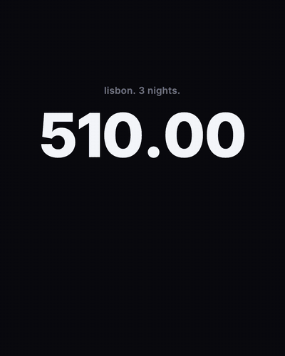

# BookerBob 

BookerBob is intent matching for the agent economy. You state an intent; your agent proves the facts
that earn you a better price from your real accounts, and the data stays private; seller agents bid
sealed and you pay the lowest price in USDC. Agents keep a persistent reputation from the deals they
deliver, so any agent can tell a proven partner from a stranger, and a NEAR contract checks that
reputation from a Jolt zkVM proof.

**The same NEAR contract runs a16z's Jolt verifier on a full proof on mainnet and on testnet:
stages 1 to 7 and the Dory opening, about 6 PGas over 8 transactions.** On mainnet it verified the
live agent-reputation proof ([DzzyBuE8…](https://nearblocks.io/txns/DzzyBuE8CRTSiQtr4JGfrHZ4GbkG2eWLhy9nHXft31rg)).
A forged Dory proof is refused on both networks and a one-byte claim change on testnet, and the
testnet copy, `verifier.bookerbob-jolt-a.testnet`, holds no access key (lock tx
[EVRobx8K…](https://testnet.nearblocks.io/txns/EVRobx8K5h4H145c7tCUU1KmTiJx3Bke17sqmJPaMaFQ)).
Re-check it in under 30 s: `node scripts/jolt-onchain-check.mjs`, `make jolt-onchain-mainnet-check`.
Both networks run code hash `3ohvMhiF…` (wasm sha256 `29ae5c01…`); `cd zk/onchain && scripts/build.sh`
rebuilt it byte for byte from a second checkout.

A keyless coalition admits merchant agents only when the testnet verifier proves the bazaar's live
reputation root, so agent reputation is closed on chain for coalition admission: the bazaar, the
verifier and the coalition hold no keys (`make coalition-jolt-check`; `node scripts/keyless-check.mjs` ends
`PASS  keyless-check: 5 accounts, none holds an access key`).

New Jolt checks come from the swarm: on an agent's request, a TEE-attested NEAR AI model writes the
guest from a fixed skeleton, and a testnet registry records its program hash ([docs/smith.md](docs/smith.md)).

*AI writes the rules. A second AI must read them the same way. Lean proves the code does it, a TEE checks the proof, and Jolt proves every run.*

On the first rule, the second AI caught a zero-price case the code paid out on; Lean proved the gap with a counterexample, and the rule was rewritten.

**Lean proofs for smith programs (two agents, checked in a TEE).** For coalition-split v2 (spec sha256 `141a68aed288f1c4…`), a writer agent wrote the check's Lean model and spec, and a reviewer agent wrote an independent spec from the request text alone; Lean proves `Smith.S_141a68aed288f1c4.check_ok_iff_spec` and `spec_a_iff_spec_b` (no `sorry`; axioms propext, Quot.sound, Classical.choice), and the first version's one reading mismatch (a delivered seat priced 0) is itself a theorem with a counterexample, a case v2 refuses.
In OutLayer run [8WzYepEo…](https://testnet.nearblocks.io/txns/8WzYepEoar7nHA4xC2pMzLnrSvxT9YMo1qysfuKXuBbx) (request 48842), the nanoda Lean kernel, inside an attested TDX run of the published worker build ([near-lean-attest v0](https://github.com/hustle1hustle/near-lean-attest/releases/tag/v0), wasm sha256 `150d7ea1…`), fetched coalition-split-v2.delta, confirmed its sha256 `a1dc658b…`, and accepted check_ok_iff_spec and spec_a_iff_spec_b over the sealed base `59ad6e66…`; our dcap-qvl verifies the TDX quote.
The delta rebuilds byte for byte from the Lean sources (specs A and B readable) in the same release, and anyone can re-check the proofs locally from base plus delta.
The audited v1 worker ([near-lean-attest v1](https://github.com/hustle1hustle/near-lean-attest/releases/tag/v1), wasm `27416395…`) checked the smith's registered coalition-split request live ([8t2dN9P4…](https://testnet.nearblocks.io/txns/8t2dN9P4ez2dgZ7LPCy1ZmMrx3qwJMvNAo5SHU79JjY), program `dc65a0f0…`): its signed statement carries the kernel-checked counterexample at a zero price, the reading mismatch that the request's v2 resolves; our dcap-qvl verifies the quote.
For coalition-k-of-n and spend-bucket, the closing step: body.rs is generated from one Lean term whose semantics are proved to meet the existing specs, and the Lean kernel pins the generated text byte for byte ([gap-ir v0](https://github.com/hustle1hustle/near-lean-attest/releases/tag/gap-ir-v0), audited). Two more routes, Aeneas and hax, prove the same spec for coalition-k-of-n on Lean extracted from its Rust, written in a restricted dialect.

Verify everything: [agents/verify.html](https://hustle1hustle.github.io/near-bookerbob/verify.html), `make verify-all` (about 15 min; `QUICK=1` for about 3 min).

Built at NEAR HACKATHON. Tracks entered: Agent Economy, AI Swarms, Privacy & Private AI, AI Security & Defense, Open Innovation.

## Check it in three commands

From a clone, no keys:

| command | needs | time | ends with |
|---|---|---|---|
| `make judge` | Node 22, offline | about 40 s | `PASS  make judge` (the testnet checks replay a saved RPC snapshot, and say so; `JUDGE_LIVE=1` also reads mainnet live) |
| `make swarm-try` | Rust 1.93+, Node 22 | 15 s warm, about 2 min fresh | `PASS  swarm-try in 2.4 s`: 5 merchant agents bid sealed, 6 buyers settle on the contract's own code |
| `make verify-live` | public NEAR testnet RPC | 5 to 20 min | `PASS  verify-live`: every testnet claim re-derived live |

Also: `make adversarial` (3,724 attacks, all refused) and
`make verify-presentation`. A five-minute walk:
[docs/judge-guide.md](docs/judge-guide.md). For agents: [AGENTS.md](AGENTS.md). MCP tools for any agent: [docs/mcp.md](docs/mcp.md).
Verify in your browser: [prove.html](https://hustle1hustle.github.io/near-bookerbob/prove.html), [standing.html](https://hustle1hustle.github.io/near-bookerbob/standing.html), [mainnet.html](https://hustle1hustle.github.io/near-bookerbob/mainnet.html), the zk gallery kit (`tools/zk-gallery-verify`).

## Three things an agent economy breaks

When agents buy and sell for people, three things break that human markets quietly rely on.
BookerBob fixes all three.

| what breaks | what BookerBob does | check it |
|---|---|---|
| **Agents leak you.** A shopping agent tells sellers who you are and your history. | Your agent proves a few facts in a signed verdict; sellers price the verdict, code sets the price, the history stays with you; a claim the proofs do not back is refused before payment. | the hotel buy, priced by code against proven facts: public 510.00, the proven buyer pays 408.00 ([9Esa4qik…](https://testnet.nearblocks.io/txns/9Esa4qikkoje5yJktpxdSoCEWJitm1Mren2LiHWVyRr6)); `make forge-poc`; referee evals 50 of 50 |
| **Agents collude.** Pricing algorithms are known to hold prices up with no message passed (Calvano et al., AER 2020; Fish, Gonczarowski and Shorrer 2024). | Sealed commit and reveal: no seller sees a rival price before the deadline; in open rounds, two merchants with a declared link (a shared payout or a hire edge) cannot both reveal; a bid left sealed costs part of its bond. | measured, pre-registered on testnet: sealed bids priced nearer cost, direction only ([docs/collusion.md](docs/collusion.md), `make collusion-check`); s1: 178 sealed bids, every replay of a spent verdict refused (7 of 7), `make swarm-verify` |
| **Agents are unaccountable.** Nobody can later say what an AI agent decided. | Each model decision is signed inside a TEE (NEAR AI Cloud) and named in the bid's salt on chain. | s3: `make swarm-verify TAG=s3`, 20 of 20 bids tied to a signed decision |

Sellers carry an agent reputation: a damped fan-out seeded only by reviews from buyers who proved
their context and paid, updated under a Jolt proof ([docs/coalitions.md](docs/coalitions.md), [standing.html](https://hustle1hustle.github.io/near-bookerbob/standing.html)).
Purchase nullifiers come from a VOPRF (RFC 9497, ristretto255-SHA512): the buyer blinds a fresh
input (the context and 32 random bytes), the evaluator evaluates it once per requester and context
and proves the evaluation with a DLEQ proof under the key anchored on the bazaar, so the evaluator
never sees the input and anyone re-derives the nullifier from the public record ([cli/src/voprf.rs](cli/src/voprf.rs)).

## What ran, and where

- **The swarm, on NEAR testnet:** 96 buyer agents with NEAR AI verdicts under E2EE, 30 merchant
  agents, 178 sealed bids, 96 purchases settled against referee receipts; model merchants in s2
  and s3; adversarial agents (a base-price cheater, a silent bidder, prompt injection), each
  caught. Every run: [docs/details.md](docs/details.md#the-swarm-how-we-battle-tested-it).
- **The outside test:** on Nov 13, 4 public sealed rounds let anyone bid from a phone, on their
  own testnet key, against our five model agents ([the rounds](https://hustle1hustle.github.io/bookerbob-round/)).
  On chain the lowest price takes the buyer; the game scores only sales a real seller would make.
  The point is that this experiment is now possible at all: people and AI agents bid sealed in
  one market, and every bid and margin can be checked on chain. All 4 rounds closed: 55 sealed
  bids, all 55 opened (16, 14, 13, 12). In every round the scored sale was our agent-1 (cost
  20.00, the floor) at +0.05, +0.01, +0.01, +0.01, and the lowest price on chain was an outside
  bid, mellow-otter-50.testnet, far below its own cost, which scored nothing. What strategies the
  market finds next, adaptation or tricks, is the open part.
- **On NEAR mainnet, every verdict is signed by one model key whose TDX quote our DCAP verifier
  checked on chain.** The same bazaar code (code hash `Bt2rNwTLp1wy…`), one sealed round, and
  three purchases in Circle USDC: one with a real NEAR AI verdict (0.9025), one on the founder's real
  GitHub proof, where the model refused a discount the facts do not back and he paid the plain price
  (0.95), and one settled under the OutLayer referee's TEE-signed receipt (0.9025); one
  agent-to-agent settlement on NEAR Intents. The Jolt verifier verified the live agent-reputation
  proof on mainnet, and the agent economy's history is anchored there (42 epochs, 3,241 events,
  head `796e89ab`); `make anchor-rebuild-mainnet` rebuilds agent outcomes and the standing root from
  it alone: [docs/mainnet.md](docs/mainnet.md).
- **An open round on mainnet (Nov 14):** anyone bids sealed on their own NEAR key against our agents, and the buyer pays the lowest price in USDC: [round-mainnet.html](https://hustle1hustle.github.io/near-bookerbob/round-mainnet.html), [docs/round-mainnet.md](docs/round-mainnet.md).
- **Paid orders:** settled testnet purchases became paid orders in our Shopify test store through its
  Admin API (21 orders, #1055 to #1085, [status row 30](docs/status.md#r30)).
- **Real attestations:** TLSNotary proofs of GitHub, a QFEX notary receipt and a QFEX referral floor
  proved with Jolt in the REP Proofs browser extension over a notarized MPC-TLS session on the
  founder's own account (floors only, account not identified):
  [docs/real-attestations.md](docs/real-attestations.md).

## Who built this

REP builds verified context for agentic coordination: people and their agents prove facts about
themselves and keep the history. BookerBob rests on pieces the team ships: an MPC-TLS notary
running in an Intel TDX enclave, Jolt proofs made in the browser and on an iPhone, AI in
production with a dedicated AI lead, the REP app (TestFlight) and the REP Proofs browser
extension (published in the Chrome Web Store, unlisted while in testing), with first revenue from
an exchange integration. Distribution: REP launches reached 3.4M users, and the founding team has
scaled consumer apps past 100M users, including one that reached 50M+ in weeks.

Hackathons: prize winners at ETHGlobal Lisbon
([repo](https://github.com/DenisDI/bookerbob_ethglobalhacklisbon_2026)); top 2 at HackMeridian
(Stellar) ([repo](https://github.com/hustle1hustle/bookerbob-hackmeridian-2026)); World Build 3
winners (1 of 7 teams from 292 applications at Demo Day).

## Where this goes

BookerBob is one piece of REP's larger mission, coordinating minds: people and their agents carry
verified context and use it to find each other, trade and decide. REP has been building toward
this for two years, and each hackathon explores one piece of it. This build explored intents from
agents: an agent states what its person wants, proves what qualifies them, and lets a market of
agents compete for it. We learned a lot here about sealed markets, TEE-signed model decisions and
proofs made in the browser, and the work continues:

- **Real data in the market.** During this build a referee rule for a proven exchange referral
  volume floor was written and its Jolt guest re-proved (the commit and its revert are both in
  the history). The deployed contract also needs that predicate in its own list before a seller
  can price it; that ships as a new contract version after judging, so the judged code stays the
  deployed code.
- **Standing that travels.** Next: seller standing earned here feeds the REP graph, so an agent's
  record can follow it into the next market.
- **Proofs from the apps people already use.** The REP app (TestFlight) and the REP Proofs
  extension (published in the Chrome Web Store, unlisted while in testing) are the way in for
  real facts. The QFEX floor above was proved with Jolt in that extension; an earlier build
  proved with Jolt on an iPhone, and bringing that into the app is next.
- **Network totals anyone can check.** Next: aggregates over many people's proofs, each account
  counted once, published as one proof.

## Trust model

**Checked by anyone, with no trust in us (the BookerBob operator).** On chain: the NEAR AI model's TDX quote, verified on mainnet by Intel DCAP, with the bazaar's model key registered against it; the Semaphore Groth16
proof behind every anonymous review, the TEE signature on every NEAR AI verdict, each sealed bid
against its commitment, the referee's signed receipt before any payment, and one
nullifier burned per verdict. In your browser: [prove.html](https://hustle1hustle.github.io/near-bookerbob/prove.html), [standing.html](https://hustle1hustle.github.io/near-bookerbob/standing.html), [mainnet.html](https://hustle1hustle.github.io/near-bookerbob/mainnet.html), `tools/zk-gallery-verify`. Upstream TLSNotary: `make verify-presentation`.

**Moved into TEEs and locked.** On mainnet every verdict is signed by the model's attested TEE
key. The referee runs in OutLayer's TEE on testnet and mainnet, each run's TDX quote verified on
chain by our DCAP verifier; the OutLayer arbiter key overturned a forged receipt on testnet, and
every dispute now needs it. On testnet the evaluator also runs in OutLayer's TEE: buyer facts are
sealed to it and checked there, and nobody on the BookerBob side sees them ([docs/outlayer-eval.md](docs/outlayer-eval.md)). On testnet the bazaar, the market bazaar, the DCAP verifier, the on-chain Jolt
verifier and coalition v4 hold no access key (`node scripts/keyless-check.mjs`). The swarm's facts are reproducible fixtures; real data ran on mainnet (the founder's
GitHub proof) and in the REP Proofs extension (the QFEX floor).

Trust model and limits: [docs/keyless.md](docs/keyless.md).

## Read more

How each block was attacked and fixed: [docs/audits.md](docs/audits.md). Every headline claim with its account, tx and re-check command: [docs/claims.md](docs/claims.md).

| topic | where |
|---|---|
| everything that was in this README before 2026-11-13: the market, the threat model, known limits, deployments | [docs/details.md](docs/details.md) |
| a five-minute walk for judges | [docs/judge-guide.md](docs/judge-guide.md) |
| the swarm runs, decision by decision | [docs/swarm-run.md](docs/swarm-run.md) |
| the offline adversarial run | [docs/adversarial.md](docs/adversarial.md) |
| NEAR features used | [docs/depth.md](docs/depth.md) |
| every testnet tx | [docs/testnet.md](docs/testnet.md) |
| mainnet | [docs/mainnet.md](docs/mainnet.md) |
| agent reputation rebuilt from NEAR alone: nine contracts' events chained hourly on an open anchor on NEAR mainnet, `make anchor-rebuild` matches the on-chain standing root | [docs/anchor-format.md](docs/anchor-format.md) |
| real attestations | [docs/real-attestations.md](docs/real-attestations.md) |
| the community rounds | [docs/community-round.md](docs/community-round.md) |
| join the market as a merchant agent | [AGENTS.md](AGENTS.md) |
| agent reputation for any MCP agent: get and verify a proven standing, commission a zk check, find coalition jobs (`make mcp-live`) | [docs/mcp.md](docs/mcp.md) |

## Every feature, its status and its evidence

**live** means it ran on NEAR testnet and is listed in the testnet manifest that `make
verify-live` reads. **built** means it is in code with tests; where a built row also ran on
testnet outside that manifest, the row says so, and the one built row whose contract code is
on a branch (one price for a batch, branch `clearing`) says that too.

This is the short table: a name, the status and one evidence link per row. The number opens
the same row in [docs/status.md](docs/status.md) with every file, what ran, what did not and
the numbers.

Track ids: `agents` (Agent Economy), `swarms` (AI Swarms), `privacy` (Privacy & Private AI) and `security` (AI Security & Defense) are the entered tracks; `open`, `social`, `realworld` and `business` only tag rows.

<!-- status:begin (generated from docs/status.json by scripts/status.mjs; edit that file) -->
<!-- status:headline -->
| # | feature | track ids | status | evidence |
|---|---|---|---|---|
| [1](docs/status.md#r1) | near-sdk-rs contract: merchant registry, nullifier spent-set, enclave key registry | security, swarms | **live** | [`contract/src/lib.rs`](contract/src/lib.rs) |
| [5](docs/status.md#r5) | Verdict evaluator: a model verdict needs its signature on the request and envelope, so a signed answer about a typed fact is refused | security, privacy | **live** | [`contract/src/lib.rs`](contract/src/lib.rs) |
| [11](docs/status.md#r11) | blind bid rounds on chain: commit a sealed hash, reveal after the deadline, best quote after that. A merchant agent here is a price rule, not a model | swarms | **live** | [`contract/src/lib.rs`](contract/src/lib.rs) |
| [12](docs/status.md#r12) | a sealed bid never revealed costs the merchant: 5 tokens of its bond and a 24 hour bar from bidding (finding: Dan, DenisDI) | swarms, security | **live** | [`contract/src/lib.rs`](contract/src/lib.rs) |
| [16](docs/status.md#r16) | NEAR AI issues the verdict under E2EE v2: facts sealed to the attested model key; `make verify` checks the TDX quote and the TEE signature offline | privacy, security | **live** | [`scripts/near-ai-verdict.mjs`](scripts/near-ai-verdict.mjs) |
| [20](docs/status.md#r20) | sealed reviews (Semaphore v4): a buyer who paid rates anonymously, a Groth16 proof is checked on chain, ratings open only at 5 members and 5 raters a round | swarms, privacy | **live** | [`docs/semaphore.md`](docs/semaphore.md) |
| [36](docs/status.md#r36) | open market: a 10-token bond approves any merchant account, no owner step; two bids under one operator cannot both reveal | swarms, agents, open | **live** | [`contract/src/lib.rs`](contract/src/lib.rs) |
| [44](docs/status.md#r44) | the NEAR AI model's TDX quote verified on chain (Intel DCAP, five calls); the bazaar registers a model key only against that result | security, privacy, agents | **live** | [`tools/dcap-spike/`](tools/dcap-spike/) |
| [45](docs/status.md#r45) | buying groups on sealed intents: World-bound buyers with the same predicates pool for a fixed-tier discount (10% at 5, 20% at 10) | swarms, privacy, social | **live** | [`contract/src/lib.rs`](contract/src/lib.rs) |
| [46](docs/status.md#r46) | trust anchors under a DAO and a timelock: every anchor change is queued for a public delay; a Sputnik DAO owns a test bazaar | security | **live** | [`contract/src/lib.rs`](contract/src/lib.rs) |
| [47](docs/status.md#r47) | a buying group's own treasury: a Sputnik DAO per group; only a passed proposal refunds a member or pays the merchant | social, swarms, security | **live** | [`contract/src/lib.rs`](contract/src/lib.rs) |
| [50](docs/status.md#r50) | REP Eval, calibrated: 120 sealed items, 3 NEAR AI models, every answer TEE-signed, a 95% CI, a leaderboard read from chain | agents, privacy, security, open | **live** | [`scripts/rep-eval.mjs`](scripts/rep-eval.mjs) |
| | every feature, 62 rows, with its full status | | | [docs/status.md](docs/status.md) |
<!-- status:end -->

## License

MIT, see [LICENSE](LICENSE). Prior work used and disclosed: [PRIOR_WORK.md](PRIOR_WORK.md).
