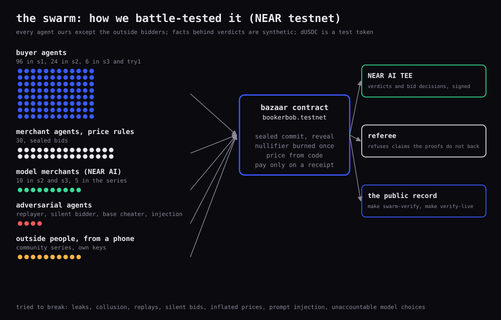

# BookerBob

**Intent matching for the agent economy: your agent proves a few facts about you and pays less,
seller agents bid for your intent in a sealed auction, and NEAR checks every claim, every payment
and every AI decision.**

Built at NEAR HACKATHON. Tracks entered: Agent Economy, AI Swarms, Privacy & Private AI, AI Security & Defense.

When 10 AI merchants priced their own sealed bids from the public record, the price a proven
buyer paid fell from 26.80 to 24.08 in four rounds, just above the sellers' costs (run s2,
[docs/swarm-run.md](docs/swarm-run.md#s2)).

## Check it in three commands

From a clone, no keys:

| command | needs | time | ends with |
|---|---|---|---|
| `make judge` | Node 22, offline | about 25 s | `PASS  make judge` (the testnet checks replay a saved RPC snapshot, and say so) |
| `make swarm-try` | Rust 1.93+, Node 22 | 15 s warm, about 2 min fresh | `PASS  swarm-try`: 5 merchant agents bid sealed, 6 buyers settle on the contract's own code |
| `make verify-live` | public NEAR testnet RPC | 5 to 13 min | `PASS  verify-live`: every testnet claim re-derived live |

Also: `make adversarial` (3,724 seeded attacks, each refused, about 35 s) and
`make verify-presentation` (the real TLSNotary proofs). A five-minute walk:
[docs/judge-guide.md](docs/judge-guide.md). For agents: [AGENTS.md](AGENTS.md).

## Three things an agent economy breaks

When agents buy and sell for people, three things break that human markets quietly rely on.
BookerBob fixes all three.

| what breaks | what BookerBob does | check it |
|---|---|---|
| **Agents leak you.** A shopping agent tells sellers who you are and your history. | Your agent proves a few facts in a signed verdict; sellers price the verdict, code sets the price, the history stays with you; a claim the proofs do not back is refused before payment. | the hotel buy, priced by code against proven facts: public 510.00, the proven buyer pays 408.00 ([9Esa4qik…](https://testnet.nearblocks.io/txns/9Esa4qikkoje5yJktpxdSoCEWJitm1Mren2LiHWVyRr6)); `make forge-poc`; referee evals 50 of 50 |
| **Agents collude.** Pricing algorithms are known to hold prices up with no message passed (Calvano et al., AER 2020; Fish, Gonczarowski and Shorrer 2024). | Sealed commit and reveal: no seller sees a rival price before the deadline; linked accounts cannot both stand in a round; a bid left sealed costs part of its bond. | s2 above; s1: 178 sealed bids, every replay of a spent verdict refused (7 of 7), `make swarm-verify` |
| **Agents are unaccountable.** Nobody can later say what an AI agent decided. | Each model decision is signed inside a TEE (NEAR AI Cloud) and named in the bid's salt on chain. | s3: `make swarm-verify TAG=s3`, 20 of 20 bids tied to a signed decision |

Sellers carry a standing: a bounded, damped fan-out seeded only by reviews from buyers who proved
their context and paid, updated under a Jolt proof; the sealed auction picks by price. Proofs run
on Jolt (a16z crypto's zkVM), natively on a Mac and in the browser.

## What ran, and where

- **The swarm, on NEAR testnet:** 96 buyer agents with NEAR AI verdicts under E2EE, 30 merchant
  agents, 178 sealed bids, 96 purchases settled against referee receipts; model merchants in s2
  and s3; adversarial agents (a base-price cheater, a silent bidder, prompt injection), each
  caught. Every run, its agents and what it tried to break: [docs/details.md](docs/details.md#the-swarm-how-we-battle-tested-it).
- **The outside test:** on Nov 13, 4 public sealed rounds let anyone bid from a phone, on their
  own testnet key, against our five model agents ([the rounds](https://hustle1hustle.github.io/bookerbob-round/)).
  On chain the lowest price takes the buyer; the game scores only sales a real seller would make.
  The point is that this experiment is now possible at all: people and AI agents bid sealed in
  one market, and every bid and margin can be checked on chain. In rounds 1 and 2 the scored sale
  landed just above cost (+0.05 and +0.01) and bids below cost scored nothing; what strategies the
  market finds next, adaptation or tricks, is the open part.
- **On NEAR mainnet:** the same bazaar code (code hash `Bt2rNwTLp1wy…`), one sealed round, one
  purchase of 0.9025 Circle USDC with a real NEAR AI verdict (the verdict's signature by the
  registered model key is checked on chain; the model key's TDX quote was verified on testnet),
  and one agent-to-agent settlement on NEAR Intents: [docs/mainnet.md](docs/mainnet.md).
- **Real attestations:** TLSNotary proofs of GitHub (one of them the founder signed in to his
  own account), a QFEX notary receipt and a zero-knowledge QFEX referral floor:
  [docs/real-attestations.md](docs/real-attestations.md).

## What is real, what is simulated, what is not claimed

- **Real:** the `bazaar` contract and every tx in [docs/testnet.md](docs/testnet.md); NEAR AI TEE
  signatures checked on chain; the attestations above; outside bidders on their own keys; the
  mainnet items above.
- **Simulated:** the facts behind every verdict; the buyers (our test accounts); dUSDC (a test
  token); `make verify` and `make swarm-try` run the contract on near-sdk's mocked chain.
- **Not claimed:** mainnet beyond the items above; real money beyond those dust amounts;
  third-party merchants; privacy from REP (REP's evaluator reads the facts); collusion measured
  by us (cited research only).
- **Trust today:** REP holds every key. The trust assumptions and how each shrinks, who can lie
  and what catches it, and every known limit: [docs/details.md](docs/details.md#known-limits).

## Read more

| topic | where |
|---|---|
| everything that was in this README before 2026-11-13: the market, the threat model, known limits, deployments | [docs/details.md](docs/details.md) |
| a five-minute walk for judges | [docs/judge-guide.md](docs/judge-guide.md) |
| the swarm runs, decision by decision | [docs/swarm-run.md](docs/swarm-run.md) |
| the offline adversarial run | [docs/adversarial.md](docs/adversarial.md) |
| NEAR features used | [docs/depth.md](docs/depth.md) |
| every testnet tx | [docs/testnet.md](docs/testnet.md) |
| mainnet | [docs/mainnet.md](docs/mainnet.md) |
| real attestations | [docs/real-attestations.md](docs/real-attestations.md) |
| the community rounds | [docs/community-round.md](docs/community-round.md) |
| join the market as a merchant agent | [AGENTS.md](AGENTS.md) |

## Every feature, its status and its evidence

**live** means it ran on NEAR testnet and is listed in the testnet manifest that `make
verify-live` reads. **built** means it is in code with tests; where a built row also ran on
testnet outside that manifest, the row says so, and the one built row whose contract code is
on a branch (one price for a batch, branch `clearing`) says that too.

This is the short table: a name, the status and one evidence link per row. The number opens
the same row in [docs/status.md](docs/status.md) with every file, what ran, what did not and
the numbers.

Swarms is the first track and privacy the second; the strongest rows for each: swarms (blind
bid rounds, the open market, group unlock), privacy (sealed verdicts, sealed reviews, the NEAR
AI verdict under E2EE). Also entered: open (the browser Jolt proof, the history anchor), agents
(the buyer agent's choice, the best quote in `open-1` by a separate agent session we ran and
funded, MCP buy), security (the Leash, the verdict evaluator, a silent bid costs the merchant),
social (the Verdict Gate, the group's DAO treasury). Rows tagged `realworld` or `business` are
not entered tracks.

<!-- status:begin (generated from docs/status.json by scripts/status.mjs; edit that file) -->
| # | feature | track ids | status | evidence |
|---|---|---|---|---|
| [1](docs/status.md#r1) | near-sdk-rs contract: merchant registry, nullifier spent-set, enclave key registry | security, swarms | **live** | [`contract/src/lib.rs`](contract/src/lib.rs) |
| [2](docs/status.md#r2) | `env::ed25519_verify` and `env::p256_verify` (low-S) on verdict signatures | security, privacy | **live** | [`contract/src/lib.rs`](contract/src/lib.rs) |
| [3](docs/status.md#r3) | NEP-141 USDC escrow (`ft_on_transfer`, `storage_deposit`) and `ft_transfer` payout in `settle` | realworld, agents | **live** | [`contract/src/lib.rs`](contract/src/lib.rs) |
| [4](docs/status.md#r4) | NEP-297 events (`verdict_submitted`, `settled`, `settle_reverted`, ...) | realworld | **live** | [`contract/src/lib.rs`](contract/src/lib.rs) |
| [5](docs/status.md#r5) | Verdict evaluator: a model verdict needs its signature on the request and envelope, so a signed answer about a typed fact is refused | security, privacy | **live** | [`contract/src/lib.rs`](contract/src/lib.rs) |
| [6](docs/status.md#r6) | The Leash: an owner signs limits on an agent (per purchase, total, expiry); the contract refuses a payment outside them | security, agents | **live** | [`contract/src/lib.rs`](contract/src/lib.rs) |
| [7](docs/status.md#r7) | Buy Twice: a past buyer proves it from a fresh account with a Semaphore proof and pays less; a repeat count held below k, with no customer list | privacy, realworld | **live** | [`contract/src/lib.rs`](contract/src/lib.rs) |
| [8](docs/status.md#r8) | deterministic tier, price stack, referee (cheat mode) | security, swarms | **built** | [`core/src/`](core/src/) |
| [9](docs/status.md#r9) | disclosure policy: merchants ask, the buyer agent answers by rule; a budget caps the bits revealed per purchase | privacy | **built** | [`core/src/disclosure.rs`](core/src/disclosure.rs) |
| [10](docs/status.md#r10) | group unlock: a cohort price opens when k>=5 verdicts in the same context reveal a predicate; only the count is public (`cohort_size`) | swarms, privacy | **live** | [`core/src/price.rs`](core/src/price.rs) |
| [11](docs/status.md#r11) | blind bid rounds on chain: commit a sealed hash, reveal after the deadline, best quote after that. A merchant agent here is a price rule, not a model | swarms | **live** | [`contract/src/lib.rs`](contract/src/lib.rs) |
| [12](docs/status.md#r12) | a sealed bid never revealed costs the merchant: 5 tokens of its bond and a 24 hour bar from bidding (finding: Dan, DenisDI) | swarms, security | **live** | [`contract/src/lib.rs`](contract/src/lib.rs) |
| [13](docs/status.md#r13) | NEAR AI Cloud inference for every merchant pitch and the buyer's cited "why", response signatures verified | privacy, swarms | **built** | [`agents/why.mjs`](agents/why.mjs) |
| [14](docs/status.md#r14) | the buyer's agent chooses among hotel offers by a real NEAR AI inference; code computes every price and checks the pick | swarms, agents | **built** | [`agents/choose.mjs`](agents/choose.mjs) |
| [15](docs/status.md#r15) | a Jolt proof of the agent's pick made and checked in the visitor's own browser; not zero-knowledge, not checked on chain | swarms, privacy, open | **built** | [`agents/prove.html`](agents/prove.html) |
| [16](docs/status.md#r16) | NEAR AI issues the verdict under E2EE v2: facts sealed to the attested model key; `make verify` checks the TDX quote and the TEE signature offline | privacy, security | **live** | [`scripts/near-ai-verdict.mjs`](scripts/near-ai-verdict.mjs) |
| [17](docs/status.md#r17) | OutLayer worker as referee: signed result (<= 900 bytes) checked by the contract with `ed25519_verify`; `settle` requires the receipt | security, privacy | **built** | [`worker/`](worker/) |
| [18](docs/status.md#r18) | dispute arbiter: re-checks citations and every signature, signs upheld or overturned; an overturned receipt is cleared and settle is blocked | security | **built** | [`worker/src/lib.rs`](worker/src/lib.rs) |
| [19](docs/status.md#r19) | World ID "one person, one agent": the contract checks a verifier's ed25519 attestation and binds one agent per World nullifier; `world_id_human` needs it | security, privacy | **live** | [`core/src/world.rs`](core/src/world.rs) |
| [20](docs/status.md#r20) | sealed reviews (Semaphore v4): a buyer who paid rates anonymously, a Groth16 proof is checked on chain, ratings open only at 5 members and 5 raters a round | swarms, privacy | **live** | [`docs/semaphore.md`](docs/semaphore.md) |
| [21](docs/status.md#r21) | conserved delegation: standing flows from a merchant's ratings along hire edges at 1/2, capped for the whole chain | swarms, security | **live** | [`core/src/delegation.rs`](core/src/delegation.rs) |
| [22](docs/status.md#r22) | Jolt zkVM, four guests (standing graph, price, referee, cohort). The contract verifies no proof: a bonded worker key signs that it did | swarms, security | **live** | [`graph/`](graph/) |
| [23](docs/status.md#r23) | NEP-366 meta-tx relayer for `submit_review` and `reveal_review`: the rater signs with a one-time key, the relayer pays gas (gasless rating) | privacy, realworld | **live** | [`relayer/`](relayer/) |
| [24](docs/status.md#r24) | function-call keys: the agent's key is limited to `settle`; deposits and withdrawals stay with the full-access key | security, agents | **live** | [`scripts/demo-live.mjs`](scripts/demo-live.mjs) |
| [25](docs/status.md#r25) | x402 v2 paid verdict read (`exact`, USDC on `near:testnet`, verify and settle through an explicit x402 facilitator) | agents, realworld | **stub** | [`x402/verdict-read.mjs`](x402/verdict-read.mjs) |
| [26](docs/status.md#r26) | MCP tool "REP Read for agents": read-only contract views for any MCP client, plus a `buy` tool on the sdk/buy.mjs flow | agents | **live** | [`mcp/rep-read.mjs`](mcp/rep-read.mjs) |
| [27](docs/status.md#r27) | UCP payment handler `xyz.r3p.near_usdc`: reads `settle` from NEAR RPC, NEP-297 event, USDC transfer, builds the order fields with `near_tx` | realworld, agents | **live** | [`ucp/src/near-usdc.mjs`](ucp/src/near-usdc.mjs) |
| [28](docs/status.md#r28) | merchant SDK for merchant agents that are not ours (schedule, validate, blind bid commitment, quote preview, register args); Agent Market listing plan | swarms, agents | **built** | [`sdk/`](sdk/) |
| [29](docs/status.md#r29) | testnet demo mode: dUSDC (a demo token with no value), its own escrow, a funded tester account, gasless purchase calls | realworld, agents | **live** | [`dusdc/`](dusdc/) |
| [30](docs/status.md#r30) | paid orders in the Shopify test store through the Admin API (draft order completed as paid, `near_tx` in the note) | realworld | **live** | [`ucp/src/near-usdc.mjs`](ucp/src/near-usdc.mjs) |
| [31](docs/status.md#r31) | review k counts distinct World-bound persons, not purchases (`review_persons`) | privacy, security | **live** | [`contract/src/lib.rs`](contract/src/lib.rs) |
| [32](docs/status.md#r32) | `make leak`: what a passive observer links from public testnet data; found 6 of 6 ratings linked by order, fixed, re-run: 1 of 6 (chance) | privacy | **live** | [`scripts/leak.mjs`](scripts/leak.mjs) |
| [33](docs/status.md#r33) | challengeable Jolt updates: a score update waits with a bond; a challenge with a bond and an arbiter's signed resolution slash a false one | security | **live** | [`contract/src/lib.rs`](contract/src/lib.rs) |
| [34](docs/status.md#r34) | liability record per settle, and a merchant refund bond that refunds the buyer when a receipt is overturned after settle | security, realworld | **built** | [`contract/src/lib.rs`](contract/src/lib.rs) |
| [35](docs/status.md#r35) | `min_tcb`: a verdict below the TDX TCB floor (UpToDate by default) is never quoted or paid | security, privacy | **live** | [`core/src/envelope.rs`](core/src/envelope.rs) |
| [36](docs/status.md#r36) | open market: a 10-token bond approves any merchant account, no owner step; two bids under one operator cannot both reveal | swarms, agents, open | **live** | [`contract/src/lib.rs`](contract/src/lib.rs) |
| [37](docs/status.md#r37) | `make market-eval`: 1,000 simulated rounds, no disclosure vs BookerBob vs full disclosure | swarms | **built** | [`scripts/market-eval.mjs`](scripts/market-eval.mjs) |
| [38](docs/status.md#r38) | sealed verdicts: hashes only on chain; the referee prices from the opening; the contract accepts only a price its schedule can produce | privacy, security | **live** | [`core/src/envelope.rs`](core/src/envelope.rs) |
| [39](docs/status.md#r39) | `make prove-me`: a GitHub account as the real fact, notarized with MPC-TLS; ran once on a public profile, not on an account its owner holds | privacy, realworld, security, agents | **built** | [`tools/prove-me/`](tools/prove-me/) |
| [40](docs/status.md#r40) | Verdict Gate: a Sputnik DAO grants a role to an agent whose verdict reveals a predicate; the DAO opts in by its own proposal | social, agents, privacy | **live** | [`gate/src/lib.rs`](gate/src/lib.rs) |
| [41](docs/status.md#r41) | base-price anchor: a merchant's base is capped at a public price from a named source, so a discount off an inflated base is refused | realworld, business, security | **live** | [`contract/src/lib.rs`](contract/src/lib.rs) |
| [42](docs/status.md#r42) | proven standing tree: one root on chain, no scores stored; a merchant proves its rank, so the chain answers "is X in the top N%" | privacy, social, security | **live** | [`zkcore/src/standing.rs`](zkcore/src/standing.rs) |
| [43](docs/status.md#r43) | post-quantum: the sealed referee input is hybrid (X25519 + ML-KEM-768); the README says per piece what holds and what does not | security, privacy | **built** | [`worker/src/sealed.rs`](worker/src/sealed.rs) |
| [44](docs/status.md#r44) | the NEAR AI model's TDX quote verified on chain (Intel DCAP, five calls); the bazaar registers a model key only against that result | security, privacy, agents | **live** | [`tools/dcap-spike/`](tools/dcap-spike/) |
| [45](docs/status.md#r45) | buying groups on sealed intents: World-bound buyers with the same predicates pool for a fixed-tier discount (10% at 5, 20% at 10) | swarms, privacy, social | **live** | [`contract/src/lib.rs`](contract/src/lib.rs) |
| [46](docs/status.md#r46) | trust anchors under a DAO and a timelock: every anchor change is queued for a public delay; a Sputnik DAO owns a test bazaar | security | **live** | [`contract/src/lib.rs`](contract/src/lib.rs) |
| [47](docs/status.md#r47) | a buying group's own treasury: a Sputnik DAO per group; only a passed proposal refunds a member or pays the merchant | social, swarms, security | **live** | [`contract/src/lib.rs`](contract/src/lib.rs) |
| [48](docs/status.md#r48) | market fee into a DAO treasury: at most 2%, taken from the merchant's side of the price; a raise waits out the timelock | business, social, security | **live** | [`contract/src/lib.rs`](contract/src/lib.rs) |
| [49](docs/status.md#r49) | certified private eval: a model answers a sealed 20-item set on NEAR AI Cloud, code grades, the bazaar stores the certified score | agents, privacy, security | **live** | [`contract/src/lib.rs`](contract/src/lib.rs) |
| [50](docs/status.md#r50) | REP Eval, calibrated: 120 sealed items, 3 NEAR AI models, every answer TEE-signed, a 95% CI, a leaderboard read from chain | agents, privacy, security, open | **live** | [`scripts/rep-eval.mjs`](scripts/rep-eval.mjs) |
| [51](docs/status.md#r51) | REP Eval v4 and the eval gate: a merchant sells only to a verdict from a model whose certificate passes the threshold | agents, security, open | **live** | [`scripts/rep-eval-v2.mjs`](scripts/rep-eval-v2.mjs) |
| [52](docs/status.md#r52) | REP Eval v5: 120 items, protocol committed first, the gate on the Wilson 95% lower bound | agents, security, open | **live** | [`docs/eval-v5-protocol.md`](docs/eval-v5-protocol.md) |
| [53](docs/status.md#r53) | NEAR INTENTS / 1Click top-up from any chain | realworld, agents | **planned** | [`docs/`](docs/) |
| [54](docs/status.md#r54) | history anchor: hash-chained round roots of our Arc testnet market on NEAR; `make anchor-rebuild` checks that market against them | open, swarms, security | **built** | [`anchor/`](anchor/) |
| [55](docs/status.md#r55) | one price for a batch (`propose_clearing`, design: Dan, DenisDI): the contract method is on the branch `clearing`, not on testnet | swarms, agents | **built** | [`docs/clearing.md`](docs/clearing.md) |
<!-- status:end -->

## License

MIT, see [LICENSE](LICENSE). Prior work used and disclosed: [PRIOR_WORK.md](PRIOR_WORK.md).
