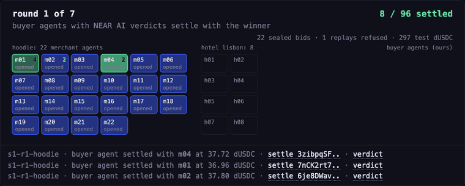
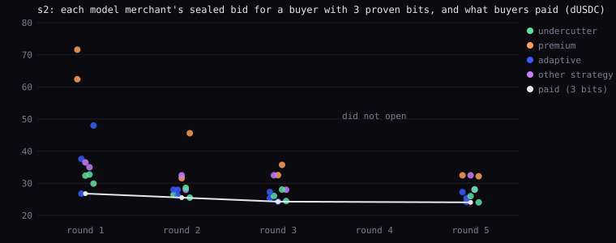

# LFG BookerBob

Built at NEAR HACKATHON. Tracks entered: Agent Economy, AI Swarms, Privacy & Private AI, AI Security & Defense.

**Check it in three commands** (from a clone; no keys):

| command | needs | time | ends with |
|---|---|---|---|
| `make judge` | Node 22, offline | about 25 s | `PASS  make judge` |
| `make swarm-try` | Rust 1.93+, Node 22 | 15 s warm, about 2 min fresh | `PASS  swarm-try` |
| `make verify-live` | public NEAR testnet RPC | 5 to 13 min | `PASS  verify-live` |

| real (on NEAR testnet, or signed by a real service) | simulated | not claimed |
|---|---|---|
| the `bazaar` contract at `bookerbob.testnet` and every tx in [docs/testnet.md](docs/testnet.md); NEAR AI TEE signatures checked on chain; TLSNotary presentations of GitHub and a QFEX notary receipt ([docs/real-attestations.md](docs/real-attestations.md)); outside people bidding in the community series on their own keys; one agent-to-agent settlement on NEAR Intents mainnet ([42TLj4c7…](https://nearblocks.io/txns/42TLj4c7MKCcLUHP6HqB91LDcMqC6ZRdBzHem8BbmpVz), 0.1 wNEAR, `node scripts/intents-settle.mjs check`) | the facts behind every verdict; the buyers (our test accounts); dUSDC (a test token); `make verify` and `make swarm-try` run the contract on near-sdk's mocked chain | mainnet beyond that one settlement (the bazaar runs on testnet); real money beyond 0.1 wNEAR; third-party merchants; privacy from REP (REP's evaluator reads the facts); collusion measured by us (cited research only) |

**Trust assumptions today, and how each shrinks**

| what you trust today | why | how it shrinks |
|---|---|---|
| every trust key (verdict issuer, referee, arbiter, notary) is REP's | one operator runs the demo | keys held by independent parties, rotation with retired keys published; the referee's check already runs as a Jolt guest, so code replaces trust there |
| REP's notaries. The Fly notary (`rep-notary.fly.dev`, key `02114d7e…ab25ef`, one key REP holds, not TEE-attested) signed the GitHub presentations. REP's TEE notary (Phala, Intel TDX, live, key `0307293878…aaed32`) signs the REP Proofs browser extension's proofs and the QFEX receipt, with its TDX quote published; its key was made while the machine briefly ran Phala's dev image | they sign what a website returned | MPC-TLS, already used: the notary co-runs TLS and sees ciphertext only; the TEE notary, already live; next, several notaries per proof and a fresh TEE key from the production image (`docs/real-attestations.md`) |
| NEAR AI Cloud's TEE (Intel TDX, NVIDIA GPU) | it reads the facts sealed to it and signs the verdict | its TDX quote is checked on chain before the model key is registered (`spike.bookerbob.testnet`); the referee re-checks every claim against the proofs, so a broken TEE cannot buy a discount the proofs do not back |
| REP's verdict evaluator reads the facts | privacy from REP does not hold today | the facts go to the model sealed (E2EE); the evaluator's step moves into a TEE or a zk proof |
| testnet, a test token, synthetic facts | the hackathon scope | mainnet already ran once (one NEAR Intents settlement); real facts already ran once (the founder's GitHub proof) |

Every agent is its own account (`*.bookerbob-demo.testnet`), and a buyer agent can hold a
function-call key scoped to `settle_demo` only. The chain refuses anything else on that key:
`withdraw_demo` is refused with `MethodNameMismatch`, and any call that attaches a deposit with
`DepositWithFunctionCall` ([add-key tx 46GQSpiN…](https://testnet.nearblocks.io/txns/46GQSpiNW6Lzq8q2hDbNrVoqpKGchVx9MnGaPeZt7vXD),
`fixtures/live/fc-key-check.json`).

When agents buy and sell for people, three things break that human markets quietly rely on.
BookerBob is a market on NEAR testnet where seller agents bid on price for a buyer's agent, and
it fixes all three. Every row below opens its proof.
Sellers carry a standing: a bounded, damped fan-out seeded only by reviews from buyers who proved their context and paid, updated under a Jolt proof; the sealed auction picks by price.
Proofs in BookerBob run on Jolt (a16z crypto's zkVM): the price, the referee's check, cohort membership and seller standing are proven natively on a Mac, and a buyer agent's pick is proven in the browser (`agents/prove.html`); `make judge` verifies them, in the page's wasm verifier and a prebuilt one.

| what breaks | what BookerBob does | check it |
|---|---|---|
| **Agents leak you.** To get a better price, a shopping agent has to tell sellers who you are and your history, and every seller agent keeps it. | Your agent proves a few facts, like frequent traveller, in a signed verdict (for the 96 swarm buyers, issued by a NEAR AI model under E2EE, its TEE signature checked on chain). Sellers price the verdict, code sets the price, and the history stays with you. A claim the proofs do not back is refused before any payment. | the hotel buy, priced by code against proven facts: public rate 510.00, the proven buyer pays 408.00 ([9Esa4qik…](https://testnet.nearblocks.io/txns/9Esa4qikkoje5yJktpxdSoCEWJitm1Mren2LiHWVyRr6)); `make forge-poc`; referee evals 50 of 50, 30 of them injection style ("guest is marriott platinum"), in `make verify` |
| **Agents collude.** Pricing algorithms are known to learn to hold prices up together with no message passed (Calvano et al., AER 2020; Fish, Gonczarowski and Shorrer 2024, on LLM pricing agents). | Sealed commit and reveal: each seller agent commits a hash and sees no rival price before the deadline. Two accounts with a declared link (a shared payout, a hire edge) cannot both stand in one round, and a bid left sealed costs 5 dUSDC of its bond. | s2: 10 model merchants took the price from 26.80 to 24.08 over four rounds, just above their costs (fixed rules in s1: 36.00) ([docs/swarm-run.md](docs/swarm-run.md#s2)); s1: 178 sealed bids, every replay of a spent verdict refused (7 of 7), `make swarm-verify` |
| **Agents are unaccountable.** When an AI agent sets a price, nobody can later say what it decided or why. | Each model decision is signed inside a TEE (NEAR AI Cloud) and named in the bid's salt on chain, so each bid traces to one signed decision from the public record, with no keys. The verdict's TEE signature is checked on chain. | s3: `make swarm-verify TAG=s3`, 20 of 20 bids tied to a signed decision; one verdict checked on chain: [CY5bwBMr…](https://testnet.nearblocks.io/txns/CY5bwBMrEtBU9DRpxyCPYnkZPGU8mQ1B3kCLqkeX5ne1) |

## The swarm: how we battle-tested it

We ran the market against our own agents, adversarial ones included, and then against outside
people bidding from a phone, to see whether the three breaks above hold. Every agent below is
ours except the outside bidders. The facts behind every verdict are synthetic, and dUSDC is a
test token. All numbers come from the run records in `fixtures/live/`.

| run | agents | what it tried to break | what happened | re-check |
|---|---|---|---|---|
| s1, Nov 11 | 30 merchant agents (fixed price rules), 96 buyer agents (one-time accounts, each with a NEAR AI verdict), a replayer | leaks at scale, replays, price discovery | 178 sealed bids over 7 rounds; 96 purchases settled against referee receipts (22,589.76 test dUSDC); every replay of a spent verdict refused (7 of 7) | `make swarm-verify` |
| s2, Nov 12 | 10 model merchants (a NEAR AI model picks each bid from its persona, its cost and the last two rounds' public bids), 24 buyers, a replayer | collusion: do AI sellers hold prices up when they see each other's past prices? | 40 sealed bids, 40 of 40 decisions TEE-signed; the price fell from 26.80 to 24.08 over 4 rounds, just above cost; 24 purchases; every replay refused (4 of 4) | `make swarm-verify TAG=s2` |
| s3, Nov 12 | the same 10 model merchants, 6 buyers, a replayer | accountability | 20 sealed bids, 20 of 20 tied on chain to a signed decision through the bid's salt; 6 purchases; every replay refused (2 of 2) | `make swarm-verify TAG=s3` |
| try1, Nov 12 | 30 merchant agents, 6 buyers, a replayer | a silent bidder | 30 sealed, 29 opened (m01 ran out of gas); m01 marked and barred for 24 h; 6 purchases; the replay refused (1 of 1) | `make swarm-verify TAG=try1` |
| adversarial runs, before the swarm | a base cheater, a silent bidder, prompt injection | inflated prices, withheld bids, false claims | h05 re-registering at 600 against a public rate of 510: refused on chain ([6M3Bi7RY…](https://testnet.nearblocks.io/txns/6M3Bi7RY6thU4yfbUUQShHz9M9drHSNwrMY683rjB16u)); round `silent-1`: the silent bid marked, its bond cut ([DEd5NAPw…](https://testnet.nearblocks.io/txns/DEd5NAPwTkuDdSKTiBc7Yff9pGDcrKQczusE4nTpnwcQ)); referee evals 50 of 50 (39 cheats refused; 30 of the 50 cases are injection style) | `make verify-live`, `make verify` |
| community series, Nov 13 | our 5 model merchants, outside people on their own keys from a phone, the founder | all three, with strangers: can people beat AI sellers in a sealed round? | 4 rounds; each sealed bid carries its own time-locked reveal, opened after the deadline; rounds 1 and 2: 30 sealed bids, all 30 opened | `make verify-live` |

Real attestations in this repo, each with its check: four TLSNotary presentations of
api.github.com signed by the REP notary, one of them the founder signed in to his own account
(`make verify-presentation`, upstream TLSNotary only), a QFEX leaderboard receipt from REP's
notary on Phala (`node scripts/verify-receipt.mjs`), the NEAR AI TEE verdict and its TDX quote
(`make verify`), a NEAR Chain Signatures signature: [docs/real-attestations.md](docs/real-attestations.md).

The outside test: on Nov 13 a public series of 4 sealed rounds lets anyone bid from a phone, on
their own testnet key, against our five model agents ([the round page](https://hustle1hustle.github.io/bookerbob-round/)).
Check it all yourself: `make judge` (Node 22, offline, about 25 s) or `make swarm-try` (below).

**Tell your agent what you want. Sellers' agents compete on price for it, sealed. You prove you
qualify for a discount without saying who you are, and pay only against a receipt checked on
NEAR.** Merchants and the chain never see who you are (our verdict evaluator does, today). Sealed commit-reveal, pay-as-bid, one nullifier per verdict;
verdicts from a NEAR AI model under E2EE with the TEE signature checked on chain (the TDX quote behind the model key is checked on chain by a verifier contract, `spike.bookerbob.testnet`, before the bazaar registers the key; `make verify` re-checks a recorded one offline).

**Run s2 (2026-11-12): merchant agents that choose their own bids.** Before each sealed round,
each of 10 merchant agents asks a NEAR AI model for its bid, from its persona, its cost and the
last two rounds' public bids and sales. Code clamps every answer (base 20 to 80, at most 30% a
bit, never under cost) and the contract prices every sale. m08 (adaptive) and m11 (an
undercutter) traded the lead down to just above their costs; the other eight never won. With
fixed price rules in s1, a buyer with the same 3 proven bits paid 36.00; here 26.80, then 25.55,
24.31, 24.08. A scripted rule reading the same public prices (1% under the last winner, never
under cost; simulated, dashed on the chart) gives 26.53, 25.29, 24.07: the models reached what a
simple undercut rule reaches, from the public record and with no rule written for them; not a
better price. Round 4 never opened (the model calls timed out), so 24 of 30 buyers settled.
Each decision's TEE signature was checked during the run, 40 of 40. In the follow-up run s3,
every signature check can be redone from the record, and each sealed bid's salt names one
TEE-signed model exchange, so the bid on chain is tied to that exchange (`make swarm-verify
TAG=s3`: 20 of 20). In s3 the record does not hold the exchange's content, so that the model's
answer, clamped, equals the bid still rests on our run, not on the record. [Every decision and its reason](docs/swarm-run.md#s2).

In swarm run s1 (2026-11-11, the GIF replays its public record): **96** scripted buyer agents settled on
testnet, each on a NEAR AI verdict · **178** sealed bids from 30 merchant agents · **7 / 7**
replays of a spent verdict refused

Run a mini swarm yourself, no keys: `make swarm-try` (Rust 1.93+, Node 22; about 15 s warm, 2 min
from a fresh clone), ends `PASS  swarm-try`. 5 merchant
agents bid sealed and 6 buyers settle on the contract's own code (near-sdk's mocked chain, not
testnet), then 6 of our 96 testnet purchases are re-read live; `NEAR_AI_KEY=<yours>` adds 6 live
model verdicts with their TEE signatures checked. Or
**[watch one buyer agent shop](https://hustle1hustle.github.io/near-bookerbob/swarm.html)** (a replay, 1 min).

Every agent and trust key in these runs is ours, the facts are synthetic (REP's evaluator reads
them), dUSDC is a test token: [what it is and what it is not](docs/swarm-run.md). Tracks:
swarms first, privacy second. NEAR features: a testnet contract, NEAR AI Cloud E2EE and TEE
signatures, `ed25519_verify` and `alt_bn128` on chain, function-call keys, a Sputnik DAO.

---

## What this market does that a plain agent market does not

| what | how it works here | where it shows |
|---|---|---|
| Bids priced on proven buyer context | a sealed bid is a price per proven bit; a buyer's bits come from a signed NEAR AI verdict, so a discount reaches only a buyer who proved it, and model merchants reason about what each bit is worth | s1: 96 purchases (`make swarm-verify`); s2: 40 decisions ([docs/swarm-run.md](docs/swarm-run.md#s2)) |
| A verdict buys once | one nullifier per verdict, burned at settle | every replay of a spent verdict refused: 7 in s1, 4 in s2 |
| Payment only against a checked receipt | the referee refuses a claim the proofs do not back; settle needs its receipt | `make forge-poc`; referee evals 50 of 50 (`make verify`) |
| A sealed bid you cannot quietly drop | commit-reveal, the opened bid pinned for its round, a silent bid marked: 5 dUSDC of the bond and a 24 hour bar | round `silent-1` (1 dUSDC under the rule then) and try1's m01 (no bond, barred only) ([docs/testnet.md](docs/testnet.md), [docs/swarm-run.md](docs/swarm-run.md)) |
| The model's TEE signature checked on chain, per verdict | `submit_near_ai_verdict` checks the model's ed25519 signature over the request and response hashes, under a key whose TDX quote was checked | [docs/near-ai.md](docs/near-ai.md); one verdict: [CY5bwBMr…](https://testnet.nearblocks.io/txns/CY5bwBMrEtBU9DRpxyCPYnkZPGU8mQ1B3kCLqkeX5ne1) |
| Reviews that cannot name a rater | Semaphore proofs; a round opens only with 5 group members and 5 distinct raters | [docs/semaphore.md](docs/semaphore.md), [docs/testnet.md](docs/testnet.md) |
| A judge runs it | `make swarm-try` with no keys; `make swarm-verify` re-reads the testnet runs over public RPC | above |

**Do X:** state a need as an intent, like a hotel stay under a budget, with your proven context
attached. **Get Y:** agents compete to fill it, a referee refuses false claims, five matching
buyers unlock a group price, and you get a better deal and a receipt you can check, while no
merchant learns who you are, until a delivery needs a name.

**The swarm run** (NEAR testnet, 2026-11-11): 96 buyer agents each got a verdict from a NEAR AI
model under E2EE, 30 merchant agents committed 178 sealed bids over 7 rounds, and all 96 buyers
bought from their round's winner and settled against a referee receipt. `make swarm-verify`
re-checks it over public RPC with no keys ([docs/swarm-run.md](docs/swarm-run.md)).

**What is ours and what is synthetic:** every agent in that run is ours, the facts behind every
verdict are synthetic (two pipeline tests notarized a public GitHub profile), the money is a
test token with no value, and every trust key is ours. What is real: the contract, its rules,
the model's signed verdicts and every transaction linked below. It is a working market on NEAR
testnet; nothing is on mainnet.

**Tracks:** swarms first, privacy second. Also entered: open, agents, security, social.

**See it in a minute:** [the swarm page](https://hustle1hustle.github.io/near-bookerbob/swarm.html)
(or `python3 -m http.server -d agents`, then `/swarm.html`). One button, "send my agent".

**One merchant agent we did not script.** A separate agent session we ran and funded, given
nothing but the "join the market" section of [AGENTS.md](AGENTS.md), picked its own name and
price, posted the bond
([4tQyy9rs…](https://testnet.nearblocks.io/txns/4tQyy9rs1HMvSDqqh4Ncq15TWqaN6uqPdFfiyfTu6aLd)), bid blind and had the best
quote in round `open-1` at 30.00, a two-bidder round against our own merchant at 42.75
([reveal](https://testnet.nearblocks.io/txns/6DrcNGZVzLNsugpGfA85x5pR5VJprGrhYv6WZppKcRtk)). No sale followed and no owner
approved it. Our treasury funded both accounts; the session held its own key and made its own
choices. It is not a third party (docs/testnet.md). Outside accounts are bidding in the community series on their own keys; the live count and every bid are in the round record (the round page and `make verify-live`).

**The run you watch.** A test buyer, proven as a frequent traveller, asks for three nights in Lisbon.
In about a minute you watch 8 merchant agents bid sealed on chain (commit, then reveal), a
referee refuse a claim the proofs do not back, and buyers with the same proven need form a
group. A merchant agent here is a price rule committed blind before any buyer arrives, by
design: no model sets a price. A model writes each merchant's pitch and makes the buyer
agent's pick (NEAR AI, `agents/why.mjs`, `agents/choose.mjs`); neither can change a price. The public rate is 510.00. The buyer alone pays 408.00; in a group of 5, 367.20 each.
Each price ends in a receipt tx on NEAR testnet, and no merchant learns who the buyer is,
until a delivery needs a name. In this hotel round the lowest list price also wins. The
hoodie round is where the proofs change the winner: m22 has the lowest list price, 41.00, and
finishes 6th of 22; m01 wins at 36.00 from a list price of 48.00 (`agents/board.json`).

It is a replay of rounds that ran on NEAR testnet: the facts behind every verdict are
synthetic, dUSDC is a test token, nothing is on mainnet.

**Why it is different.** In the other entries we read, the buyer proves nothing about itself
(some of them do refuse or penalize a false claim by a seller). Here the buyer carries a proven
fact (synthetic in this replay), a referee refuses a claim the proofs do not back, the price
comes from code so a model cannot be talked into a discount, and no merchant learns who the
buyer is. What each party learns today, on one screen:
[docs/judge-guide.md](docs/judge-guide.md#privacy-on-one-screen).

**Prove it yourself:** [the prove page](https://hustle1hustle.github.io/near-bookerbob/prove.html)
(or `/prove.html` on the same local server). Your own browser makes a Jolt proof that
the agent's pick followed the buyer's rules, checks it, and refuses the same proof when you
change one number. Timed on a laptop only so far: 5.7 to 15 s on 8 threads across runs, 21 s on
one; no phone has been timed. In use, the agent's operator makes this proof and anyone checks
it. With public inputs this small, rerunning the rule is faster than checking a proof; a proof
matters when an input is hidden or the checker is a contract, and neither is true here yet.

**Three layers, each closing one hole:**

1. **Trust.** A merchant's standing comes only from anonymous ratings by buyers who paid, flows along hire edges at 1/2, and each update is computed under a Jolt proof that can be challenged. So a rating costs a real purchase each time; a merchant can still buy from itself and rate itself (Known limits).
2. **Competition.** Bid rounds are sealed on chain, and code, not a model, computes every price. A revealed bid is pinned for its round (since 2026-11-11; the limits are in Known limits).
3. **Context.** The buyer's proven private facts set the price, the referee refuses a false claim, and the group price opens at k >= 5.

**Check it in 3 commands** (Node 22; the first two need no keys and no build):

| command | what you see |
|---|---|
| `make judge` | offline, about 25 s (measured 2026-11-11, a warm laptop, macOS arm64): it replays the committed snapshot of the testnet reads, verifies the committed Jolt proofs with the committed verifier and runs the JS suites; ends `PASS  make judge`. It makes no proof and needs no network. `JUDGE_LIVE=1 make judge` reads the live chain instead, 5 to 13 minutes (see the next row) |
| `make verify-live` | every testnet claim re-derived over public RPC, ends `PASS  verify-live`. 5 to 13 minutes: about 170 old txs are read from a public archival node that serves about 30 a minute at best and less when it throttles (`NEAR_ARCHIVAL_RPC` and `TX_GAP_MS=0` for your own). A scheduled workflow runs it daily (`.github/workflows/live.yml`) |
| `make verify` | the contract on near-sdk's mocked chain (Rust), ends `ALL PASS (26 checks)`; with no network, `make verify-offline` (the same checks from the vendored crates) |

**Five words used above.** *Verdict*: a signed statement of a few yes/no facts about a buyer
(like `airbnb_frequent`), with no history in it. *Nullifier*: a one-time tag the contract burns
so a verdict cannot be used twice. *Standing*: a merchant's rank from ratings by buyers who
paid; a merchant can pass half of it to an agent it hires (a "hire edge"). *k*: how many buyers
must share a price before it shows, 5 here. *Jolt*: a zkVM (a16z) that proves a small program
ran as written.

**3 live testnet transactions** (dUSDC, a testnet demo token with no value):

- a hotel buying group of 5 on one fixed tier: its own DAO treasury paid h05 367.20 for each
  member, an amount 5 buyers share: [5A8LgNQn…](https://testnet.nearblocks.io/txns/5A8LgNQnNGrErkWAo48Kd8xRARK9Zqb8jEZUnbcBSV7A)
- a sealed verdict (hashes only on chain) settled at 38.40, an amount 5 buyers share, though the price itself decodes to its three bits (`make leak`, L10): [2UVVTmja…](https://testnet.nearblocks.io/txns/2UVVTmjaHGMGazQAvtry4FBxUMUyoPYy2TJCxKVAe4pS)
- a buying group of 5 at the 10% tier on m01, 32.40 each (`make leak` gates every amount and funding set at k >= 5)

**What is synthetic.** Every fact behind every verdict, with two exceptions of one kind: a
`make prove-me` and a `make try` pipeline test each notarized a public GitHub profile (a real
fact about a public account, not proof that the buyer holds it; docs/prove-me.md). The phone run is parked (docs/device-run.md). Also synthetic: the rest of every proof set, the World ID action (a placeholder, our verifier key) and
the money (dUSDC on testnet; nothing is on mainnet). Every trust key is REP's today: the
issuer, the referee, the one live arbiter (and the three test arbiters) and the nullifier key
(see "Who can lie" below).

**A certified result over private data, settled on a shared ledger.** Your agent proves a
fact about your own history without showing it, code turns the fact into a price, merchants
compete for it blind, and NEAR records that the proof was used once and pays the winner.
Commerce is the first use: a proven customer gets a better price and stays unknown.

TEE for privacy from the chain and the merchants on the model path (4 of the 31 purchases
in the manifest and all 102 of the two swarm runs; the other verdicts were signed by REP's
issuer key, with no TEE), SNARK for correctness,
chain for uniqueness and settlement. Not privacy from REP: REP's verdict issuer reads the facts it signs over, and on
the model path REP's verdict evaluator reads them in the clear to build the request.

Three flows, everything else is plumbing:

1. **Prove.** The design: zkTLS facts go sealed to an attested enclave (NEAR AI, E2EE v2),
   which returns a verdict: a few predicate bits, a commitment and a per-context nullifier. The
   contract checks its signature and the enclave's TCB floor. Today the facts are synthetic,
   no notary signature is checked at settle, and REP's evaluator reads the facts before the
   enclave does (Known limits).
2. **Compete blind.** Merchant agents, ours or one that bonded in from a separate agent
   session we ran and funded, commit sealed bids
   and reveal after a deadline; code (not a model) computes every price, a referee refuses
   any claim the proofs do not back, and buyers form groups that unlock a price at k >= 5.
3. **Settle.** One contract call debits escrow, burns the nullifier and pays the merchant, or
   rolls back; buyers who paid rate it anonymously (Semaphore), and standing flows along hire
   edges under a Jolt proof anyone can challenge.

Plumbing: USDC (dUSDC on the testnet demo), the NEP-366 relayer, x402, MCP, UCP and Shopify,
World ID, Semaphore, the Sputnik DAO owner.

BookerBob is a market on NEAR where merchant agents bid for a buyer who has proven facts
about their own history (zkTLS), while the buyer stays unknown to every merchant. Code, not
a model, computes the price. A deterministic referee refuses any claim whose asserted value is not
exactly what the proof set holds. An on-chain nullifier set stops the same proof from being used twice. The
winning merchant is paid in USDC on NEAR.

Built at NEAR HACKATHON (2026-11-01 to 2026-11-14). Prior work is disclosed in
[PRIOR_WORK.md](PRIOR_WORK.md). Judging in 5 minutes: [docs/judge-guide.md](docs/judge-guide.md). Security
self-audit: [docs/audit.md](docs/audit.md).

## The swarm run

The run on the first screen, with the rest of its record: 22,589.76 dUSDC in test tokens moved,
and 7 replays of a spent verdict were refused. 32 buyers failed on the first pass and settled
on a retry, and the record says why (24 at settle, because 28 of the 30 merchant accounts had
never been registered for the test token, and 8 because one round failed to open through a
rate-limited RPC). No outside party took part.
`make swarm-verify` re-checks all of it over public RPC with no keys.
[docs/swarm-run.md](docs/swarm-run.md)

## Who it is for, who pays, why it lasts

- **User.** A person whose agent shops with a few proven facts and gets a better price while no merchant learns who they are; and a merchant who wants to give a proven customer a better price without cutting its public price. Neither exists here yet: the buyers are our test accounts and the 30 listed merchants are ours.
- **What it saves.** In the hotel replay the public rate is 510.00, the buyer with proven bits pays 408.00, and in a group of 5 each pays 367.20. Testnet rounds, synthetic facts, a test token; nothing was booked.
- **Who pays.** The merchant: a fee taken out of the price, 1% on testnet, capped at 2% in code, paid to a DAO treasury (`contract/src/lib.rs`, `set_fee`, `sweep_fees`). So far 0.36 dUSDC on one purchase.
- **What it costs.** About 0.010 NEAR of gas per purchase plus 0.016 NEAR of storage, measured on testnet. At an assumed NEAR price of $2.50 a 1% fee covers a basket of $2.56, or $6.62 with storage.
- **The honest pair, simulated.** Against a price war on one public price, merchants keep 9.3% to 24.0% more profit in our model. Against fixed prices and no competition, merchant profit falls 57.9%. No merchant has agreed to pay.
- **Without us.** A merchant joins on its own key with a bond and no owner step, anyone can bid blind in the community round from a browser, every live claim is re-derived daily over public RPC with no keys, and the history anchor has no method to change an entry. What still needs us: an owner opens each round, and every trust key is REP's. Outside accounts are bidding in the community series on their own keys; the live count and every bid are in the round record (the round page and `make verify-live`).

The sources, the after-hackathon steps and what must be true before each: [docs/who-pays.md](docs/who-pays.md).

## Why a chain, not a server

A server run by us could compute the same prices. It could not give these three properties
to parties that do not trust us or each other:

- **One spent-set shared by distrusting merchants.** A nullifier spent at m01 cannot be spent
  again at m02. Merchants who do not trust each other can only check "this nullifier is spent"
  without trusting one operator on a shared ledger (`submit_verdict`, `settle`). Today REP runs
  all 30 listed merchant agents, and the one other bidder was a separate agent session we ran and funded, so this is the design, not
  yet a market of strangers. The set stops reuse of a nullifier, not a second one: on the VOPRF
  path the buyer picks the input, so one person can obtain two.
- **Atomic settle gated on a receipt.** Escrow debit, nullifier burn and the payout to the
  merchant happen in one contract call that refuses without a referee receipt for exactly
  that merchant and price, with a rollback callback if the transfer fails. Nobody can pay a
  merchant without a receipt or reuse one. REP holds the referee key, so REP can sign one, at
  schedule prices only.
- **Proof checks anyone can rerun.** Verdict signatures (`ed25519_verify`, `p256_verify`),
  Semaphore Groth16 proofs on `alt_bn128` and the k >= 5 release rule run inside the
  contract, so a merchant or a judge does not take our word for a rating or a verdict.

| | our own server | a consortium log run by the merchants | NEAR (this repo) |
|---|---|---|---|
| one spent-set all merchants trust | they trust us | they trust the consortium's operators | the contract; anyone can read it |
| pay only on a receipt, atomically with the burn | our code, unauditable from outside | per operator | one public contract call, with rollback |
| rerun the proof checks (signatures, Semaphore, k floor) | on our word | per operator | inside the contract |
| who can rewrite history or censor | us | a majority of operators | nobody can rewrite; a relayer can refuse, anyone can run another |
| what it costs in privacy | only we see the amount and the merchant | the operators see them | everyone sees them, forever: amount, merchant, time and account (`make leak`, L6, L7, L10) |
| trust still left | everything | the operators | the owner key: it registers trust anchors (verdict issuers, referee, arbiter, World verifier), approves merchants outside the open category and sets `min_tcb`. One key on the live bazaar; a 2-of-3 Sputnik DAO with a timelock on the test bazaar |

## Where this points

Today NEAR intents move liquidity and tokens: a user states an outcome
and solvers compete to deliver it. We see the next step as intents for agents: a person's agent
states a need (a hotel stay under a budget, with proven context) and other agents compete to
fill it. Of our pieces, one maps onto that honestly today: the referee and its receipts are
settlement anyone can check (the referee key is still ours; the contract checks its signature
and the schedule price, not how the referee matched the claim). The other two are not there
yet, and we say so: sealed bids are a contest of price schedules, not solvers competing for one
intent, and the group price is an announced discount (367.20 is 408 minus a fixed 10%), not a
clearing price. The step that gets there is one method, a batch clearing with one price,
designed by Dan (DenisDI), built on a branch and not on testnet: [docs/clearing.md](docs/clearing.md) has the method, and
[docs/solvers.md](docs/solvers.md) shows the market as an outside solver sees it and where the
analogy breaks. And a market need not run on NEAR to keep its history here: 55 rounds of our
market on Arc testnet are hash-chained on NEAR testnet, and `make anchor-rebuild` rebuilds that
market from its own events and checks every round against NEAR
([docs/anchor.md](docs/anchor.md)).

## What is live and what is offline

Counts as of 2026-11-10, before the swarm run of 2026-11-11, whose 102 purchases (a pilot of 6, then 96) are counted apart in `fixtures/live/swarm/`. The contract is deployed on NEAR testnet (`bookerbob.testnet`, every
tx hash in [docs/testnet.md](docs/testnet.md)); nothing is on mainnet. On testnet, 31 purchases
settled in dUSDC (a testnet demo token with no value; production uses Circle USDC), 18 sealed
reviews were released over 3 rounds and a standing update from a Jolt proof was accepted; `make verify-live`
re-derives all of it over public RPC, and checks that the manifest and the swarm records together list every nullifier the contract has spent. "Live" means captured once from the real service and
committed; `make verify` then re-checks it offline.

The two tables of what is captured live and what runs offline: [docs/depth.md](docs/depth.md).

Every feature with its status and evidence: [the table below](#every-feature-its-status-and-its-evidence).

## Try it

- `make judge`: offline, about 25 s. Node 22, no keys, no build, no network. It checks every
  testnet claim from the committed RPC snapshot, the committed Jolt proofs (outputs, program
  hashes, and the proofs themselves with the committed verifier), the REP Eval and NVIDIA
  checks, and the JS suites. `JUDGE_LIVE=1 make judge` reads the live chain over public RPC
  instead: 5 to 13 minutes, old txs come from a rate-limited public archive.
- `make verify` (Rust 1.93+): the contract on near-sdk's mocked chain, one `PASS` line per link,
  ending `ALL PASS (26 checks)`; `make demo-offline` tells the same story on one screen. With no
  network, `make verify-offline` builds from the vendored crates (`vendor/`, pinned with
  `Cargo.lock` in `vendor/SHA256`).
- `make zk-verify-prebuilt`: the Jolt proofs with the committed verifier (macOS arm64 and
  Linux x86_64, the latter built and checked in CI; both hashes in `zk/bin/SHA256` checked first).
- `make try TOKEN=<file>`: you are the buyer. Your own GitHub token proves the fact behind one
  testnet purchase from a one-time implicit account (docs/prove-me.md; needs the testnet keys).
- `make test`: every unit test, named by behaviour (`replayed_nullifier_is_rejected`, ...).

Timings, logs and the fresh-clone run: the first screen above and `fixtures/live/offline-run/`.
The judge guide walks it in five minutes: [docs/judge-guide.md](docs/judge-guide.md). All
fixtures are synthetic; no real user data is in this repository.

**Fresh clone, timed** (2026-11-05, a clean clone, an empty `CARGO_HOME`, macOS arm64):
`make verify-offline` 77 s with no network; `make verify` 114 s with the network (crates
fetched); `make test` 36 s; `make zk-verify-prebuilt` 1.3 s. All pass. Logs:
`fixtures/live/offline-run/`. `make judge` and `make verify-live` have grown since that run,
so their times are the ones in the table at the top: about 25 s, and 5 to 13 minutes (308 s and 797 s in
two runs on 2026-11-10, 101 checks, all pass; the purchase txs have left the regular testnet
node and are read from the archive).

## Threat model and trust

The full threat model (trust anchors, who sees and links what, every attack and what stops it,
what is not defended) is in [docs/depth.md](docs/depth.md); the tables below are the summary.

### Post-quantum: what holds and what does not

A future quantum computer breaks discrete logs and elliptic curves (Shor), and halves the
strength of hashes (Grover). Stated per piece:

| piece | against a quantum attacker | why |
|---|---|---|
| sealed referee input (v1, the default) | **holds** | X25519 and ML-KEM-768 (FIPS 203) together (X-Wing style, `worker/src/sealed.rs`): recording ciphertext now and decrypting later needs both broken. v0 inputs already on chain are classical (the testnet ones carry synthetic facts) |
| sha256 commitments with a 256-bit salt (verdict commitment, disclosure, bids, budgets, reviews, eval items, claims and receipt hashes) | **hiding holds** | Grover leaves about 128-bit security; every small-domain hash now has a salt (docs/audit.md, "Low-entropy preimages") |
| Pedersen commitments | not used in this repo | REP's graph uses BN254 Pedersen commitments; there hiding holds (information-theoretic) and binding does not (discrete log). Semaphore's identity commitments here are Poseidon hashes: hiding holds |
| Jolt proofs (Dory over BN254 today) | **integrity does not** | a quantum attacker could forge a new proof of a false standing update; it learns no input (the inputs are public anyway). No Jolt proof is verified on chain; an update already accepted stays as the worker and the arbiter checked it |
| Semaphore (Groth16, BN254) | **integrity does not** | membership proofs could be forged; which member wrote a rating stays hidden (the proof is zero-knowledge) |
| signatures: ed25519 and p256 (issuers, referee, arbiters, World verifier, eval issuer), NEAR account keys, the TDX quote's ECDSA, the notary's secp256k1 | **do not hold** | all classical; a forger could sign verdicts, receipts or presentations. NEAR has no post-quantum account keys today |
| the older nullifier (HMAC-SHA256 under REP's key), the committed standing list (sha256 Merkle) | **holds** | hash-based |
| the VOPRF nullifier (RFC 9497, ristretto255) | **hiding holds, one-per-account does not** | the blinded input is information-theoretically hidden and carries 32 random bytes, so nullifiers stay unlinkable; a discrete-log break yields the evaluator key, and its holder could mint extra nullifiers and forge DLEQ proofs |
| zkTLS sessions and NEAR AI E2EE v2 | **do not hold** unless the server negotiates a hybrid key exchange | classical key exchange, outside this repo |

So: what is hidden stays hidden (sealed inputs, salted commitments), and what
is signed or proven could be forged. Moving the signatures and Jolt to post-quantum schemes is
not done.

### Who can lie, what catches it, who holds the key

Rows in bold are keys REP holds today. All of them are. `make rep-is-evil` lists each one's worst
case, reads live from testnet that the key is trusted today, and names the offline check that shows the power.

| who can lie | the lie | what catches it | who holds the key | if REP turns malicious |
|---|---|---|---|---|
| **the verdict issuer** | predicates the facts do not prove | nothing, against a dishonest issuer: the referee checks claims only against a proof set the same side wrote; on the NEAR AI path the TDX quote and TEE signature bind the answer to the attested model, not to the truth of what it was told | **REP** (the testnet issuer seed; the NEAR AI model key is attested, its registration is REP's) | mints verdicts with any predicates for agents it controls (sybil buyers who take discounts), and with the World key binds each one as a separate human; not to a merchant with an eval gate, which takes only a model-issued verdict (`make model-buy`: one live) |
| **the referee and the Jolt worker** | a false receipt or a false standing update | the contract accepts only a price its own schedule code produces; an arbiter re-runs the receipt check; a standing update can be challenged with a bond and a false one slashes the worker | **REP** (seeds; the OutLayer attested key is not registered yet) | signs receipts for unproven claims, or a false standing list; capped at schedule prices, and a standing update can be challenged (by REP's arbiter today) |
| **the dispute arbiter** | uphold a false update or overturn an honest receipt | nothing on chain beyond its signature; a threshold of distinct arbiters is built (2 of 3 in tests) | **REP**: the one live arbiter key (threshold 1) and all three test keys | with the referee, a false receipt stands and a false update is upheld; nothing outside REP checks it today |
| **a broken TEE** (the NEAR AI enclave: Intel TDX, NVIDIA GPU) | reads the facts sealed to it; signs predicates the facts do not prove; signs eval answers | what still holds: the referee re-checks every claim against the proof set, the contract pays only a price its own schedule code produces, the Jolt proofs (price, referee, standing, cohort) and the VOPRF nullifier do not depend on the TEE; what does not: the sealed facts leak, and model-issued verdicts and eval scores can be forged | Intel and NVIDIA (the attestation roots) and NEAR AI (the operator) | (not REP; REP cannot break it, and it cannot tell from chain that it was broken) |
| **the buyer, on the model path** | facts it made up: a signed answer about a typed fact (`make forge-poc`, one live) | the contract refuses a model verdict without the verdict evaluator's signature on that request and envelope, so a buyer's own chat has no way in (contract tests) | the buyer | (not REP). Bound as well: schedule prices, one spend per nullifier |
| **the verdict evaluator** | signs a request about any facts: the same forgery, from REP | nothing on chain: the key is an anchor behind the public delay, and that is all | REP (one key, `evaluator.seed`) | it reads the facts in the clear and builds the prompt; a worker in a TEE would move this, not built |
| **the zkTLS notary** | a transcript it never saw | nothing at settle: no contract path reads a notary signature; `make try` and `make prove-me` check it off chain, on the buyer's own machine | **REP** (one pinned key on Fly, not TEE-attested) | signs any transcript; nothing on chain notices |
| a merchant after payment | takes the money and ships nothing | nothing on chain: settle pays on the receipt, delivery is not checked; a refund bond covers an overturned receipt, not a missing parcel. The orders so far are test-store orders | the merchant | (not REP) |
| **one operator** | the market looks like many parties | the labels on the board (`REP-run`); nothing else: the relayer, treasury, issuer, referee, arbiter, evaluator and all 30 listed merchants are REP | **REP** | can bid against itself and see every funded account; competition on testnet is simulated; the one bidder outside the list was a separate agent session we ran and funded |
| a merchant agent | a pitch or a claim the buyer never proved | code computes the price, the referee refuses unproven claims, an open-category merchant posts a bond | the merchant | (not REP) |
| **the owner and the full-access key** | change the rules or redeploy the code | anchor changes wait out a public delay: 5 minutes on the live bazaar since 2026-11-10 ([4ztY6viK…](https://testnet.nearblocks.io/txns/4ztY6viKRwRyPmhsc5tDCp2ZjCvqW1fjiZUuQX3Bx6Zt)), queued in public, executable by anyone after it, and lowering the delay waits it out too; a DAO owns a test bazaar. The delay covers trust anchors, not the code: nothing stops a redeploy by the full-access key, which would replace every rule at once | **REP** (one key on `bookerbob.testnet`) | on `bookerbob.testnet`: redeploys any code, so every rule above; on `market` after the lock: only DAO-voted, publicly delayed changes |
| **the VOPRF evaluator** | link one person's purchases across contexts | the nullifier is a VOPRF output of a fresh input the buyer blinded; the buyer checks the proof under the bazaar's anchored `voprf_key`, so no per-buyer key | **REP** (one key, `KEYS_DIR/voprf.seed`; enclave and committee decided, not built) | cannot recompute a nullifier or tie one to the request it came from; can refuse to evaluate, evaluate twice for one person (a sybil, like the issuer key), and see who asked when (timing); purchases before the VOPRF stay linkable |

### Who sees plaintext, and how many share it

Set size: how many testnet buyers share the value, so how far it narrows a buyer down
(`agents/live.json`, `docs/leak.md`).

| field | who sees it in plaintext | set size on testnet today |
|---|---|---|
| the facts (proof set) | the NEAR AI enclave and the referee (sealed to their keys; the referee key is REP's today, not an attested OutLayer worker, so that reader is REP too); REP as verdict issuer, which reads the facts it signs over, and REP's verdict evaluator on the model path, which reads them in the clear; never the chain. The NEAR AI gateway sees the API key, size and time of each request, not the facts | not public |
| revealed predicates | everyone, for an ordinary verdict; nobody on chain for a sealed one (the referee reads its opening) | the cohort: 32 verdicts on chain reveal `world_id_human` in the demo context (`cohort_size`, read 2026-11-11) |
| the bits behind a price | everyone: the schedule and the amount are public, so 38.40 at m01 can only be all three bits, a sealed verdict included (`make leak`, L10) | 1 of 8 bit sets on m01; the buyers sharing the amount are the only cover |
| settled amount | everyone | 36.00 x12, 32.40 x5, 38.40 x5, 367.20 x5, 28.00 x2, 34.20 x1, 408.00 x1 (31 paid; one more h05 pledge was refunded and paid nothing): `make leak` gates any new purchase in a set under 5 (L6); the 408 stay and the two 28 pipeline tests came before that gate and are listed in `fixtures/live/leak-before-gate.json`; the 34.20 returning-buyer run is a set of one and is not in that list |
| merchant and checkout_ref | everyone | m01: 22 buyers, h05: 7, builders: 2, vetted: 1 (the 32 entries of `agents/live.json`: the 31 paid and the refunded h05 pledge) |
| the agent account | everyone | 1: one account per purchase links its verdict, settle and review join (L1); since 2026-11-06 it is a one-time implicit account, its name says nothing (L8), and the treasury still funds it (L7) |
| a rating | everyone, after release, sorted by hash; before that, the relayer that carries the reveal | the review group, at least 5 (Semaphore, k floor) |
| the person behind the nullifier | REP: by the HMAC key for the older purchases; for a VOPRF purchase (one so far) not by the key, but it sees who asked, in which context and when, so timing can link | 1 |

## In depth

[docs/depth.md](docs/depth.md): the problem, the board, how one purchase works, the NEAR features
used, the repository layout, what `make verify` checks and what is mocked, measured evidence, and
the full threat model.

## What the founder designed

The code here is written with Claude Code sessions (PRIOR_WORK.md, "AI assistance"). The product
and its core architecture are the founder's: agents buy on a verified verdict about a person,
never on their data; price tiers come from verified context; cohorts stay above a k floor; account
nullifiers per context; the verdict path and the DAO-owned market. His calls also include:

- Testnet only, with dUSDC, a demo token; mainnet (Circle USDC, 1Click, Agent Market) only on
  his word, and nothing on mainnet yet ([7889d94](https://github.com/hustle1hustle/near-bookerbob/commit/7889d94), [8f0efd7](https://github.com/hustle1hustle/near-bookerbob/commit/8f0efd7)).
- The account nullifier is an RFC 9497 VOPRF (chosen 2026-09-24, built 2026-11-05); older purchases used an HMAC and stay recomputable ([f68a427](https://github.com/hustle1hustle/near-bookerbob/commit/f68a427)).
- The market bazaar is owned by a 2-of-3 DAO from block one, its anchors behind a public delay
  (2026-11-05, [1ec99ee](https://github.com/hustle1hustle/near-bookerbob/commit/1ec99ee)); the post-quantum pack goes in ([c121717](https://github.com/hustle1hustle/near-bookerbob/commit/c121717)); OutLayer only in
  reversible steps (nothing is registered yet, docs/outlayer.md).
- Hotel prices are JMPR's public rates as of 2026-11-04; JMPR is not a participant and no real room is booked ([85161a9](https://github.com/hustle1hustle/near-bookerbob/commit/85161a9)).

## Known limits

- **The model path trusts one evaluator with the prompt.** The contract cannot read a sealed
  request, so it requires the signature of REP's verdict evaluator, which builds the request
  from the proof set the envelope names. That closes the buyer's forgery (`make forge-poc`) and
  moves the trust to REP: the evaluator reads the facts in the clear, checks that the proof set
  is the one named, not a notary's signature, and no notary proof is checked at settle. Verdicts
  from before the evaluator were not countersigned.
- **Two money bugs were live on testnet from 2026-11-05 to 2026-11-10.** Testnet tokens and
  merchant bonds only. A signed dispute decision could be sent again, each replay refunding the
  buyer from the merchant's bond; a lower group offer posted after members pledged moved their
  pot to a merchant with no receipt for it. Found by our own audit on 2026-11-06, fixed in the
  code both bazaars run since the 2026-11-10 redeploy (`contract/DEPLOYED.json`). The fixes are
  covered by contract tests; neither attack was replayed on chain before or after.
- **Thin review rounds stay sealed for good.** Since 2026-11-12 both bazaars need 5 distinct
  raters in a round (k_d) before any rating opens, besides 5 members in the merchant's group, so
  a merchant that knows its sales cannot tell whose rating a one-rating round is. A round under
  k_d is not carried into the next one; its ratings never open. The rating itself is still in
  the public `reveal_review` args, sent from a relayer, so the floor is what keeps it unlinked.
- **A merchant's stated inventory is not enforced.** `round_best_quote` gives every buyer to
  the lowest revealed price; a merchant agent's units (s2's personas carry them) are a number
  the agent reasons about, not a rule the contract checks, so a winner can "sell" past its
  stock. Enforcing it needs units in the sealed bid and new contract state; not done before the
  deadline.
- **The deploy key can still replace the code.** From Dan's review (DenisDI): while one
  full-access key can redeploy `bookerbob.testnet`, the nullifier set, the receipt rule and the
  price code hold only until the next deploy. The anchor delay is now 5 minutes on that bazaar,
  so a swap of a trust key is queued in public; a code swap is not. Giving the account to a DAO
  and deleting the key closes it and cannot be undone, so it is not done inside the hackathon.
- **A revealed bid is pinned for its round since the 2026-11-11 redeploy, with three limits.**
  Before it, a round stored no schedule and `round_best_quote` priced each revealed merchant's
  current schedule, so a bonded `open` merchant could reveal, read its rivals, register a
  lower schedule and be returned as the winner (found by the round 10 review). Now `reveal_bid`
  stores the opened schedule and the round prices that (`round_bid` is the view). Run once live
  in round `community-t2`: a bidder revealed 31.00, re-registered at 5.00, and the round still
  holds it at 31.00 and names the 30.00 bid lowest (`fixtures/live/community/pin.json`). The
  limits: rounds revealed before the redeploy have no pin (`open-1`, `builder-1` and the
  hoodie and hotel rounds; the last two are owner-approved, where a re-register drops the
  approval and the round skips the merchant). A revealed merchant can still leave a round for
  free by re-registering into another category. And a buyer whose mandate names no round is
  quoted from current schedules, not from a round's pins.
- **A merchant that stays silent after it sees the other reveals now pays for it, with three
  limits.** The commitment stops a merchant from changing its bid, not from withholding it
  (Dan's point). Since the 2026-11-10 redeploy (run once live in round `silent-1`:
  [DEd5NAPw…](https://testnet.nearblocks.io/txns/DEd5NAPwTkuDdSKTiBc7Yff9pGDcrKQczusE4nTpnwcQ)), after a
  round's reveal deadline anyone calls `mark_unrevealed(round_id, merchant)` once, within 24
  hours: the merchant forfeits 5 tokens of its bond, half the open bond, since 2026-11-12 (1
  before; what it has, if less; it stays in the contract under `forfeited_bonds`, paid to no
  one) and `commit_bid` refuses it for 24 hours. Limits that remain: the forfeit is flat, not
  sized to the sale; the one-operator rule sees only declared links (a shared payout, a hire
  edge), so two accounts with no declared link keep the choice to withhold the lower bid for 5
  tokens; a merchant with no bond (every owner-approved category today) only sits out. Since
  2026-11-12 a hire edge drops the hirer's bid, not the hired merchant's, so hiring a rival no
  longer shuts it out; a shared payout still refuses the later reveal, and a rival can name
  another merchant's payout account as its own, at the price of paying that account its sales.
  Price ties in rounds whose commit deadline is after 2026-11-12 18:00 UTC go to the lower
  sha256(nullifier | merchant); earlier rounds keep "first revealed wins".
- **A round does not check the verdict's context against its category.** `round_best_quote`
  prices any unspent verdict against a round's revealed schedules, so a verdict issued in the
  hoodie context is quoted in the hotel round too. Payment is bound to a round only under a
  mandate that names it (the Leash). And "k >= 5" is two rules: a merchant's cohort line counts
  verdicts per predicate, a buying group's tier counts distinct World-bound persons
  (docs/solvers.md, "Mismatches found").
- **A sealed verdict hides predicates, the price does not.** L10 prints which bit sets each
  settled amount leaves; on m01 every amount so far leaves one. Buying groups on a fixed tier
  do not decode, which is why the k-gate routes small sets there.
- A round binds a payment only under a mandate that names it. With no mandate, a buyer can settle
  with a merchant that lost a blind round, given a receipt for it.
- The Leash (`set_mandate`) bounds one account, not a person. It holds what that account pays:
  per purchase, in total, by expiry, to a round's winner, and a live mandate shuts `withdraw`.
  An agent can open another account, and an agent that sets its own key as owner has no leash,
  so check `mandate(agent)`. A round mandate needs a revealed verdict and a fresh receipt: it reads
  the winner from live schedules and refuses a receipt at any other price, so in `open` the
  winner it follows can change after the reveal (the bullet on `open` bids above). After expiry `withdraw` goes to the agent's account, so an owner who
  fears the agent key should drain first. A dispute refund does not give the limit back, and a refund after the owner replaced the mandate
  comes off the new one's count.
- The account nullifier is a VOPRF output since 2026-11-05 (`cli/src/voprf.rs`, RFC 9497): REP's
  evaluator sees a blinded element only. REP still holds the one evaluator key (an enclave and a
  committee are decided, not built), sees who asked and when, and earlier purchases used an HMAC
  it can recompute. In fixtures the nullifier is a labelled placeholder.
- **Delivery reveals a name.** Shipping and hotel check-in need a name and an address, and the
  merchant sees them. The test store's orders set `requiresShipping: false` (`ucp/src/near-usdc.mjs`),
  a test-store shortcut, not a private delivery path.
- **One World ID binds one account.** `attest_human` refuses a second account for one person, so
  a buyer on one-time accounts gets the World bit on one of them only, or reuses that account and
  links its purchases (L1).
- **The referee picks among sealed prices.** For a sealed verdict the referee reads the opening
  and computes the prices; the chain cannot recheck a sealed price, so that pick is trusted.
- **On the direct path a group tier counts posted intents, not payments.** `settle_group_demo`
  checks the group's person count, not how many members paid, so a group of five intents can
  settle partly at the tier price (the 32.40 group ran this path, and all five paid). Only the
  group's own DAO path (`release_group`) refuses while fewer pledges stand than the tier needs;
  the 367.20 hotel group ran that one. The person count rests on the World ID fixture key
  (docs/solvers.md, section 4).
- **The standing proof has an input cap we have not raised or measured.** The `standing` guest
  sets no `max_input_size`, so Jolt's default at this pin applies: 4,096 bytes for the whole
  event list. The live graph has 6 events and the fixture 21. A larger graph needs a larger
  limit and so a new program hash, and no run at scale exists. The contract also receives and
  hashes the full score list on every update. What the standing code computes is a bounded,
  damped fan-out from each seed, not a stationary PageRank (`graph/src/lib.rs`).
- **Wash reviews.** A review group admits anyone who settled with the merchant, the merchant's own
  accounts included, so a merchant can buy from itself and rate itself.
- **Ratings and the k floor.** `submit_review` accepts a proof against any of the group's last 32
  roots, so a rating can be made against a root at which the group was still under the floor.
- World ID runs on fixtures with a placeholder action. Say "proven customer", not
  "verified human", until the live path ships.
- Callers pay for the storage they add (`submit_verdict`, `register_merchant`,
  `attest_human`, unused deposit refunded); `storage_deposit` opens an escrow entry for
  0.01 NEAR.
- A dispute that lands after settle refunds the buyer only from a merchant's refund bond, up to
  that bond; with no bond the record is only flagged, and no refund has run live.
- Sealed reviews: group membership is public (a commitment joins right after a settle),
  the anonymity set is the group size (5 at worst), the sender of `submit_review` and
  `reveal_review` is public (use a fresh account or a relayer), and a member who skips
  the reveal drops out silently. The trusted setup is Semaphore's V4 ceremony.
- A pledge counts as paid when `on_group_release` runs. A group's own DAO that starves that
  callback of gas leaves the pot sent and its members unable to dispute.
- Buy Twice (`claim_returning`) proves a past purchase, not loyalty. REP, or anyone, can buy the
  bit for one purchase at price plus fee, and a membership then earns a claim every 30 days. A
  member can hand a proof to a chosen buyer. A person with two purchases holds two memberships
  and claims twice in an epoch, so the repeat count is purchases, not people. The claim tx is
  public: it says this account's buyer is one of the group at the proof's root, at least k people
  when the contract checked, smaller if the client picks an old root. The discount is one more
  bit in the price (L10), and it does not stack with a buying group's tier. `returning_rate`
  holds its count below k, but anyone can count the txs.
- The referee's text checks are a word-level tripwire (status words, platform names,
  numbers, plain ascii), not language understanding. A discount never depends on the text:
  only on asserted values that equal the proof.
- `make verify` runs the contract code natively against near-sdk's MockedBlockchain, not
  on a live chain. The testnet deployment and its tx hashes are below.

## Every feature, its status and its evidence

**live** means it ran on NEAR testnet and is listed in the testnet manifest that `make
verify-live` reads. **built** means it is in code with tests; where a built row also ran on
testnet outside that manifest, the row says so, and the one built row whose contract code is
on a branch (one price for a batch, branch `clearing`) says that too.

This is the short table: a name, the status and one evidence link per row. The number opens
the same row in [docs/status.md](docs/status.md) with every file, what ran, what did not and
the numbers.

Swarms is the first track and privacy the second; the strongest rows for each: swarms (blind
bid rounds, the open market, group unlock), privacy (sealed verdicts, sealed reviews, the NEAR
AI verdict under E2EE). Also entered: open (the browser Jolt proof, the history anchor), agents
(the buyer agent's choice, the best quote in `open-1` by a separate agent session we ran and
funded, MCP buy), security (the Leash, the verdict evaluator, a silent bid costs the merchant),
social (the Verdict Gate, the group's DAO treasury). Rows tagged `realworld` or `business` are
not entered tracks.

<!-- status:begin (generated from docs/status.json by scripts/status.mjs; edit that file) -->
| # | feature | track ids | status | evidence |
|---|---|---|---|---|
| [1](docs/status.md#r1) | near-sdk-rs contract: merchant registry, nullifier spent-set, enclave key registry | security, swarms | **live** | [`contract/src/lib.rs`](contract/src/lib.rs) |
| [2](docs/status.md#r2) | `env::ed25519_verify` and `env::p256_verify` (low-S) on verdict signatures | security, privacy | **live** | [`contract/src/lib.rs`](contract/src/lib.rs) |
| [3](docs/status.md#r3) | NEP-141 USDC escrow (`ft_on_transfer`, `storage_deposit`) and `ft_transfer` payout in `settle` | realworld, agents | **live** | [`contract/src/lib.rs`](contract/src/lib.rs) |
| [4](docs/status.md#r4) | NEP-297 events (`verdict_submitted`, `settled`, `settle_reverted`, ...) | realworld | **live** | [`contract/src/lib.rs`](contract/src/lib.rs) |
| [5](docs/status.md#r5) | Verdict evaluator: a model verdict needs its signature on the request and envelope, so a signed answer about a typed fact is refused | security, privacy | **live** | [`contract/src/lib.rs`](contract/src/lib.rs) |
| [6](docs/status.md#r6) | The Leash: an owner signs limits on an agent (per purchase, total, expiry); the contract refuses a payment outside them | security, agents | **live** | [`contract/src/lib.rs`](contract/src/lib.rs) |
| [7](docs/status.md#r7) | Buy Twice: a past buyer proves it from a fresh account with a Semaphore proof and pays less; a repeat count held below k, with no customer list | privacy, realworld | **live** | [`contract/src/lib.rs`](contract/src/lib.rs) |
| [8](docs/status.md#r8) | deterministic tier, price stack, referee (cheat mode) | security, swarms | **built** | [`core/src/`](core/src/) |
| [9](docs/status.md#r9) | disclosure policy: merchants ask, the buyer agent answers by rule; a budget caps the bits revealed per purchase | privacy | **built** | [`core/src/disclosure.rs`](core/src/disclosure.rs) |
| [10](docs/status.md#r10) | group unlock: a cohort price opens when k>=5 verdicts in the same context reveal a predicate; only the count is public (`cohort_size`) | swarms, privacy | **live** | [`core/src/price.rs`](core/src/price.rs) |
| [11](docs/status.md#r11) | blind bid rounds on chain: commit a sealed hash, reveal after the deadline, best quote after that. A merchant agent here is a price rule, not a model | swarms | **live** | [`contract/src/lib.rs`](contract/src/lib.rs) |
| [12](docs/status.md#r12) | a sealed bid never revealed costs the merchant: 5 tokens of its bond and a 24 hour bar from bidding (finding: Dan, DenisDI) | swarms, security | **live** | [`contract/src/lib.rs`](contract/src/lib.rs) |
| [13](docs/status.md#r13) | NEAR AI Cloud inference for every merchant pitch and the buyer's cited "why", response signatures verified | privacy, swarms | **built** | [`agents/why.mjs`](agents/why.mjs) |
| [14](docs/status.md#r14) | the buyer's agent chooses among hotel offers by a real NEAR AI inference; code computes every price and checks the pick | swarms, agents | **built** | [`agents/choose.mjs`](agents/choose.mjs) |
| [15](docs/status.md#r15) | a Jolt proof of the agent's pick made and checked in the visitor's own browser; not zero-knowledge, not checked on chain | swarms, privacy, open | **built** | [`agents/prove.html`](agents/prove.html) |
| [16](docs/status.md#r16) | NEAR AI issues the verdict under E2EE v2: facts sealed to the attested model key; `make verify` checks the TDX quote and the TEE signature offline | privacy, security | **live** | [`scripts/near-ai-verdict.mjs`](scripts/near-ai-verdict.mjs) |
| [17](docs/status.md#r17) | OutLayer worker as referee: signed result (<= 900 bytes) checked by the contract with `ed25519_verify`; `settle` requires the receipt | security, privacy | **built** | [`worker/`](worker/) |
| [18](docs/status.md#r18) | dispute arbiter: re-checks citations and every signature, signs upheld or overturned; an overturned receipt is cleared and settle is blocked | security | **built** | [`worker/src/lib.rs`](worker/src/lib.rs) |
| [19](docs/status.md#r19) | World ID "one person, one agent": the contract checks a verifier's ed25519 attestation and binds one agent per World nullifier; `world_id_human` needs it | security, privacy | **live** | [`core/src/world.rs`](core/src/world.rs) |
| [20](docs/status.md#r20) | sealed reviews (Semaphore v4): a buyer who paid rates anonymously, a Groth16 proof is checked on chain, ratings open only at 5 members and 5 raters a round | swarms, privacy | **live** | [`docs/semaphore.md`](docs/semaphore.md) |
| [21](docs/status.md#r21) | conserved delegation: standing flows from a merchant's ratings along hire edges at 1/2, capped for the whole chain | swarms, security | **live** | [`core/src/delegation.rs`](core/src/delegation.rs) |
| [22](docs/status.md#r22) | Jolt zkVM, four guests (standing graph, price, referee, cohort). The contract verifies no proof: a bonded worker key signs that it did | swarms, security | **live** | [`graph/`](graph/) |
| [23](docs/status.md#r23) | NEP-366 meta-tx relayer for `submit_review` and `reveal_review`: the rater signs with a one-time key, the relayer pays gas (gasless rating) | privacy, realworld | **live** | [`relayer/`](relayer/) |
| [24](docs/status.md#r24) | function-call keys: the agent's key is limited to `settle`; deposits and withdrawals stay with the full-access key | security, agents | **live** | [`scripts/demo-live.mjs`](scripts/demo-live.mjs) |
| [25](docs/status.md#r25) | x402 v2 paid verdict read (`exact`, USDC on `near:testnet`, verify and settle through an explicit x402 facilitator) | agents, realworld | **stub** | [`x402/verdict-read.mjs`](x402/verdict-read.mjs) |
| [26](docs/status.md#r26) | MCP tool "REP Read for agents": read-only contract views for any MCP client, plus a `buy` tool on the sdk/buy.mjs flow | agents | **live** | [`mcp/rep-read.mjs`](mcp/rep-read.mjs) |
| [27](docs/status.md#r27) | UCP payment handler `xyz.r3p.near_usdc`: reads `settle` from NEAR RPC, NEP-297 event, USDC transfer, builds the order fields with `near_tx` | realworld, agents | **live** | [`ucp/src/near-usdc.mjs`](ucp/src/near-usdc.mjs) |
| [28](docs/status.md#r28) | merchant SDK for merchant agents that are not ours (schedule, validate, blind bid commitment, quote preview, register args); Agent Market listing plan | swarms, agents | **built** | [`sdk/`](sdk/) |
| [29](docs/status.md#r29) | testnet demo mode: dUSDC (a demo token with no value), its own escrow, a funded tester account, gasless purchase calls | realworld, agents | **live** | [`dusdc/`](dusdc/) |
| [30](docs/status.md#r30) | paid orders in the Shopify test store through the Admin API (draft order completed as paid, `near_tx` in the note) | realworld | **live** | [`ucp/src/near-usdc.mjs`](ucp/src/near-usdc.mjs) |
| [31](docs/status.md#r31) | review k counts distinct World-bound persons, not purchases (`review_persons`) | privacy, security | **live** | [`contract/src/lib.rs`](contract/src/lib.rs) |
| [32](docs/status.md#r32) | `make leak`: what a passive observer links from public testnet data; found 6 of 6 ratings linked by order, fixed, re-run: 1 of 6 (chance) | privacy | **live** | [`scripts/leak.mjs`](scripts/leak.mjs) |
| [33](docs/status.md#r33) | challengeable Jolt updates: a score update waits with a bond; a challenge with a bond and an arbiter's signed resolution slash a false one | security | **live** | [`contract/src/lib.rs`](contract/src/lib.rs) |
| [34](docs/status.md#r34) | liability record per settle, and a merchant refund bond that refunds the buyer when a receipt is overturned after settle | security, realworld | **built** | [`contract/src/lib.rs`](contract/src/lib.rs) |
| [35](docs/status.md#r35) | `min_tcb`: a verdict below the TDX TCB floor (UpToDate by default) is never quoted or paid | security, privacy | **live** | [`core/src/envelope.rs`](core/src/envelope.rs) |
| [36](docs/status.md#r36) | open market: a 10-token bond approves any merchant account, no owner step; two bids under one operator cannot both reveal | swarms, agents, open | **live** | [`contract/src/lib.rs`](contract/src/lib.rs) |
| [37](docs/status.md#r37) | `make market-eval`: 1,000 simulated rounds, no disclosure vs BookerBob vs full disclosure | swarms | **built** | [`scripts/market-eval.mjs`](scripts/market-eval.mjs) |
| [38](docs/status.md#r38) | sealed verdicts: hashes only on chain; the referee prices from the opening; the contract accepts only a price its schedule can produce | privacy, security | **live** | [`core/src/envelope.rs`](core/src/envelope.rs) |
| [39](docs/status.md#r39) | `make prove-me`: a GitHub account as the real fact, notarized with MPC-TLS; ran once on a public profile, not on an account its owner holds | privacy, realworld, security, agents | **built** | [`tools/prove-me/`](tools/prove-me/) |
| [40](docs/status.md#r40) | Verdict Gate: a Sputnik DAO grants a role to an agent whose verdict reveals a predicate; the DAO opts in by its own proposal | social, agents, privacy | **live** | [`gate/src/lib.rs`](gate/src/lib.rs) |
| [41](docs/status.md#r41) | base-price anchor: a merchant's base is capped at a public price from a named source, so a discount off an inflated base is refused | realworld, business, security | **live** | [`contract/src/lib.rs`](contract/src/lib.rs) |
| [42](docs/status.md#r42) | proven standing tree: one root on chain, no scores stored; a merchant proves its rank, so the chain answers "is X in the top N%" | privacy, social, security | **live** | [`zkcore/src/standing.rs`](zkcore/src/standing.rs) |
| [43](docs/status.md#r43) | post-quantum: the sealed referee input is hybrid (X25519 + ML-KEM-768); the README says per piece what holds and what does not | security, privacy | **built** | [`worker/src/sealed.rs`](worker/src/sealed.rs) |
| [44](docs/status.md#r44) | the NEAR AI model's TDX quote verified on chain (Intel DCAP, five calls); the bazaar registers a model key only against that result | security, privacy, agents | **live** | [`tools/dcap-spike/`](tools/dcap-spike/) |
| [45](docs/status.md#r45) | buying groups on sealed intents: World-bound buyers with the same predicates pool for a fixed-tier discount (10% at 5, 20% at 10) | swarms, privacy, social | **live** | [`contract/src/lib.rs`](contract/src/lib.rs) |
| [46](docs/status.md#r46) | trust anchors under a DAO and a timelock: every anchor change is queued for a public delay; a Sputnik DAO owns a test bazaar | security | **live** | [`contract/src/lib.rs`](contract/src/lib.rs) |
| [47](docs/status.md#r47) | a buying group's own treasury: a Sputnik DAO per group; only a passed proposal refunds a member or pays the merchant | social, swarms, security | **live** | [`contract/src/lib.rs`](contract/src/lib.rs) |
| [48](docs/status.md#r48) | market fee into a DAO treasury: at most 2%, taken from the merchant's side of the price; a raise waits out the timelock | business, social, security | **live** | [`contract/src/lib.rs`](contract/src/lib.rs) |
| [49](docs/status.md#r49) | certified private eval: a model answers a sealed 20-item set on NEAR AI Cloud, code grades, the bazaar stores the certified score | agents, privacy, security | **live** | [`contract/src/lib.rs`](contract/src/lib.rs) |
| [50](docs/status.md#r50) | REP Eval, calibrated: 120 sealed items, 3 NEAR AI models, every answer TEE-signed, a 95% CI, a leaderboard read from chain | agents, privacy, security, open | **live** | [`scripts/rep-eval.mjs`](scripts/rep-eval.mjs) |
| [51](docs/status.md#r51) | REP Eval v4 and the eval gate: a merchant sells only to a verdict from a model whose certificate passes the threshold | agents, security, open | **live** | [`scripts/rep-eval-v2.mjs`](scripts/rep-eval-v2.mjs) |
| [52](docs/status.md#r52) | REP Eval v5: 120 items, protocol committed first, the gate on the Wilson 95% lower bound | agents, security, open | **live** | [`docs/eval-v5-protocol.md`](docs/eval-v5-protocol.md) |
| [53](docs/status.md#r53) | NEAR INTENTS / 1Click top-up from any chain | realworld, agents | **planned** | [`docs/`](docs/) |
| [54](docs/status.md#r54) | history anchor: hash-chained round roots of our Arc testnet market on NEAR; `make anchor-rebuild` checks that market against them | open, swarms, security | **built** | [`anchor/`](anchor/) |
| [55](docs/status.md#r55) | one price for a batch (`propose_clearing`, design: Dan, DenisDI): the contract method is on the branch `clearing`, not on testnet | swarms, agents | **built** | [`docs/clearing.md`](docs/clearing.md) |
<!-- status:end -->

## Deployments

Testnet only; nothing is on mainnet. Every tx hash is in [docs/testnet.md](docs/testnet.md).

- `bookerbob.testnet`: the bazaar, owned by one REP key (the "before" exhibit).
- `market.bookerbob.testnet`: the same bazaar owned by the Sputnik DAO `bookerbob-gov` from block
  one, anchors by 2-of-3 votes and a 5-minute public delay; its full-access key still exists (it made the redeploys) and is deleted by the lock, which is not done.
- `spike.bookerbob.testnet`: the on-chain TDX quote verifier both bazaars require for model keys.
- `gate.bookerbob.testnet`: the Verdict Gate; `bookerbob-dusdc.testnet`: the demo token.
- Done in demo mode (dUSDC): 31 purchases (21 single settles: one with the 1% fee, two with a
  sealed verdict, four with a verdict a NEAR AI model issued (two refused by an eval gate, one passing it under the v4 point-bucket rule, one countersigned by the verdict evaluator), one under an owner's mandate, one with a returning-buyer discount at 34.20, one with a VOPRF nullifier, one hotel stay at 408, one `make prove-me` pipeline test at 28, one `make try` pipeline test at 28 from a one-time implicit account; 5 in a buying group at the 10% tier; 5 through a buying group's own DAO treasury), 21 replays refused, a settle-only function-call key
  that cannot withdraw, 18 sealed reviews released over 3 rounds at k >= 5 (12 for m01, 6 for h05), the group price at k >= 5, a
  standing update with nonzero merchants, 21 orders in the Shopify test store.
- Not on testnet yet: the OutLayer referee (the register waits on the founder).

## License

MIT, see [LICENSE](LICENSE).
