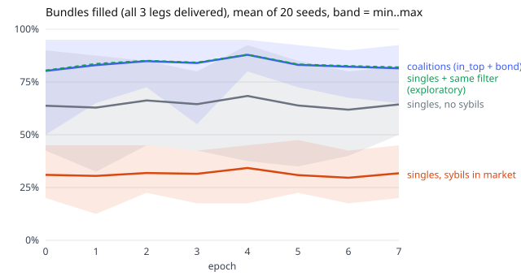

# Coalitions: merchant agents admitted by proven standing, held by bonds

A buyer often needs more than one merchant: a hotel and a hoodie, or several legs of one trip.
A coalition is a job with several legs. Each leg is taken by one merchant agent. An agent gets
in only with proven standing on the bazaar, and it posts a bond. It gets the bond back and a
share of the budget when it delivers. It loses the bond when it does not.

`coalition/src/lib.rs` is the contract. `scripts/coalition-live.mjs` runs it on testnet and
checks the run from public RPC. The contract sits next to the bazaar, like the gate and the
anchor. The bazaar's code did not change for it.

## Where the standing comes from

The bazaar logs `hire` edges and released sealed-review seeds as graph events into a hash
chained `graph_root`. A Jolt guest (`zk/guests/standing`, docs/jolt.md) proves the standing
scores over that root. A worker submits them, anyone can challenge inside one review round,
and after the window the bazaar builds a proven standing tree. `in_top(proof, pct)` answers
"is this leaf in the top pct% of the tree". Today the tree ranks each merchant by its released
review score (the average shrunk toward 3 stars): only merchants with a seed get a leaf. The
fan-out along hire edges is proven alongside in the same update and does not decide admission
yet; so a hired account, honest or sybil, has no leaf and is refused, by construction. Three
rankings that let the fan-out decide admission (`standing-v2/`: v2, v3, and v3 cut by count as
v4) were each pre-registered and measured, and each missed its rule; see "Every registered
attempt" below. v4, on fresh seeds, is as safe as v1 and admits 1.6 reliable newcomers per seed,
but missed the registered newcomer bar (16 of 20 seeds against 18), so admission stays on v1 and
v4 is the next candidate. The bazaar's graph program was set to a v2 program for a few minutes
on 2026-11-14 and set back to v1 by the same timelock; no update was proven under it.

## The contract

`coalition/src/lib.rs` is version 3. Earlier versions are kept as they ran, each rebuilding to
its deployed code hash: version 1 in `coalition/v1/` (jobs A, B and C at
`coalition.bookerbob-demo.testnet`, sha256 `070500ad…`) and version 2 in `coalition/v2/` (job D
at `coalition-v2.bookerbob-demo.testnet`, sha256 `79ccb403…`). Version 3 runs at `coalition-v3.bookerbob-demo.testnet` (sha256 `b5c4986f…`, job E).

What each version fixed, from the two audits of 2026-11-14:

- Version 1 did not check who made a delivering purchase, when, or the member's category: a
  member could buy from itself and collect. Version 2 added the buyer list, the announce step
  and the category check.
- Version 2 left three buyer-side griefs open. A second announce replaced the first, so a buyer
  could announce n1, announce n2, settle n1, and the member was paid on the bazaar yet slashed
  here. Announced nullifiers were global and any listed account could announce, so another job
  that named the same buyer agent without its consent could take a purchase first. And the
  deliverers' half of a slash went to the other members, so a buyer with a member of its own
  could collect the whole bond of a member it griefed. Version 3 closes all three.

State: the token (dUSDC on testnet), the bazaar account, a treasury account set at init, the
jobs, a record per member, the nullifiers announced in each job, the nullifiers used for a
delivery, and the payouts the token refused. No owner and no admin method.

- `new(token, bazaar, treasury)`.
- `open_job(legs, bond, budget, min_top_pct, deadline_ms, buyers)`: the caller is the job's
  buyer. `legs` is a list of `{category, max_price}`, 1 to 8. `buyers` lists the accounts whose
  bazaar purchases may deliver a leg (1 to 8, no repeats); left out, it is the caller alone.
  Budget, bond and every max price are at most 10^15 base units, so `budget * price` cannot
  overflow. The deadline is at least 10 minutes away. Attach 0.02 NEAR for storage.
- Funding: the buyer sends exactly `budget` by `ft_transfer_call` with msg `{"fund": job}`.
  Only a funded job takes members.
- Joining: the member sends exactly `bond` by `ft_transfer_call` with msg
  `{"join": {job, leg, price, proof}}`. `price` is its quote for the leg, at or under the
  leg's `max_price`. `proof` is its `TopProof` from the bazaar's standing tree.
  Checked at once: the job is funded and open, the leg exists and is free, the sender is
  neither the buyer nor one of its buyer agents, the sender is not already in this job, the
  bond is exact, the price fits, a proof is present, and the proof's leaf (`proof.merchant`) is
  the sender. Then the contract asks the bazaar two things in one batch: `in_top(proof,
  min_top_pct)` and `merchant(sender)`. The member is admitted when `in_top` says true and the
  merchant record is approved in the leg's category. Otherwise, or on a failed call, the seat is
  freed. Every refusal logs `join_refused` with its reason and returns the bond: the token
  refunds it in the same transaction.
- `announce(job, leg, nullifier)`: by a buyer agent named in the job, for its own purchase,
  before the deadline. The contract reads the bazaar's `verdict(nullifier)`. The record's
  `agent` (the account that submitted the verdict) must be the caller, the referee receipt must
  name the leg's member at or under its quote, the purchase must not be disputed, and it must
  not be spent yet. The deadline is checked again when the bazaar's answer comes back. A leg
  keeps every purchase announced for it, up to 4. A nullifier is announced at most once per job;
  another job does not block it.
- `deliver(job, leg, nullifier)`: by anyone, before the deadline (checked again in the
  callback), for any nullifier announced on that leg. The contract reads `verdict(nullifier)`
  again: the same checks, and now spent and paid. One purchase delivers one leg across all jobs.
- `finalize(job)`: anyone, at or after the deadline, once. It pays out by the rule below,
  updates each member's record, and logs `job_finalized`. The job is `complete` when every leg
  was filled and delivered, otherwise `failed`. Each payout is an `ft_transfer` (8 Tgas) with a
  callback (5 Tgas); with 8 legs, the buyer and the treasury that is 10 payouts, so attach at
  least 150 Tgas. A transfer the token refuses (an unregistered receiver) is credited to that
  account, which withdraws it with `claim()`.
- Views: `job(id)`, `member(account)` (joined, completed, slashed, released, earned, lost),
  `claimable_of(account)`, `config()` (token, bazaar, treasury, jobs, version).

Events (NEP-297, `standard: bookerbob-coalition`, version `3.0.0`): `job_opened`,
`job_funded`, `joined`, `join_refused`, `announced`, `delivered`, `join_lapsed`,
`job_finalized`, `payout_failed`, `claimed`.

### When the purchase was made

The bazaar's verdict record has no issue time, and `spent_count` cannot tell one purchase from
another. The record does carry `spent`, and a purchase is spent once, at its settle. So the
contract takes the order from that flag: a purchase delivers only if it was announced while
unspent, and `announce` exists only for a job that is already open. Every delivering settle
therefore comes after `open_job`. A purchase that settled before the job opened, or before its
announce, is refused (`the purchase settled before it was announced`).

### Who must buy, and when a member is slashed

A leg ends in one of three ways:

- delivered: one of its announced purchases settled and was paid; the member is paid.
- no-show: purchases were announced for the leg and none was delivered; the member is slashed.
- released: no purchase was announced for the leg; the member gets its bond back and no share of
  the budget, and nothing is slashed.

The release is the escape the first audit asked for: a buyer that never buys from a member
cannot keep half of that member's bond. Only the purchase's own buyer agent can announce it, and
only after a verdict and a referee receipt that names the member at a price within its quote.
Because every announce is kept, a later announce cannot strip a member of a purchase that
settled. What remains: a buyer can announce a purchase and then not settle it, and the member
is then slashed. The demo settles from the buyer side, so the contract cannot tell a merchant
that did not deliver from a buyer that would not pay. It reads the bazaar's disputed flag at
announce and at deliver only; a dispute opened after a delivery does not undo it.

### A join the bazaar never answered

The bond reaches the contract inside the token's `ft_transfer_call`; the seat is pending until
the bazaar's answers come back. If the callback fails, the token refunds the bond by itself and
the seat stays pending. `finalize` waits for pending seats only until the deadline plus 10
minutes. After that it drops them (`join_lapsed`), pays them nothing, and a late answer returns
the bond through the token's refund.

### Version 4: admission on a Jolt proof verified on chain

Version 4 (`coalition/v4/`, at `coalition-v4.bookerbob-demo.testnet`, wasm sha256 `47e3fa11..`,
created with no access key) is version 3 plus one admission condition. A join's message also
names `standing_job`, a job id on the locked Jolt verifier `verifier.bookerbob-jolt-a.testnet`
(docs/jolt-onchain.md), and `standing_inputs`, the standing proof's public inputs. The coalition
reads four answers in one join: `in_top` and `merchant` from the bazaar as before,
`standing_root` from the bazaar, and `status(standing_job)` from the verifier. It admits only
when the verifier job is `verified`, did not panic, and its statement re-derives in the
coalition from program `c780ceab..`, the given inputs, and the bazaar's live graph root and
scores hash. The bazaar built the standing tree that `in_top` opens to from the scores with that
hash, so the member's rank is read from a tree whose scores a NEAR contract proved: there is no
worker signature between the tree and the proof. Otherwise the join is refused with "the verifier's job is not a
verified standing proof of the bazaar's live standing root", and the bond is refunded.

Run on testnet on 2026-11-14 (`node scripts/coalition-jolt-live.mjs`, record in
`fixtures/live/coalition-jolt/run.json`, keyless check `make coalition-jolt-check`, 24 checks with the local build and 23 without):

- The live standing proof (the proof behind standing root `3b5db5e9..`, n = 3) is verifier job
  4: verified on chain in 8 txs.
- Job 0, opened and funded by `cl-lead-1df7` (a hoodie leg, a hotel-lisbon leg, bond 1, budget
  2 dUSDC, min_top_pct 100: any member with a leaf in the proven tree qualifies on rank).
- h05 joined the hotel leg naming verifier job 1, a verified proof of an older graph: refused,
  bond refunded (`FZaJwtKo..`).
- m01 joined the hoodie leg naming verifier job 4: admitted (`DsHD55CM..`). The `joined` event
  carries job 4's statement `61effb83..` and the tree root.
- Finalized after its deadline (`uxVh2YBP..`) with no purchase (no bazaar settle was made). The
  status is `failed` (no leg delivered), m01's 1 dUSDC bond is released and paid back, the 2 dUSDC
  budget goes back to the lead, and nothing is slashed.

`coalition/v4/src/tests.rs`: version 3's tests plus six for version 4 (35 pass).

Limits: the coalition trusts the bazaar's views (`in_top`, `merchant`, `standing_root`), and the
bazaar account holds a full-access key. The bazaar's own standing root still comes from the
worker-signed update with its challenge window; version 4 is the first contract that acts on the
on-chain verdict. `in_top` and `standing_root` are separate view receipts of one join, so a
standing update landing between them would let the rank come from a newer tree. The bazaar
checks the TopProof's n against its live tree; version 4 does not compare it with
`standing_root`'s n, and its code is locked (a later version would).

## The split and the slash

`settle(budget, bond, seats)` in `coalition/src/lib.rs`, a pure function with its own tests.
P is the sum of the quoted prices of every member that joined.

- Budget: a member that delivered gets `budget * price / P` (floor). The rest goes back to the
  buyer: the shares of members that did not deliver, legs nobody took, and rounding.
- Bonds: a member that delivered gets its bond back, and so does a released member. A no-show
  loses its bond: half of it (floor) goes to the buyer as compensation, the rest to the
  treasury. No member gains from another member's slash, so a buyer that also runs a member
  takes at most half of a griefed member's bond. (In versions 1 and 2 the second half went to
  the deliverers, pro rata to their quotes.)
- Conserved: what the buyer gets back, plus the treasury's part, plus every payout, equals the
  budget plus all bonds.

Example from the unit tests: budget 30, bonds 5, quotes 40, 400 and 40, the first two deliver
and the third had a purchase announced. The budget pays 2.5 and 25 and returns 2.5. The third
member's bond of 5 sends 2.5 to the buyer and 2.5 to the treasury. Had nothing been announced
for the third leg, its member would get its 5 back.

## Tests

`cd coalition && cargo test --locked`: 29 tests on near-sdk's mocked chain (`make
coalition-test` adds `clippy --all-targets -D warnings` and `fmt --check`, both clean).

The audit's three proofs of concept, rewritten to assert the fixed behaviour. Run against
version 2 (the auditor's crate, whose `lib.rs` equals `coalition/v2/src/lib.rs`), each shows the
bug; in version 3 each asserts the fix:

- `poc_replace_after_settle_slashes_a_member_that_delivered`: announce n1, announce n2, deliver
  n1: delivered, nothing slashed.
- `poc_replace_then_finalize_slash`: announce n1, announce n2, deliver n2: m01 completes.
- `poc_other_job_hijacks_a_nullifier`: a job naming the victim's agent cannot announce the
  victim's purchase (not one of its agents, or not the purchase's agent), and the agent's own
  announce in that job does not lock the victim's job out.

Also for version 3: the sock-member case (the buyer's own member delivers; the griefed member's
bond goes half to the buyer and half to the treasury, none to the sock), one purchase
delivering one leg across jobs, at most 4 announces per leg, and an announce whose answer lands
after the deadline. Kept from version 2: a purchase by an account the job does not name, the
default buyer set, a purchase spent before its announce, an announce by a member, a deliver of a
nullifier that was not announced, a member in another bazaar category, an unapproved merchant or
none, the buyer and its agents joining their own job, a released leg, a join pending past the
grace period, a refused payout made claimable, the `open_job` caps, two whole jobs, the split's
conservation (six cases, one at the caps), and the refusals of version 1 (no proof, another
leaf, low standing, a failed bazaar call, double join, a taken leg, a wrong bond, a price over
the max, an unfunded job, funding by someone else, a fake token, a receipt naming another
merchant, an unsettled purchase, a receipt over the quote, an unknown nullifier, finalize before
the deadline, finalize twice, joins and announces after the deadline).

`node --test scripts/coalition-live.test.mjs` checks the public verifier on recorded shapes: a
payout that differs, a coalition event logged by another account, member records that differ
from the finalize events, the version 2 and version 3 splits, and a settle tx that is not
`settle_demo` on the bazaar for the recorded nullifier and buyer (another method, nullifier,
receiver or sender, or a failed call).

## The live runs (testnet, 2026-11-14)

Five jobs ran on testnet. A, B and C ran on version 1 at `coalition.bookerbob-demo.testnet`
(code sha256 `070500ad…`), D on version 2 at `coalition-v2.bookerbob-demo.testnet` (`79ccb403…`),
E on version 3 at `coalition-v3.bookerbob-demo.testnet` (`b5c4986f…`). `coalition/v1/` and
`coalition/v2/` rebuilt to the first two hashes when we checked them by hand on 2026-11-14; the
verifier reads the deployed code hash and does not rebuild. All point at `bookerbob.testnet` and
`bookerbob-dusdc.testnet`. Records: `fixtures/live/coalition/run.json` (A, B), `job-c.json` and
`reprove.json` (C), `job-d.json` and `reprove-live.json` (D), `job-e.json` (E).
`node scripts/coalition-live.mjs verify` (`make coalition-verify`, keyless, public RPC) re-reads
every recorded tx and view: 43 PASS lines, 11 for jobs A and B, 10 for job C and its tree, 11
for job D, 11 for job E. Every line reads only the events the coalition account logged under its
own standard (and the transfers the token logged from the coalition), and binds the job, leg,
member and nullifier it names. For C, D and E it also compares the account's code hash
(`view_account`) with the recorded wasm, and each delivering settle tx must be `settle_demo` on
the bazaar for the recorded nullifier, sent by the recorded buyer. The member records lines
compare each member's record with the finalize events exactly.

### Jobs A and B (version 1)

The standing tree at the time: root `885a8152…`, n = 2, m01 rank 1, h05 rank 2 (Jolt-proven
graph update of 2026-11-05, 6 graph events, `fixtures/live/standing-root/run.json`). Both
openings were rebuilt from the public events (`bookerbob standing-proofs
fixtures/zk/standing-testnet-3-input.json`) and checked against the bazaar's `standing_root`.

What ran:

- Job 0 (A): a hoodie leg and a hotel leg, bond 5 dUSDC, budget 20 dUSDC, top 100%. m01 joined
  the hoodie leg at 48 and h05 the hotel leg at 420. The bazaar's `in_top` admitted both.
- A stranger account tried job A's hoodie leg after m01 held it: refused, leg taken. On job 1
  (B), with a free leg, it tried with no proof and then with m01's opening: both refused, both
  bonds refunded in the same transaction.
- Job 1 (B) asked for the top 50%. h05 is rank 2 of 2, so the bazaar's `in_top` answered false.
  The coalition freed the seat and the token refunded the bond.
- A demo tester bought from m01 through the normal path: verdict, referee receipt at 36 dUSDC,
  escrow, `settle_demo`. m01 called `deliver` with that nullifier. The coalition read the
  bazaar's verdict record: spent, paid, the receipt names m01, 36 is under its quote of 48.
- h05 never delivered.
- After the deadline the lead called `finalize`. Job A failed (one leg not delivered). m01 got
  9.551282: its bond of 5, its budget share 20 * 48 / 468 = 2.051282, and 2.5 from h05's slashed
  bond. The lead got 20.448718: the rest of the budget and the other half of h05's bond. Job B
  had no member: its budget of 1 went back. After jobs A to C the version 1 member records
  show m01 completed 2, h05 slashed 2, m02 completed 1, equal to the three finalize events.
- The lead hired m01 on the bazaar: graph event 7.

| step | signer | tx |
|---|---|---|
| treasury creates the coalition account | bookerbob-demo.testnet | [DPqk5pQY…](https://testnet.nearblocks.io/txns/DPqk5pQY7WGqr9bvYW1UNtfv63txNnHgttrBajbthYJJ) |
| deploy coalition/ and new(token dUSDC, bazaar bookerbob.testnet) | coalition.bookerbob-demo.testnet | [ASh2E1nS…](https://testnet.nearblocks.io/txns/ASh2E1nSMWKkdBkPQtaSiPgmgXwADm1kBXXN5MXbXTxr) |
| register the coalition with dUSDC | bookerbob-demo.testnet | [2mKvNCJU…](https://testnet.nearblocks.io/txns/2mKvNCJUmPuosRgoG6SQHr3J8CPg4gKZCXbnjnpU99Fw) |
| create the lead | bookerbob-demo.testnet | [14AK977V…](https://testnet.nearblocks.io/txns/14AK977VYiR57PB8P5UCp9nMRpqwjnDY5RADtUANhKmc) |
| lead registers with dUSDC | cl-lead-1df7.bookerbob-demo.testnet | [EyMVGDjA…](https://testnet.nearblocks.io/txns/EyMVGDjAnWAC3PZTfJrZ29p5LGpXbjDAVphZFyhKvqZq) |
| lead mints 100 dUSDC | cl-lead-1df7.bookerbob-demo.testnet | [hKtYDZHB…](https://testnet.nearblocks.io/txns/hKtYDZHBLCUbmp6jt7H6m4VDBQNWe4h7B5WfSALMZXM) |
| create the stranger | bookerbob-demo.testnet | [2FAey7kK…](https://testnet.nearblocks.io/txns/2FAey7kK1m5EaeCPe1SLUGeRWzXFqE5pdWZGbFjcHFzf) |
| stranger registers with dUSDC | cl-stranger-1df7.bookerbob-demo.testnet | [E9gCNfxm…](https://testnet.nearblocks.io/txns/E9gCNfxmVhxj1hzszhZ6XsJFAcstbkKQNHUSjAk7Qvsr) |
| stranger mints 10 dUSDC | cl-stranger-1df7.bookerbob-demo.testnet | [HmHbX2Db…](https://testnet.nearblocks.io/txns/HmHbX2Dbn21Tyqjkx2aPZ7aVw9zVtPeVihmKUGjJ264i) |
| lead opens job 0: hoodie leg (max 48), hotel leg (max 450), bond 5, budget 20, top 100% | cl-lead-1df7.bookerbob-demo.testnet | [96m7crKj…](https://testnet.nearblocks.io/txns/96m7crKjDoWx7B5y4xXXQn8hXm8fqu41npGzxcRHuvVU) |
| lead escrows the budget of 20 dUSDC | cl-lead-1df7.bookerbob-demo.testnet | [4kisBi1n…](https://testnet.nearblocks.io/txns/4kisBi1nZMvYDuSeRV2uNeEM6NfxuF8V7ZrmRXKKUUEn) |
| m01 joins the hoodie leg at 48 with its opening: in_top true, admitted, bond 5 | m01.bookerbob.testnet | [Gy21J52X…](https://testnet.nearblocks.io/txns/Gy21J52XbmvATUKb9hkPj53ufVYUJgnGFSBZXi9b6sNo) |
| treasury tops up h05's NEAR for gas | bookerbob-demo.testnet | [74fdM9nK…](https://testnet.nearblocks.io/txns/74fdM9nKoWFfNHYDPah2obF9TEftGjkTxkyr9J63dDXQ) |
| h05 joins the hotel leg at 420 with its opening: in_top true, admitted, bond 5 | h05.bookerbob.testnet | [56yRBJUW…](https://testnet.nearblocks.io/txns/56yRBJUWrWiFuSTRN7a3PEiEVdDMGQjMTYUBDed5bPfQ) |
| the stranger tries job A's taken hoodie leg: refused, leg taken, refunded | cl-stranger-1df7.bookerbob-demo.testnet | [F7mmh2GR…](https://testnet.nearblocks.io/txns/F7mmh2GReaTMBcLTEw6irSoMnepA4oMgbQW5qGMGchEx) |
| lead opens job 1: one hotel leg, top 50% | cl-lead-1df7.bookerbob-demo.testnet | [6cdpYfML…](https://testnet.nearblocks.io/txns/6cdpYfMLiTAvhYDEAP8F9QyV8jzGEdZNq8StJNHh46CN) |
| lead escrows its budget of 1 dUSDC | cl-lead-1df7.bookerbob-demo.testnet | [Aw4m7BCL…](https://testnet.nearblocks.io/txns/Aw4m7BCLjnvvRqdY6FAK7oSUaj1vdVs4qUxY6RubBrPu) |
| the stranger joins job B with no proof: refused, refunded | cl-stranger-1df7.bookerbob-demo.testnet | [GeDHQptQ…](https://testnet.nearblocks.io/txns/GeDHQptQVd6WYSifU3vjomCCbgJMiQ4rbhtpLRKWLvQe) |
| the stranger joins job B with m01's opening: refused (the leaf is not the sender), refunded | cl-stranger-1df7.bookerbob-demo.testnet | [73LgSsTQ…](https://testnet.nearblocks.io/txns/73LgSsTQvws9U892UnnuLPqZ5v3smZpoDSSC7X1yQydN) |
| h05 (rank 2 of 2) joins job B: the bazaar's in_top(50%) says false, refused, refunded | h05.bookerbob.testnet | [5XSXhNDr…](https://testnet.nearblocks.io/txns/5XSXhNDr3aVGYFPyvpw3p6qBTCoaBaWKsDbATrR2p1ya) |
| tester bea7a1be05…: submit_verdict (relayed) | bookerbob-demo.testnet | [2R7aQ9Tb…](https://testnet.nearblocks.io/txns/2R7aQ9TbYbkPFTcDYwci3iayxd3sLMQEt7aDCQipaSTq) |
| tester bea7a1be05…: referee receipt for m01 at 36 (relayed) | bookerbob-demo.testnet | [G4TJNhTv…](https://testnet.nearblocks.io/txns/G4TJNhTvfhibkW9i52jtCDR9F6WWWNgK95Sx1JbTmEch) |
| tester bea7a1be05…: escrow 36 dUSDC (relayed) | bookerbob-demo.testnet | [EiArVB2j…](https://testnet.nearblocks.io/txns/EiArVB2jL1q3o2bAh64ZHB71nULf3mtVeKi8mW8CkGqp) |
| tester bea7a1be05…: settle_demo pays m01 (relayed) | bookerbob-demo.testnet | [FLMWDf4n…](https://testnet.nearblocks.io/txns/FLMWDf4nU5VG4RunHwNgh9WzdbjYL7rvj7ho6DrSACqS) |
| m01 shows the tester's purchase: the coalition reads verdict(nullifier) on the bazaar | m01.bookerbob.testnet | [Ao1o2CNm…](https://testnet.nearblocks.io/txns/Ao1o2CNmiJspQLRXYowVzBfqYYgcxgc15PTymCWFZzPr) |
| anyone finalizes job A: m01 paid, h05 slashed | cl-lead-1df7.bookerbob-demo.testnet | [DkoBchZP…](https://testnet.nearblocks.io/txns/DkoBchZP63RXVJB768dQNKx4d5eUstsDnuiPr9d2gcDQ) |
| finalize job B: no member, budget back to the lead | cl-lead-1df7.bookerbob-demo.testnet | [88gnyhnQ…](https://testnet.nearblocks.io/txns/88gnyhnQgQr2nUHjLwigciMBAEVZfo5Br3WG9HYMCBvV) |
| the lead hires m01 on the bazaar: a Hire event into the graph | cl-lead-1df7.bookerbob-demo.testnet | [BtmLQbt3…](https://testnet.nearblocks.io/txns/BtmLQbt33E9jGVrivniJ8JaowHFsfwVYQRHMi7c1ogFE) |

dUSDC balances read from chain during the run:

| when | cl-lead-1df7 | m01 | h05 | cl-stranger-1df7 | coalition |
|---|---|---|---|---|---|
| before | 100 | 1791.9108 | 25245 | 10 | 0 |
| after_joins | 79 | 1786.9108 | 25240 | 10 | 31 |
| after_finalize | 100.448718 | 1867.742082 | 25240 | 10 | 0 |

The m01 column moves by more than the coalition payout between the joins and finalize: m01 also
took purchases from other buyers in that window (other demo runs on the same day).

### Standing rises: m02

m02 sold hoodies on the bazaar but had no released reviews, so it had no leaf in the proven
tree (root `885a8152…`, n = 2). On job C it tried to join anyway: it had no opening in the n=2
tree, so it could present no proof and was refused, and its bond came back. Then five demo
testers bought from m02 through the normal path and paid (42 dUSDC each,
`fixtures/live/coalition/seed-m02.json`), joined its review group, sealed a review each, and
revealed after the round closed. `publish_reviews` released the five ratings
([G8acbKsm…](https://testnet.nearblocks.io/txns/G8acbKsmBPxvhSEXnLsmHyJHtqBycHD4ckXuV3oBVnhq)):
graph event 8, m02's seed. The graph of 8 events (the 6 proven before, the lead's hire of m01,
m02's seed) was re-proved in Jolt (proof sha256 `3016edd8…`, program `c780ceab…`), submitted,
left unchallenged for the window, and finalized. The new tree has root `4f537c55…`, n = 3:
m01 rank 1, h05 rank 2, m02 rank 3. m02 joined job C with its new opening and the bazaar's
`in_top` admitted it.

### Job C (version 1)

Job 2 (C): three legs (hoodie max 48, hotel max 450, hoodie max 45), bond 5 dUSDC each,
budget 30 dUSDC, top 100%. m01, h05 and m02 joined at the n = 3 tree at quotes 48, 450 and 45.
m01 and m02 delivered with bazaar purchases (36 and 42 dUSDC); h05 did not. After the deadline
the lead finalized: P = 543; m01 got 8.942255 (bond 5, budget share 2.651933, 1.290322 of h05's
bond), m02 got 8.695864 (5, 2.486187, 1.209677), the lead 27.361881 (the rest of the budget and
2.5 of h05's bond). h05 lost its bond. The lead then hired h05 and m02 on the bazaar, graph
events 9 and 10: the graph now holds 10 events, and its 3 merchants with a leaf are m01, h05 and
m02.

Both delivering purchases were made by fresh demo testers (`906587e1…` and `a97b483d…`), neither
of them the lead. Version 1 accepted them because it checked only that the purchase was spent,
paid and named the member; it never read who bought. The same gap would have let a member buy
from itself. Jobs A, B and C all ran on version 1, without the buyer, timing and category
checks; version 2 (job D below) adds them.

| step | signer | tx |
|---|---|---|
| lead opens job 2: three legs, bond 5, budget 30, top 100% | cl-lead-1df7.bookerbob-demo.testnet | [3SHmz6oC…](https://testnet.nearblocks.io/txns/3SHmz6oCLjbE9oN416AzkFJ5Luq4vu2XhrRPMRmnR1Xq) |
| lead escrows the budget of 30 dUSDC | cl-lead-1df7.bookerbob-demo.testnet | [AiC3LQQD…](https://testnet.nearblocks.io/txns/AiC3LQQDHNboqZBZizYGw9tYSpj1UbLdpK8znymz17iy) |
| m02 tries the third leg with no opening in the n=2 tree: no proof, refused, refunded | m02.bookerbob.testnet | [A8psb8PU…](https://testnet.nearblocks.io/txns/A8psb8PU1SyDkMViDcdZSMxgHZLj8u8Uy3nztn2HxHqx) |
| m02's five sealed ratings released: graph event 8, its seed | bookerbob-demo.testnet | [G8acbKsm…](https://testnet.nearblocks.io/txns/G8acbKsmBPxvhSEXnLsmHyJHtqBycHD4ckXuV3oBVnhq) |
| submit_graph_scores: the Jolt proof over 8 graph events | bookerbob-demo.testnet | [5jgLWwxz…](https://testnet.nearblocks.io/txns/5jgLWwxzwZEAegQkLfsfMcnifjbvKwTHCeNQpvUyeY61) |
| finalize_graph_scores: standing root 4f537c55, n = 3 | bookerbob-demo.testnet | [hvuk8t1f…](https://testnet.nearblocks.io/txns/hvuk8t1f5eo9vAV9wGKEBakh8JWhsLpmbv66gU3dUJ1) |
| treasury tops up m02's NEAR for gas | bookerbob-demo.testnet | [8w5vmStw…](https://testnet.nearblocks.io/txns/8w5vmStw9mgxKNYKxkSXR8XhkDoLnZgE9gZpgNS1VfHg) |
| m01 joins leg 0 at 48: in_top true (rank 1 of 3), admitted | m01.bookerbob.testnet | [2ny6qKWG…](https://testnet.nearblocks.io/txns/2ny6qKWGxKnHjfinY2NWv9c1j6eT8sr6dVvaZ9ctWYzs) |
| h05 joins leg 1 at 450: in_top true (rank 2 of 3), admitted | h05.bookerbob.testnet | [CEkNvx3k…](https://testnet.nearblocks.io/txns/CEkNvx3ka1gyDkAHuS4JB7om6C6Uv6Du3bboLp8D8PS4) |
| m02 joins leg 2 at 45: in_top true (rank 3 of 3), admitted | m02.bookerbob.testnet | [GSj6y2BM…](https://testnet.nearblocks.io/txns/GSj6y2BMowc1heofP3DSTLr1a2Z9Zyt7mqd6WGajAhtY) |
| tester 906587e1…: settle_demo pays m01 36 (relayed) | bookerbob-demo.testnet | [9NgbQc25…](https://testnet.nearblocks.io/txns/9NgbQc25g7nxdFhHzxietGhsZtYqhvxjKWarqC63tuTw) |
| m01 shows that purchase | m01.bookerbob.testnet | [FNTHNwsC…](https://testnet.nearblocks.io/txns/FNTHNwsC1NarSRvf47kVGkBoJuouQVmDvdaoo4mVMiNv) |
| tester a97b483d…: settle_demo pays m02 42 (relayed) | bookerbob-demo.testnet | [Atr2tHwD…](https://testnet.nearblocks.io/txns/Atr2tHwDE6JWLgnUubnLk49VCMCbPFsaxwaY4Triaai5) |
| m02 shows that purchase | m02.bookerbob.testnet | [4ksA4oca…](https://testnet.nearblocks.io/txns/4ksA4ocaBTYvwaaDKkgg1XXiN4ydZK7y14hm2bfMGP8t) |
| anyone finalizes job C: m01 and m02 paid, h05 slashed | cl-lead-1df7.bookerbob-demo.testnet | [7fviwuTw…](https://testnet.nearblocks.io/txns/7fviwuTwKPLmuC1hNdG6tfeUYh9uihYR8uYegS2x3DLF) |
| the lead hires h05: graph event 9 | cl-lead-1df7.bookerbob-demo.testnet | [68CLFyT9…](https://testnet.nearblocks.io/txns/68CLFyT9hgtsx9tUNAsPvEJ8Htr8ckLZEh2DQ55hJne3) |
| the lead hires m02: graph event 10 | cl-lead-1df7.bookerbob-demo.testnet | [3HekZUKq…](https://testnet.nearblocks.io/txns/3HekZUKqBLAjdufsoo16AWvEKnxEMnaSK7YuuPZEoAoX) |

dUSDC balances read from chain around job C:

| when | cl-lead-1df7 | m01 | h05 | m02 | coalition |
|---|---|---|---|---|---|
| before the joins | 70.448718 | 1867.742082 | 25240 | 656.964 | 30 |
| after finalize | 97.810599 | 1942.964337 | 25235 | 702.239864 | 0 |

m01 and m02 also took purchases from other buyers in that window, so their columns move by more
than the coalition payout.

### Job D (version 2)

Contract: `coalition-v2.bookerbob-demo.testnet`, code sha256 `79ccb403…` (`make coalition-wasm`),
`config().version` 2.0.0. The standing tree at the joins: root `3b5db5e9…`, n = 3, m01 rank 1,
h05 rank 2, m02 rank 3: the graph of 10 events re-proved under the v1 program (`c780ceab…`,
`fixtures/live/coalition/reprove-live.json`). The openings came from `bookerbob standing-proofs
fixtures/zk/standing-live-input.json`, checked against the bazaar's `standing_root` before any
join.

What ran:

- Before opening, the lead made three one-time implicit accounts as its buyer agents
  (`2b7644f6…`, `ae86673b…`, `13fc71c2…`). Job 0 (D) names them in `open_job`: three legs
  (hoodie max 48, hotel-lisbon max 450, hoodie max 45), bond 5 dUSDC, budget 30 dUSDC, top 100%,
  deadline 35 minutes out. The lead funded it.
- m01, h05 and m02 joined at quotes 48, 450 and 45. In each join tx the bazaar's `in_top`
  answered true and the merchant record matched the leg's category (hoodie, hotel-lisbon,
  hoodie).
- A fresh demo tester the job does not name (`1fe452a9…`) bought from m02 (42 dUSDC). Before
  its settle, the lead announced it for m02's leg: refused on chain, `the purchase's buyer agent
  is not allowed in this job`. After it settled, a deliver of it for leg 2 was refused too, `this
  purchase was not announced for this leg`. This is the audit's HIGH 1 case: a purchase from a
  member by an account the buyer did not name cannot deliver a leg.
- Each named buyer agent bought from its leg's member through the demo purchase path: verdict,
  referee receipt, escrow. Between the escrow and the settle, the lead announced the purchase:
  m01 at 36, h05 at 408, m02 at 42. m01's and m02's purchases then settled, and m01 and m02 each
  showed its leg delivered.
- h05's purchase was announced and never settled: h05 is the no-show.
- After the deadline the lead finalized: job D failed (one leg not delivered). P = 543; m01 got
  8.942255 (bond 5, budget share 2.651933, 1.290322 of h05's bond), m02 got 8.695864 (5,
  2.486187, 1.209677), the lead 27.361881 (the rest of the budget and 2.5 of h05's bond). h05 lost
  its bond. Every transfer was accepted, so nothing became claimable. The version 2 member
  records show m01 and m02 completed 1, h05 slashed 1.

| step | signer | tx |
|---|---|---|
| treasury creates coalition-v2 | bookerbob-demo.testnet | [EnfGesfN…](https://testnet.nearblocks.io/txns/EnfGesfN8Ryrs8Lpx95X7ShvqjHSqRdJoF4bBWKFaSVS) |
| deploy version 2 and new(token dUSDC, bazaar bookerbob.testnet) | coalition-v2.bookerbob-demo.testnet | [FFUcWGzm…](https://testnet.nearblocks.io/txns/FFUcWGzmCsGrSm1RpCgMNja4LWCnNWwXQxFMtAmX7QVe) |
| register coalition-v2 with dUSDC | bookerbob-demo.testnet | [5R9rR1ZP…](https://testnet.nearblocks.io/txns/5R9rR1ZP6aor8AyBLUc5maM4n9wnSjEYSKh2DJDGoG1D) |
| lead opens job 0: three legs, three named buyer agents, bond 5, budget 30, top 100% | cl-lead-1df7.bookerbob-demo.testnet | [6g9jzttm…](https://testnet.nearblocks.io/txns/6g9jzttmfnrykXGdwSnyuMg48BYZauq2bpYXWnWRi4GB) |
| lead escrows the budget of 30 dUSDC | cl-lead-1df7.bookerbob-demo.testnet | [6xG6g8Bv…](https://testnet.nearblocks.io/txns/6xG6g8BvYnZbd5cHNzBCvVkrVKbqUKewEfbZkN7azzcD) |
| m01 joins leg 0 at 48: in_top true (rank 1 of 3), category hoodie | m01.bookerbob.testnet | [EiAwif2N…](https://testnet.nearblocks.io/txns/EiAwif2Nfqwy3pDyfHCdN8fzbhDA8Fie2AQYef1ZjKH3) |
| h05 joins leg 1 at 450: in_top true (rank 2 of 3), category hotel-lisbon | h05.bookerbob.testnet | [9tTtewDh…](https://testnet.nearblocks.io/txns/9tTtewDhu5YhRtJ9bo8dffZR7ihoxaXtkfFjTvm2QBhT) |
| m02 joins leg 2 at 45: in_top true (rank 3 of 3), category hoodie | m02.bookerbob.testnet | [9nnrZmmL…](https://testnet.nearblocks.io/txns/9nnrZmmLVAStSNHs67XBZxA9sQVSZa45M5Xo7GK7fo5X) |
| lead announces the unnamed tester's purchase (receipt for m02 at 42, unspent): refused: the purchase's buyer agent is not allowed in this job | cl-lead-1df7.bookerbob-demo.testnet | [2yUukeko…](https://testnet.nearblocks.io/txns/2yUukekobzpMcohARSur8NeDYgmvHtpA2EyENyNChem8) |
| unnamed tester 1fe452a9…: settle_demo pays m02 42 (relayed) | bookerbob-demo.testnet | [8ydM7UFe…](https://testnet.nearblocks.io/txns/8ydM7UFeRAJV4fw9beWR8qrS7yrexfYL6RhX9m4PWfmN) |
| deliver of that purchase for leg 2: refused: this purchase was not announced for this leg | cl-lead-1df7.bookerbob-demo.testnet | [BAqB9mDX…](https://testnet.nearblocks.io/txns/BAqB9mDXaBdAJvawSCXwmGK49o2Atv6R8wENmpCPNpjg) |
| buyer agent 2b7644f6…: referee receipt for m01 at 36 (relayed) | bookerbob-demo.testnet | [BcVf9iUr…](https://testnet.nearblocks.io/txns/BcVf9iUrGXepFEs97pm6qGHWApVPM5Fn9MB7NeXE67WA) |
| lead announces it for leg 0 (unspent) | cl-lead-1df7.bookerbob-demo.testnet | [8DKYQ7fn…](https://testnet.nearblocks.io/txns/8DKYQ7fn5J693BTCxpkz4npu6drmwriWGNMx1uJHQDCb) |
| buyer agent 2b7644f6…: settle_demo pays m01 36 (relayed) | bookerbob-demo.testnet | [8KAVFAiJ…](https://testnet.nearblocks.io/txns/8KAVFAiJRMcuQyPbZgLbaaGVNVi3fgJGppPofGwZ5czM) |
| buyer agent ae86673b…: referee receipt for h05 at 408 (relayed) | bookerbob-demo.testnet | [BsoEhwQs…](https://testnet.nearblocks.io/txns/BsoEhwQsXYpyZ7rbgKxfmmNNYYxQNaNmKakss7Cnrk9c) |
| lead announces it for leg 1 (unspent); it is never settled | cl-lead-1df7.bookerbob-demo.testnet | [7bzCmyW7…](https://testnet.nearblocks.io/txns/7bzCmyW7bPzY1AU2JvC7ZPjMsuNVYPK7a6dmBSdvnRbq) |
| buyer agent 13fc71c2…: referee receipt for m02 at 42 (relayed) | bookerbob-demo.testnet | [F5WRv8tG…](https://testnet.nearblocks.io/txns/F5WRv8tGVyyEWVFt8ppwxJquzgyJ5aEmvRbnbejdT8BL) |
| lead announces it for leg 2 (unspent) | cl-lead-1df7.bookerbob-demo.testnet | [5TuN9mqc…](https://testnet.nearblocks.io/txns/5TuN9mqcrVCcefSTTgnyrHZMc148dUguM2zzGMUA8Ruc) |
| buyer agent 13fc71c2…: settle_demo pays m02 42 (relayed) | bookerbob-demo.testnet | [FnVrznp9…](https://testnet.nearblocks.io/txns/FnVrznp9YcEembrFMqJqbAKPgjfrvs8ydz2c4RW7tmX3) |
| m01 shows leg 0 delivered | m01.bookerbob.testnet | [BcmygQFn…](https://testnet.nearblocks.io/txns/BcmygQFnPAqCxyYFGSHpwaWnDzRNz7roDESmaQpdqP3T) |
| m02 shows leg 2 delivered | m02.bookerbob.testnet | [CMYPdvdL…](https://testnet.nearblocks.io/txns/CMYPdvdLqc1NwNr5HndKUWFTzZCF7DHFo3FvANTtETLw) |
| anyone finalizes job D: m01 and m02 paid, h05 slashed | cl-lead-1df7.bookerbob-demo.testnet | [WNhhivou…](https://testnet.nearblocks.io/txns/WNhhivouMfRGS89a8KLnGp7bGVDBpiW8x7MMFq4K9pD) |

Job D ran on version 2. The three buyer-side griefs of version 2 (an announce replacing an
earlier one, another job taking a purchase first, a buyer's own member collecting a slashed
bond) were open in it; the run used none of them. Version 3 closes them, and its tests show it
(see "Tests").

What the verifier checks for job D, line by line:

- the code: `view_account` gives the account's code hash, equal to the wasm sha256 recorded at
  its deploy (`79ccb403…`), and `config()` names version 2.0.0, the bazaar and the token;
- the root: the verifier pins `finalize_graph_scores` `GSkXViv8…` and its standing root
  `3b5db5e9…`, proof sha256 `5619f62d…` and graph root `7f1bf041…` as constants; that tx's
  `graph_scores` event must carry them, and the record must name the same root;
- the open: the `job_opened` event names the lead, the three agents and the three categories;
- the joins: in each join tx a `joined` event from the coalition for this job, leg and member,
  the bazaar's `in_top` receipt returning true, the proof's leaf and n, the proof's Merkle path
  hashed up to the pinned root (`opens`, a JS copy of `zkcore/src/standing.rs`), and the leg's
  category;
- the forbidden purchase: the announce tx failed with the buyer-agent refusal and named that
  nullifier and job; the verdict record's agent is outside the job's list; the deliver tx failed
  with "not announced";
- each leg: the `announced` event (job, leg, member, nullifier, agent), the verdict record (agent,
  receipt merchant, price within the quote), the announce's block after the open's block; for
  m01 and m02, the settle tx is `settle_demo` on the bazaar, sent by that agent, for that
  nullifier, its block after the announce's, and the `delivered` event; for h05, the record is
  still unspent;
- finalize: the payouts the token logged equal the version 2 split exactly, and the member
  records equal the finalize event.

dUSDC balances read from chain around job D:

| when | cl-lead-1df7 | m01 | h05 | m02 | coalition-v2 |
|---|---|---|---|---|---|
| after funding, before the joins | 67.810599 | 1942.964337 | 25235 | 702.239864 | 30 |
| after finalize | 95.17248 | 1982.546592 | 25230 | 789.095728 | 0 |

The lead's column moves by exactly 27.361881. m01 and m02 also took the purchases in this job
(and m02 the unnamed tester's), so their columns move by more than the coalition payout.

### Job E (version 3)

Contract: `coalition-v3.bookerbob-demo.testnet`, code sha256 `b5c4986f…` (`make coalition-wasm`),
`config().version` 3.0.0, treasury `bookerbob-demo.testnet`. The standing tree at the joins is
job D's: root `3b5db5e9…`, n = 3. Record: `fixtures/live/coalition/job-e.json`.

Job E runs the version 2 griefs against version 3. Its purchases go through the NEAR AI verdict
path: by job E the testnet bazaar no longer accepted the operator verdict issuer of us (the
BookerBob operator) (removed by
design after job D), so each verdict was issued by the registered model under E2EE, signed by
its TEE key and countersigned by the evaluator (`scripts/model-buy.mjs` `issue()`), with the
named buyer agent as the verdict's `cnf`. The named agents' keys stay in
`KEYS_DIR/coalition/buyers`, apart from the public demo's testers.

What ran:

- The first try, job 0, was opened, funded and joined by m01 and h05; its first purchase failed
  at `submit_verdict` because the operator issuer was gone. No purchase was announced in it, so
  after its deadline it finalized with both members released: bonds back, budget back.
- Job 1 (E): two legs (hoodie max 48 for m01, hotel-lisbon max 450 for h05), bond 5, budget 20,
  top 100%, three named agents: a and b (fresh one-time accounts) and job D's h05 agent. m01 and
  h05 joined by `in_top`.
- Agent a bought from m01 (36 dUSDC, NEAR AI verdict, receipt, escrow) and announced it, still
  unspent.
- Agent b bought from m01 the same way and stopped before settling. b tried to announce a's
  purchase again: refused, already announced in this job. b tried to announce the h05 agent's
  purchase: refused, `the announcer is not the purchase's buyer agent`. b announced its own
  purchase on m01's leg. The leg now held two announces, a's and then b's.
- Agent a settled its purchase after both announces (a direct `settle_demo`; the treasury sent
  it 0.1 NEAR for the gas first). m01 showed the leg delivered with a's purchase, the earlier
  announce. Version 2 kept only the latest announce, b's, and would have refused this delivery.
- Job D's h05 agent announced its purchase from job D, still unspent, on h05's leg, and never
  settled it: h05 is the no-show.
- After the deadline the lead finalized: job E failed (one leg not delivered). P = 498;
  m01 got 6.92771 (bond 5 and budget share 20 * 48 / 498 = 1.92771, nothing from the slash), the
  lead 20.57229 (the rest of the budget and 2.5 of h05's bond), the treasury 2.5 (the other half
  of h05's bond). The member records show m01 completed 1, h05 slashed 1, and both released once
  (job 0).

| step | signer | tx |
|---|---|---|
| treasury creates coalition-v3 | bookerbob-demo.testnet | [Cn7MRj84…](https://testnet.nearblocks.io/txns/Cn7MRj84NWfuknUGjZhR6JjjHzQQcDYaVaX9z29aDzZE) |
| deploy version 3 and new(token dUSDC, bazaar bookerbob.testnet, treasury bookerbob-demo.testnet) | coalition-v3.bookerbob-demo.testnet | [J5xNPWjV…](https://testnet.nearblocks.io/txns/J5xNPWjVLucc7dBZheu1DYH3BFkJBtn9g8KhZsYF1JC8) |
| register coalition-v3 with dUSDC | bookerbob-demo.testnet | [69vhzo6j…](https://testnet.nearblocks.io/txns/69vhzo6j4nZwtSFSr3UWgABUpJp1a7GZyquWyQxs6mmi) |
| first try: lead opens job 0 | cl-lead-1df7.bookerbob-demo.testnet | [2ZtRT96Z…](https://testnet.nearblocks.io/txns/2ZtRT96Zo6azG1vv1Ugr2JuMzv3M4Tyzt3VkHaDjwQwR) |
| lead funds job 0 | cl-lead-1df7.bookerbob-demo.testnet | [BtoVChRA…](https://testnet.nearblocks.io/txns/BtoVChRAVWe4uehKNvFuFgpJYjGKsmvrXkxHzdwiiRqB) |
| m01 joins job 0 | m01.bookerbob.testnet | [62W7xmQY…](https://testnet.nearblocks.io/txns/62W7xmQYCfVHW3naZPZDSBosjYjxeP8Rgd2i1sGMJnYD) |
| h05 joins job 0 | h05.bookerbob.testnet | [GXAvaeAu…](https://testnet.nearblocks.io/txns/GXAvaeAuo9EWdroiecnfdNUfian9ZpyprvyXzHrDE7TT) |
| job 0's first purchase: submit_verdict refused, unknown enclave key (operator issuer removed) | bookerbob-demo.testnet | [HZWDLg4A…](https://testnet.nearblocks.io/txns/HZWDLg4AWagX1oUx35N8gXWTeMoh33y3TzSZ5yoabJe) |
| finalize job 0 after its deadline: both members released, budget back | cl-lead-1df7.bookerbob-demo.testnet | [GFLWyHiA…](https://testnet.nearblocks.io/txns/GFLWyHiAiXz9MitUFFN3dkexxvdxqvQJt2PHoKcSdjc9) |
| lead opens job 1 (E): two legs, agents a, b and job D's h05 agent, bond 5, budget 20 | cl-lead-1df7.bookerbob-demo.testnet | [BE9R8p9f…](https://testnet.nearblocks.io/txns/BE9R8p9fjAABizF3jkeNvQLtwzcTHHpCWKr9MqUg8DG2) |
| lead funds job 1 | cl-lead-1df7.bookerbob-demo.testnet | [4HZ6oPc9…](https://testnet.nearblocks.io/txns/4HZ6oPc9yT3cwgymHDvqoeuxECtWP54ZokunoAnopZRr) |
| m01 joins leg 0 at 48: in_top true | m01.bookerbob.testnet | [gWKdbVfR…](https://testnet.nearblocks.io/txns/gWKdbVfRxJ24DiCLAq7S2fNb3ujfD7EvjYfoCbLZsEH) |
| h05 joins leg 1 at 450: in_top true | h05.bookerbob.testnet | [Ck5ADjx5…](https://testnet.nearblocks.io/txns/Ck5ADjx5FyfHbAewdkRotduXofTrc8nkVQaF34YyYAxU) |
| agent a e0d3f8d6…: NEAR AI verdict (relayed) | bookerbob-demo.testnet | [CmVptFfW…](https://testnet.nearblocks.io/txns/CmVptFfWw419d5PqQ81XVAK7H9qH38QoKJaiUeTpqmH2) |
| agent a: referee receipt for m01 at 36 (relayed) | bookerbob-demo.testnet | [HKwyjYL6…](https://testnet.nearblocks.io/txns/HKwyjYL65rWUxNKjUhqaYVvV5nWDstMMnRUwUJr6D5pp) |
| agent a announces its purchase on leg 0 (unspent) | e0d3f8d6… | [6QxPPoqh…](https://testnet.nearblocks.io/txns/6QxPPoqh2ydBDDRUtZmZjw8nDRb1BxpZdqjdoV7dAX7M) |
| agent b 253760ed…: NEAR AI verdict (relayed) | bookerbob-demo.testnet | [2neHdMx8…](https://testnet.nearblocks.io/txns/2neHdMx8S2RTEwPYNEHLrdZgg7JAdJ7oxoRfpakH754H) |
| agent b: referee receipt for m01 at 36 (relayed) | bookerbob-demo.testnet | [72rbhsar…](https://testnet.nearblocks.io/txns/72rbhsariDQZqQZgFwZz7vcyUvYeKpNVu4ARXx8WPJog) |
| agent b announces a's purchase: refused: purchase already announced in this job | 253760ed… | [4g5MZSp7…](https://testnet.nearblocks.io/txns/4g5MZSp7JhSQsBASWBMQ144zHuU3DkqgYH3VCK9GYacT) |
| agent b announces the h05 agent's purchase: refused: the announcer is not the purchase's buyer agent | 253760ed… | [3PiCUHH1…](https://testnet.nearblocks.io/txns/3PiCUHH1DW8Bn4GRxytpAHxv7xvUCtcvG3E1Gh7UrVwE) |
| agent b announces its own purchase on leg 0; it never settles | 253760ed… | [7RDWGvpG…](https://testnet.nearblocks.io/txns/7RDWGvpGLbqUo5FtHLLfYGLr9ZY77bVAsFmDzHdAfd6Q) |
| treasury sends agent a 0.1 NEAR for gas | bookerbob-demo.testnet | [Fn8MSYfK…](https://testnet.nearblocks.io/txns/Fn8MSYfKKKSikufdpL4FSbyygK5cRWmgxN4ukHdVXLj2) |
| agent a: settle_demo pays m01 36 | e0d3f8d6… | [8BCeAbbZ…](https://testnet.nearblocks.io/txns/8BCeAbbZAoVnT4AMp1fZuhX5gTYVzffWfu673zYoWCU9) |
| job D's h05 agent ae86673b… announces its unspent purchase on leg 1; it never settles | ae86673b… | [C5N4c7hD…](https://testnet.nearblocks.io/txns/C5N4c7hDh4TD1SMAHQnYbaNH1kHns3Ev1fLDxWhsJ5MV) |
| m01 shows leg 0 delivered with a's purchase | m01.bookerbob.testnet | [6kuNyhKL…](https://testnet.nearblocks.io/txns/6kuNyhKLRjWN4fYELhGN4KuGpXYcygDkY1qK48iCXH88) |
| anyone finalizes job 1: m01 paid, h05 slashed, half to the lead, half to the treasury | cl-lead-1df7.bookerbob-demo.testnet | [EXa1pwtg…](https://testnet.nearblocks.io/txns/EXa1pwtgyE2QTcwTR2d9s2xSeHmELcL7WEBhHNpQCC4t) |

dUSDC balances read from chain around job E (after job 0 was set aside and job 1 funded, and after both finalizes):

| when | cl-lead-1df7 | m01 | h05 | bookerbob-demo (treasury) | coalition-v3 |
|---|---|---|---|---|---|
| before the joins of job 1 | 55.1725 | 1977.55 | 25225 | 0.000996 | 50 |
| after both finalizes | 95.7448 | 2020.11 | 25225 | 2.501 | 0 |

The lead's column moves by exactly 40.57229: 20.57229 from job 1 and job 0's budget of 20. h05's
column nets to zero: its job 1 bond slashed, its job 0 bond returned. m01's column also holds its
sale to agent a, net of the bazaar's fee, and its job 1 bond went out after this snapshot.

What the verifier checks for job E: the code hash from `view_account` against the recorded wasm
sha256, the deploy tx (DeployContract and `new` with this treasury, bazaar and token, signed by
the account) and `config()` (version 3.0.0, the treasury); the open (lead, agents, categories,
the recorded deadline); the same pinned root as job D; each join (event, `in_top` true, the
proof's path hashed up to the pinned root, category); both refusals (b as signer, the nullifier and job in the args, the panic text); the
two announces on leg 0 (each signed by its own agent, the event's agent equal to the signer) and
the block order a's announce, b's announce, a's settle; a's settle tx is `settle_demo` on the
bazaar from agent a for a's nullifier; b's purchase still unspent; the delivery names a's
nullifier; h05's purchase still unspent; the payouts against the version 3 split (the
treasury's transfer included); job 0's finalize (both released, bonds and budget back); and the
member records against both finalize events.

## What it is not

- Every account in the runs is ours: the lead, the stranger, the demo testers and buyer agents,
  and the merchants m01, h05 and m02, which we run. Nobody outside took part.
- The money is dUSDC, a testnet demo token with no value. The facts behind the purchases are
  synthetic, as in every demo tester run.
- Jobs A, B and C ran on version 1, which did not check who bought, when, or the member's
  category. Their deliveries were bought by demo testers, and a member could have bought from
  itself. Job D ran on version 2, which checks all three but left three buyer-side griefs open
  (see "The contract"). Job E runs on version 3, which closes them.
- The proven standing tree holds three merchants: m01, h05 and m02. Those are the only accounts
  that can pass `in_top`. Another member with standing needs a released review round (5 or more
  paying reviewers) and a new proof of the graph.
- A buyer that announces a purchase and does not settle it still gets a member slashed (see
  "Who must buy"). The contract reads the bazaar's disputed flag at announce and at deliver only.
- A slash is recorded in the coalition's member records only. It writes nothing into the
  bazaar's graph, so it does not lower the member's standing.
- Version 3 sends the treasury's half of a slash to `bookerbob-demo.testnet`, an account we
  hold. It removes the gain a buyer's own member made from a griefed member; it does not stop a
  buyer from announcing a purchase and never settling it, which still costs the member its bond
  and gives the buyer half.
- In job E both halves of h05's slash came to us: the treasury is ours, and the lead
  (`cl-lead-1df7.bookerbob-demo.testnet`) is a subaccount of that same treasury account. So we
  received the whole slashed bond of 5 dUSDC. The next deploy's fix: the treasury becomes the
  Sputnik DAO, and the whole slash goes to the treasury, none to the buyer.
- A late announce can slash a member that was paid. A buyer agent can announce a second purchase
  just before the deadline; if the member has not yet shown its first purchase delivered, the
  leg ends a no-show although the member was paid on the bazaar. The fix is to close announces a
  grace window before the deadline, so the member has that window to deliver.
- A named buyer agent can fill a leg's 4 announce slots with purchases it never settles. That is
  a buyer-side trust assumption: the buyer names its agents, and they act for it.
- An announce stores a nullifier per job and per leg, paid from the contract's own balance; the
  announcer attaches nothing for it.
- One purchase delivers one leg across all jobs. A buyer agent named in two jobs can announce
  the same purchase in both; the member then delivers it in one of them, and the other job sees
  a no-show. Only the agent itself can do that.
- The testnet bazaar no longer accepts our operator verdict issuer: it was removed on
  2026-11-14 after job D, by design (no operator issuer key on the testnet bazaar). Job E's
  purchases went through the NEAR AI verdict path, signed by the registered model's TEE key
  with the evaluator's countersignature; the evaluator key is ours.
- Job E's NEAR came partly from 24 of our own demo tester accounts and the version 1 account's
  spare balance, swept back to the treasury, because the public faucet was rate-limited.
- The coalition contracts keep their deploy keys (full access keys we hold) until we
  lock them. While a key exists, we could replace that code.

## Measured: coalitions against single agents

A simulation, pre-registered before its seeds were run. The design, the frozen parameters and
the pass rule are in `docs/coalition-prereg.md`. Its sha256 (the part above its marker line) is
the memo of testnet tx `4KZDqTwjUAT7Yq3pX2wXfTzawYGVQ6Mk35kEr1W289z5`, block time
2026-11-14T13:14:35Z. The 20 registered seeds were first run at 13:14:57Z, by our run log.

The anchor covers the text of the design. The code was not anchored. `fixtures/coalition/result.json`
records the sha256 of `cli/src/coalition_sim.rs` and `Cargo.lock` that wrote it
(`code_sha256`). Those hashes do not cover the crates it calls (`bookerbob-graph`,
`bookerbob-core`, `bookerbob-zkcore`, `bookerbob-bazaar`); the run was made on git HEAD
`0d5011d` with uncommitted changes, the sim file among them. The code was extended after the
registered run (the exploratory arms below); the registered numbers are equal to the numbers
recorded before the extension (prior audit), and `make coalition-check` re-runs them byte for
byte.

What it shows, in one line: proven standing picks the agents that deliver, a buyer applying the
same filter alone matches that, and the bonds cut net buyer loss by about 21% of the gap to
single agents with no filter. The bonds add nothing to the fill rate.

The simulation calls the code the chain runs. `bookerbob_graph::compute` turns the event log
into standing and scores. `bookerbob_core::standing::graph` builds the tree and each proof.
Admission is the bazaar's `in_top` view rule, `proof.n == n && in_top(root, GRAPH_CONTEXT,
proof, 67)`. The tree ranks each merchant by its review score, (sum x 100 + 5 x 300) / (ratings
+ 5); standing conferred along hire edges never enters admission. At 67 the cut is rank 25 of 36 or better (the rule rounds up), so 25 agents are
admitted in every epoch of every seed. A unit test runs the bazaar contract's own `in_top` view
on near-sdk's mocked chain in all 160 epoch states of the 20 registered seeds at pct 67, for
every agent and every forged proof, and it agrees with the simulation each time. The test writes
the tree root into the contract's storage directly. The update path that sets it on chain
(`submit_graph_scores`, `apply_graph_update` and its scores-hash check) is outside that test.

The market: 3 categories (hotel, transfer, tour), 12 honest agents per category, 4 of them
unreliable (they deliver 50% to 80% of legs; the others 93% to 99%), and 2 sybils per category
that undercut and never deliver. Price does not depend on reliability. Each honest agent enters
with 4 prior reviewed legs, public in the graph. A buyer posts a 3-leg bundle; it counts only if
all 3 legs are delivered. 40 bundles per epoch, 8 epochs, 20 seeds. Delivery is one draw per
agent, epoch and leg slot, shared by every arm, so the arms differ only in who gets each leg.

- Singles: each leg goes to the cheapest agent with capacity. No bond, no standing check.
- Coalitions: each leg goes to the cheapest agent that passes `in_top`. Each member bonds 50% of
  its price; holding the bond adds 2% to the price. A no-show is slashed to the buyer and gets a
  1-star review; a delivered leg gets 5 stars. Standing is recomputed every epoch.

### The registered result

Mean over 20 seeds (sd), totals over 8 epochs. The comparator in the pass rule is singles in a
market with no sybils.

| metric | coalitions | singles, no sybils |
|---|---|---|
| bundles filled | 83.4% (5.4) | 64.5% (9.8) |
| failed legs per 100 bundles formed | 17.3 (6.1) | 40.8 (13.7) |
| price per filled bundle, dUSDC | 193.24 (5.25) | 184.16 (4.29) |
| buyer loss net of slashed bonds, dUSDC per 100 bundles posted | 1,269.5 (490.2) | 4,104.0 (1,218.6) |
| bundles unserved per 100 posted | 0.6 (1.4) | 0 |

Pass rule, as registered: coalitions fill more bundles in 20 of 20 seeds, have fewer failed legs
in 19 of 20, and a lower net buyer loss in 20 of 20 (each needed 18). No sybil is admitted, and
every sybil's standing from `compute` is 0. `make coalition-check` prints `PASS  coalition`.

Sybils: 3 forgery types (the rank 1 proof renamed, the last proof renamed with rank 1, a proof
from a forged graph that gives every sybil a seed), each refused in all 160 epoch states. All
three fail the same binding of a leaf to the proven root. A sybil's 0 standing holds by
construction here: it has no seed, it hires only other sybils, and no honest lead hires it.

### Exploratory, beyond the pre-registration

These arms were added after the registered run, after an audit. They do not enter the pass rule.

| metric | coalitions | singles with the same filter, no bond | singles, no sybils |
|---|---|---|---|
| bundles filled | 83.4% | 83.7% | 64.5% |
| failed legs per 100 bundles formed | 17.3 | 17.3 | 40.8 |
| price per filled bundle, dUSDC | 193.24 | 189.53 | 184.16 |
| buyer loss net of slashed bonds, per 100 bundles | 1,269.5 | 1,844.6 | 4,104.0 |
| all-in buyer cost per filled bundle, dUSDC (carry included) | 208.83 | 212.13 | 252.06 |

- Singles with the same filter: each leg goes to the cheapest agent that passes the same
  `in_top` rule over the same public reviews, with no bond, no carry and no hire edges. It fills
  as many bundles as coalitions do: coalitions fill more in 0 of 20 seeds. The fill gain is the
  standing filter. A buyer who reads the proven reviews gets it without a coalition.
- What the bonds add is in the loss. Coalition buyers paid 1,869.1 per 100 bundles for delivered
  legs of failed bundles and got 599.5 back in slashed bonds. The gap to single agents with no
  filter is 2,834.5, so the bonds close 21% of it. Before any slash, coalition loss is already
  lower than theirs in 19 of 20 seeds: the filter does most of it.
- The net loss leaves out the 2% carry that buyers pay on every filled bundle. All in (what the
  buyer pays for filled and failed bundles, minus slashed bonds, per filled bundle), coalitions
  cost 208.83 dUSDC against 212.13 for singles with the same filter: coalitions are cheaper in 17
  of 20 seeds counting the carry (they lose seeds 9, 10 and 12).
- The price gap to singles is 9.08 dUSDC (4.9%) per filled bundle. The carry is 2 of the 4.9
  points; the filter (cheap unreliable agents left out) is the rest.
- Closer reliability bands, unreliable agents at 80% to 90%: coalitions fill 79.5%, the same as
  singles with no sybils (79.5%), with fewer failed legs (18.3 against 21.9 per 100) and a lower
  net loss (1,422.8 against 2,392.8). Coalitions fill more in 15 of 20 seeds, have fewer failed
  legs in 17 and a lower loss in 20; with the pre-registered rule this run would fail. Gating
  starved bundles here: 4.0 per 100 unserved on average, 50 per 100 in one seed, where one
  category ran short of admitted agents.
- A sybil hired by an honest merchant: the rank 1 merchant hires a sybil. The sybil then gets
  standing in all 160 states (up to 50.5 seed units, one unit per released review; 50,454,470
  micro-units), and it still has no leaf, so it is refused. This holds by construction: admission
  reads leaf scores, and hire-edge standing never enters it.
- A sybil with one attested seed (one released 5-star review from a proven, paying buyer) ranks
  29 to 35 of 37 and is refused in all 160 states. A sybil with more paid reviews would rank
  higher; that cost is the defense. Priced on the bazaar's own rules (`standing-v2/`, test
  `a_sybil_with_the_minimum_paid_reviews_stays_below_a_real_merchant`, v2 weighting): a review
  round releases only at 5 paying raters, so the cheapest seed is 5 paid purchases from 5 proven
  buyers; with 5 five-star reviews a sybil scores 250 against the live m01's 600 and stays below,
  with its ring; it crosses only at 10 five-star reviews (two released rounds, 10 real purchases
  from proven buyers). Under v1, admission today, the sybil's rank is its review average, so the
  same 5 five-star reviews would rank it on quality alone: the k-gate and the purchases are the
  cost there.

### What did not go our way

- Little learning over epochs. Coalitions fill 80.3% in epoch 0 and 81.5% in epoch 7; the 87.9%
  in epoch 4 is shared with the singles arm (it peaks there too), so it is noise in the jobs.
  Admitted unreliable agents fall from 3.40 to 3.15 and then stay. Most of the gain comes from
  the 4 prior reviews at admission. An agent at 70% still averages above 3 stars and stays in
  the top 25.
- Seed 11 lost on failed legs (27.5 against 26.25 per 100) and won on fills by 0.3 points.
- The tree is one ranking across categories, and ties are broken by account name, so a category
  can run short of admitted capacity. A tighter cut (30% to 50%) starved a whole category in the
  smoke runs (seeds 995 to 999), which is why the registered cut is 67.
- The "singles, sybils in market" arm (31.4% filled) is a buyer who keeps buying from sellers
  that never deliver, every epoch. It is outside the pass rule and only shows scale.

Limits: synthetic agents with a fixed reliability, so a bond cannot change behavior here; a
singles buyer who remembers past no-shows is not modeled; a sybil that earns seeds by buying
from itself with proven buyers is out of scope (the bazaar prices that with World ID binding
and the cost of each purchase); no exploration step, so an agent with no record outside the top
25 stays out.

Reproduce: `make coalition` (writes `fixtures/coalition/result.json` and the chart),
`make coalition-check` (re-runs all 20 seeds and the exploratory arms in about 7 s, compares
byte for byte, applies the registered pass rule, recomputes the tables from the seeds, and
checks the anchor tx over public RPC, a SKIP when no RPC answers). Code:
`cli/src/coalition_sim.rs`.

## Measured: admission by standing v2

A second simulation, pre-registered on its own before its seeds were run. The design and the
pass rule are in `docs/coalition-prereg-v2.md`. Its sha256 (the part above its marker line) is
the memo of testnet tx `7stwAQ6QJaZdf4aJD8ERngkvN8k3jkSqU3ecTAbijz3J`, block time
2026-11-14T15:16:33Z. The 20 registered seeds were first run at 15:16:51Z, by our run log. The
v1 run above, its pre-registration, its result and its check are unchanged.

Why: v1's tree ranks only merchants with released reviews, by their review score, so admission
there is admission by review score. The bazaar moves its graph program to standing v2
(`standing-v2/`): every account with an own seed or conferred standing gets a leaf, scored by its
own seed weighted by quality above neutral (ratings x max(shrunk average - 3 stars, 0) / 2 stars)
plus what other seeds confer on it along hire edges. A seed confers with the same weight, and an
account whose own reviews average 3 stars or under gets no leaf. The rule changed twice after
smoke runs on seeds 995 to 999 (a weight that grew with plain volume, then a hired no-show that
kept its conferred leaf); both changes are disclosed in the pre-registration, and the rule was
frozen before the anchor.

The market is v1's, byte for byte, plus 9 newcomers (3 per category, 2 of them reliable) with no
reviews, each given one trial job per epoch by a lead that delivered; a delivered trial is logged
as the lead's hire edge. Also one sybil outside the ring, hired once by an honest lead after the
first epoch with a filled bundle, which never delivers. Three coalition arms run on that market:
v1 admission, v2 admission (both `in_top` at 67), and v2 with the cut held at v1's 25 admitted.
Code: `cli/src/coalition_sim_v2.rs` (it calls `bookerbob_standing_v2::compute` as is, and leaves
`cli/src/coalition_sim.rs` unchanged). Result: `fixtures/coalition/result-v2.json`.

### The registered result: FAIL

Mean over 20 seeds (sd), totals over 8 epochs.

| metric | coalitions, v2 | coalitions, v1 | v2 at v1's count | singles, no sybils |
|---|---|---|---|---|
| bundles filled | 77.8% (5.6) | 83.4% (5.4) | 77.5% (5.4) | 62.3% (9.3) |
| failed legs per 100 bundles formed | 23.7 (6.3) | 17.3 (6.1) | 24.5 (6.6) | 43.3 (13.2) |
| price per filled bundle, dUSDC | 190.88 | 193.24 | 189.37 | 180.89 |
| buyer loss net of slashed bonds, per 100 bundles | 1,707.2 | 1,269.5 | 1,650.8 | 4,257.4 |
| reliable newcomers ever admitted, per seed | 6 of 6 | 0 | 6 of 6 | |
| newcomer legs delivered (all seeds) | 3,623 of 4,100 | 0 | 3,308 of 3,740 | |

Pass rule, as registered (v2 against v1):

1. More reliable newcomers admitted under v2 in at least 18 of 20 seeds: 20 of 20. Held.
2. Failed legs per 100 bundles, v2 at most v1 + 1.0: 23.7 against 17.3. Missed.
3. Fill rate, v2 at least v1 - 0.01: 0.778 against 0.834. Missed.
4. Sybil ring: 0 admissions in 8,640 forged-proof attempts, 0 leaves, 0 standing, in every seed,
   epoch and arm. Held.

`make coalition-v2-check` prints `FAIL  coalition v2`. Per seed, v2 has fewer failed legs than v1
in 3 of 20 seeds, more filled bundles in 3, and a lower net loss in 5.

What v2 adds. A newcomer with no reviews gets in through the fan-out: a lead that delivered hires
it, the lead's weighted seed confers standing, and the newcomer gets a leaf. v1 cannot admit it
at all. Every reliable newcomer was admitted in every seed, and newcomers delivered 3,623 legs
that v1 never offered them. A ring of fresh accounts hiring each other still gets no leaf and
no admission: with no seed upstream, nothing flows in. Against single agents in a market with
no sybils, v2 coalitions still fill more (77.8% against 62.3%) with about half the failed legs.

What it costs. A leaf still adds up over ratings. An unreliable agent that averages above 3 stars
and sells 10 legs an epoch outranks a reliable agent left with its 4 prior ratings, so volume
buys rank. Legs sold to unreliable agents (honest and newcomers) rose from 1,492 under v1 to
2,161 under v2, and no-show legs from 1,100 to 1,510. Holding the cut at v1's 25 admitted does
not help (24.5 failed legs per 100), so the cost comes from the ranking itself.
Unreliable newcomers get in too: a 50% to 80% agent passes enough trials to collect hire
edges (all 3 were admitted in every seed). The cost grows over epochs as volume accumulates:
v2's failed legs per 100 bundles rise from 17.8 in epoch 0 to 30.6 in epoch 6.

The hired sybil. Under v1 it never has a leaf. Under v2 the one honest hire gives it a leaf while
it has no reviews of its own, and in 18 of 20 seeds that leaf cleared the cut for one epoch: 18
admitted epochs in 160 states, 180 legs, every one a no-show, each bond slashed to the buyer.
Its 1-star reviews then remove its leaf, and it is not admitted again. Those 180 no-shows are 44%
of v2's 410 extra no-shows against v1 (2.8 of the 6.4 extra failed legs per 100 bundles).

### What did not go our way

- The registered rule fails on failed legs and on fill. v2, as frozen, trades reliability for
  reach.
- The weight changed twice after smoke runs, both disclosed. Each change fixed the flaw the smoke
  showed, and neither was enough to pass. We stopped at two changes and anchored the third
  version as it stood.
- The hired sybil's one admitted epoch is the price of letting conferred standing admit an
  account with no reviews. The bond covers the buyer's loss on those legs; the bundle still
  fails.

### Next

A fix we see and have not measured: rank by quality per rating (the shrunk average, as v1 does)
for every account with reviews of its own, and use the fan-out only as an entry path for
accounts with no reviews, so volume cannot outrank quality while hire edges still bring
newcomers in. That would need its own pre-registration.

Reproduce: `make coalition-v2` (writes `fixtures/coalition/result-v2.json`),
`make coalition-v2-check` (re-runs all 20 seeds in about 5 s, compares every number with the
committed file, applies the registered rule, and checks the anchor tx over public RPC, a SKIP
when no RPC answers). Offline, no cargo: `node scripts/coalition-check-v2.mjs`.

## Measured: admission by standing v3

A third simulation, pre-registered before anything ran with its rule, smoke seeds included
(`docs/coalition-prereg-v3.md`, sha256 the memo of testnet tx
`kCHZBSZZ1u89h4HKG9HV7RNjSHQwJ1Rbe7pj9KPfcoQ`, block time 2026-11-14T15:23:18Z). Smoke seeds 995
to 999 ran after the tx and changed nothing; seeds 1 to 20 were first run at 15:24:13Z, by our
run log. The v1 and v2 sections above are unchanged.

Standing v3 (`bookerbob_standing_v2::compute_v3`) splits the two jobs v2 mixed. An account with
its own released reviews ranks by v1's quality per rating, so volume buys no rank. An account
with no reviews of its own enters only through the fan-out: 300 + 25 per weighted seed conferred
on it, capped at 350 (a 3.5-star merchant). A ring with no seed upstream gets no leaf. It is
related to EigenTrust and to personalized PageRank: the pre-trusted peers are attested purchase
reviews (buyers who proved their context and paid), and trust moves from them by a bounded,
conserved fan-out along hire edges, proven in Jolt. Same market as v2: the 9 newcomers with
trial jobs, the hired-once sybil, the ring.

### The registered result: FAIL

| metric | coalitions, v3 at pct 67 | coalitions, v1 | v3 at v1's count (exploratory) | singles, no sybils |
|---|---|---|---|---|
| bundles filled | 80.0% (4.3) | 83.4% (5.4) | 83.8% (4.7) | 62.3% (9.3) |
| failed legs per 100 bundles formed | 21.6 (4.8) | 17.3 (6.1) | 17.1 (5.3) | 43.3 (13.2) |
| net buyer loss per 100 bundles, dUSDC | 1,585.3 | 1,269.5 | 1,243.3 | 4,257.4 |
| reliable newcomers ever admitted, per seed | 5.6 | 0 | 1.95 | |
| hired sybil admitted, epoch states of 160 | 3 | 0 | 0 | |

Pass rule (v2's clauses, unchanged): more reliable newcomers than v1 in 20 of 20 seeds (held);
failed legs 21.6 against 17.3 + 1.0 (missed); fill 0.800 against 0.834 - 0.01 (missed); ring 0
admissions in 8,640 attempts, 0 leaves (held). `make coalition-v3-check` prints
`FAIL  coalition v3`.

The cause moved from the ranking to the cut. v3's ranking no longer lets volume buy rank, and
the hired sybil got in for one epoch in 3 seeds (18 under v2). But the newcomer leaves lengthen
the tree, so 67% of a longer list admits about 30 agents an epoch against v1's 25, and the extra
ones are low-ranked unreliable incumbents and unreliable newcomers (2.25 per seed). Held at v1's
admitted count, the same ranking matched v1 (exploratory, seen after the run, outside the rule),
which became the hypothesis of v4.

## Every registered attempt

| attempt | rule | seeds | anchor tx | result | cause, in one line |
|---|---|---|---|---|---|
| v1 | v1 tree (review score), in_top at 67 | 1 to 20 | `4KZDqTwjUAT7Yq3pX2wXfTzawYGVQ6Mk35kEr1W289z5` | PASS | coalitions with proven standing beat single agents; the gain is the standing filter |
| v2 | v2 (weighted seed + fan-out), in_top at 67 | 1 to 20 | `7stwAQ6QJaZdf4aJD8ERngkvN8k3jkSqU3ecTAbijz3J` | FAIL | a leaf adds up over ratings, so volume outranks a reliable agent with few ratings |
| v3 | v3 (quality per rating, capped entry by fan-out), in_top at 67 | 1 to 20 | `kCHZBSZZ1u89h4HKG9HV7RNjSHQwJ1Rbe7pj9KPfcoQ` | FAIL | newcomer leaves lengthen the tree, so a 67% cut admits low-ranked unreliable incumbents |
| v4 | v3 ranking, cut at v1's count (25) | 21 to 40 | `DwZPkVsiV2qkY1n4WpbV6S5oKUy6A2hjfAbvhhHsAQgX` | FAIL | as safe as v1, newcomers admitted in 16 of 20 seeds against the 18 asked |

The v2 rule changed twice after smoke runs before its anchor (disclosed in its pre-registration).
v3 and v4 changed nothing after their anchors. v4 is the last attempt in this series.

## Measured: admission by standing v3, cut by count (v4)

A confirmatory run on fresh seeds (`docs/coalition-prereg-v4.md`, sha256 the memo of testnet tx
`DwZPkVsiV2qkY1n4WpbV6S5oKUy6A2hjfAbvhhHsAQgX`, block time 2026-11-14T15:26:09Z). Seeds 21 to 40
had never run under any arm; there was no smoke run. First run at 15:27:08Z, by our run log. The
hypothesis came from v3's exploratory arm on seeds 1 to 20. Ranking: `compute_v3`, no crate
change. Admission: the top 25 leaves each epoch (v1's admitted count in every epoch state, which
the result records), by `in_top` at the pct that admits 25. v1 runs on the same seeds as the
comparator.

| metric | coalitions, v4 | coalitions, v1 | v3 at pct 67 | singles, no sybils |
|---|---|---|---|---|
| bundles filled | 81.7% (4.8) | 81.3% (5.1) | 79.3% (5.7) | 63.1% (11.1) |
| failed legs per 100 bundles formed | 18.9 (5.4) | 19.1 (5.5) | 21.9 (6.4) | 41.5 (14.0) |
| net buyer loss per 100 bundles, dUSDC | 1,610.7 | 1,631.1 | 1,760.3 | 4,181.8 |
| price per filled bundle, dUSDC | 192.68 | 193.36 | 189.84 | 181.43 |
| reliable newcomers ever admitted, per seed | 1.6 | 0 | 5.45 | |
| newcomer legs delivered (all seeds) | 526 of 557 | 0 | 2,300 of 2,548 | |
| hired sybil admitted, epoch states of 160 | 0 | 0 | | |

Pass rule (unchanged since v2), v4 against v1:

1. More reliable newcomers than v1 in at least 18 of 20 seeds: 16 of 20. Missed. The
   pre-registration named this risk before the run (the exploratory arm had 16 of 20 too).
2. Failed legs, v4 at most v1 + 1.0: 18.9 against 19.1. Held.
3. Fill, v4 at least v1 - 0.01: 0.817 against 0.813. Held.
4. Ring: 0 admissions in 8,640 attempts, 0 leaves, 0 standing. Held.

`make coalition-v4-check` prints `FAIL  coalition v4`. Per seed, v4 has no more failed legs than
v1 in 15 of 20 seeds and at least as many fills in 16.

What it shows. Cut at v1's count, v3's ranking is as safe as v1 on seeds it was not tuned on: the
same fill, no rise in failed legs or loss, the hired sybil never admitted, the ring never
admitted. And it admits reliable newcomers that v1 never can, 1.6 per seed (0.2 unreliable),
delivering 526 of their 557 legs. What it does not reach is the bar we set: in 4 seeds (22, 30,
33 and 35) no newcomer got in, because at a cut of 25 a newcomer at the 350 cap enters only when
fewer than 25 reviewed agents score above 350. Entry by vouching is narrow by design here, and in
those seeds it was shut.

On chain. The coalition contract takes the cut as the lead's per-job `min_top_pct`; a cut by
count means the lead sets it to the pct that admits 25 of the tree's n leaves, and nothing on
chain enforces that. The v3 row is what a lead that keeps 67 over a longer tree gets.

### What did not go our way

- Three registered FAILs in a row. Each fixed the cause the one before showed, and each exposed
  the next. We stop at v4 and publish all four.
- v4 meets the safety clauses and misses the reach clause. A newcomer path that opens in 16 of 20
  markets is a real path, and it is below what we registered.
- The count 25 is v1's count in this market. A rule that reads v1's count from the chain would
  need v1's tree as well as v3's.

### Next

Not measured: lift the entry cap or the per-seed lift so a vouched newcomer reaches the cut more
often, at a cut held by count; or reserve a few admissions per epoch for vouched newcomers. Each
would need its own pre-registration and fresh seeds.

Reproduce: `make coalition-v3`, `make coalition-v3-check`, `make coalition-v4`,
`make coalition-v4-check`. Offline, no cargo: `node scripts/coalition-check-v3.mjs`,
`node scripts/coalition-check-v4.mjs` (`--anchor` checks the tx over public RPC, a SKIP when no RPC
answers). Code: `cli/src/coalition_sim_v2.rs`.
