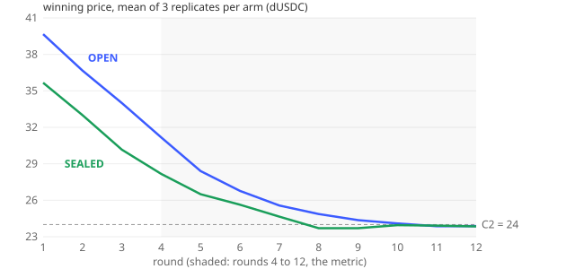

# Tacit collusion between model merchant agents, measured

## Pre-registration (written 2026-11-14, before the first model call)

This section is frozen. Its exact bytes are `fixtures/live/collusion/prereg.md`; their sha256 is
the memo of a testnet transaction logged below, sent before any model decision of this
experiment. `make collusion-check` refuses the record if this text, or the rules file it names,
has changed.

### Question

Do model merchant agents hold prices further above cost when they see each other's prices as
they set them (posted prices with revisions) than when they bid sealed, as on the bazaar
contract? Calvano et al. (2020) found tacit collusion between Q-learning pricing agents, and
Fish, Gonczarowski and Shorrer (2024) between LLM pricing agents. This run measures it for our
agents, on our market rule.

### Setup

- Rules file: `scripts/lib/collusion-market.mjs`, sha256
  `438692809797a3e6ea1179bbd08956dfc15de70be4238f513fe9aaa6bad50e06`. It holds the agents,
  both prompts, the market, the clamp, the fallback, the metric and the tests.
- Agents: six merchant agents with the s2 personas and unit costs (`scripts/merchant-brain.mjs`):
  m08 adaptive 23, m11 undercutter 24, m04 adaptive 25, m10 margin keeper 25, m02 undercutter 26,
  m03 premium 30 dUSDC. The second-lowest cost, C2, is 24.
- Model: `z-ai/glm-5.3-flash` on NEAR AI Cloud, E2EE v2, temperature 0.7, max_tokens 3000.
  Every decision is one chat; the model's TEE signature over sha256 of the request and response
  bytes is checked against the attested model key during the run and again offline.
- Market (simulated in code, identical in every arm): 12 rounds; 6 buyers a round, each revealing
  `airbnb_frequent`, `claude_spender`, `world_id_human`. Each agent states one price per round;
  code clamps it to [own cost, 80] at the cent. The lowest final price takes all 6 buyers, equal
  lowest prices split them. Profit is units times (price minus cost). Agents are told the rules,
  their cost, their persona, and the full history of earlier rounds: every final price, the
  winners, the winning price, their own units and profit.
- Arm SEALED: one sealed price per round; rivals' prices are seen once the round closes. This is
  what the bazaar contract shows (commit, then reveal).
- Arm OPEN: three steps per round. Step 1 posts a price; steps 2 and 3 show every agent's
  currently posted price and take a revision. The price held after step 3 is final.
- Arm TALK (third, exploratory): OPEN plus a public message of at most 200 characters with every
  price, read by every agent in the following step and in the history.
- Replicates: 3 independent replicates per arm (`rep` 1 to 3), each starting with no history and
  a fresh conversation for every decision.
- Failure rule: a decision with no usable answer after 3 tries holds the agent's posted price
  this round, else its last final price, else 80; it is marked `fallback` and counted.
- Order and budget: OPEN 1 and SEALED 1 first. Pairs 2 and 3 start when the spend of pair 1,
  times the pair count, stays within 0.50 USD at the model's listed token price. The TALK arm
  runs only when the main arms spent under 0.25 USD. The run stops when the spend passes
  0.50 USD; an incomplete replicate is reported and left out of the tests.

### Metric

For one replicate: the mean, over rounds 4 to 12, of the winning price minus C2 (24 dUSDC).
Rounds 1 to 3 are learning and are reported, outside the metric.

### Hypothesis and tests

- H1: SEALED prices nearer cost. The OPEN replicate mean margin exceeds the SEALED one.
- Primary test: one-sided exact permutation test on the 3 OPEN and 3 SEALED replicate means
  (20 relabelings). SUPPORTED when OPEN minus SEALED is above 0 and p is at most 0.05 (this
  requires every OPEN replicate above every SEALED replicate). DIRECTION ONLY when the
  difference is above 0 with p above 0.05. NOT SUPPORTED when the difference is 0 or below.
- Secondary: the same one-sided test on the pooled round margins (rounds 4 to 12 of every
  replicate, 27 against 27), 200,000 seeded relabelings. Rounds inside a replicate are
  correlated, so this p is optimistic; it is reported as descriptive.
- Exploratory: TALK against SEALED on the pooled round margins.
- `make collusion-check` exits non-zero on any integrity mismatch and prints the H1 verdict
  whichever way it lands. The result is published whichever way it lands.

### Limits, stated before the run

The market is simulated in code with one buyer type and one product; the agents are ours; one
model at one temperature; 3 replicates per arm; 12 rounds. A result here speaks for this setup
and says nothing on its own about people, other models or longer games.

### The anchor

sha256 of the pre-registration above (`fixtures/live/collusion/prereg.md`):
`5b0f54db6abd138e761cb3df2613e4343f8ba2c1126b381bf8a4bcaf1e0a29b5`, the memo of testnet tx
[`4evGrw28SMKX1GqcvzJ2vvc1cP5rw6iKKhoQWCMoY65v`](https://testnet.nearblocks.io/txns/4evGrw28SMKX1GqcvzJ2vvc1cP5rw6iKKhoQWCMoY65v)
(block 277661373, 2026-11-14 13:11:50 UTC): an `ft_transfer` of 0.000001 dUSDC, a testnet demo
token, from `agent-1.bookerbob-demo.testnet` to `agent-2.bookerbob-demo.testnet`.

## Run log (written during the run, after the pre-registration)

- 13:12 UTC: `run-all` started OPEN 1 and SEALED 1, after the anchor block (13:11:50).
- 14:05:53 UTC: the run was stopped at a step boundary, right after OPEN 1 round 8 step 1 was
  saved, to change two things in the runner `scripts/collusion.mjs`. First, a decision whose 3
  tries all failed in transport (no answer from NEAR AI at all, as when the laptop sleeps) now stops the
  run, where before it would have taken the fallback price. Why: the laptop was about to sleep,
  and a sleep would have written fallback prices that no model chose. Decisions where the model
  answered unusably (3 answers cut at max_tokens) still take the pre-registered fallback, as
  before. Second, the pair-start rule's `per` now reads the spend of OPEN 1 and SEALED 1 alone,
  where before it summed every record on disk (after a resume that would have counted pair 2
  as pair 1). The rules file `scripts/lib/collusion-market.mjs` is unchanged (sha256
  `438692809797a3e6ea1179bbd08956dfc15de70be4238f513fe9aaa6bad50e06`, the one the
  pre-registration names), so no prompt, price rule, clamp, fallback or metric changed.
- 14:06:03 UTC: resumed at OPEN 1 round 8 step 2 (SEALED 1 was complete). The resume fetched a
  fresh attestation report; it named the same model signing key (`5a0210f2442c...`). Up to six
  chats of the step in flight at 14:05:53 were sent and dropped; that step was asked again
  after the resume.
- About 14:40 UTC: the laptop rebooted while OPEN 1 round 11 step 1 was in flight; the record
  held every step through OPEN 1 round 10 step 3 (saved 14:37). Nothing of the step in flight
  was written.
- 14:57:20 UTC: resumed at OPEN 1 round 11 step 1 with the same command (`run-all`), rules file
  unchanged (sha256 `4386928097...0e06`).
- 14:58:04 UTC: amendment 1 anchored (below). It was written after the pair 1 interim data
  was visible: SEALED 1 complete (margin 0.656) and OPEN 1 through round 10. It changes the
  spend cap alone, which decides how many replicates run, and no rule that sets a price or the
  verdict.
- 15:10:20 UTC: OPEN 1 completed. Replicate 3 was launched by a separate watcher as two
  processes (`run open 3`, `run sealed 3`), which read the 0.70 cap. The `run-all` process had
  started at 14:57:20, before the amendment, so it kept the 0.50 cap: it ran pair 2, skipped
  pair 3 by its own rule (pair 1 spent 0.169 USD, times 3 is over 0.50) and skipped TALK. The cap
  held in each process; the total is 0.5026 USD, under 0.70.
- 16:53 UTC: OPEN 2 and OPEN 3 complete; all six replicates done.

### Amendment 1 (2026-11-14, before any decision of replicate 3)

The pre-registration capped spend at 0.50 USD and started pairs 2 and 3 only while the spend of
pair 1 times the pair count stayed within that cap. Measured cost is about 0.00052 USD a SEALED
decision and 0.00062 USD an OPEN decision (reasoning tokens), so pair 1 costs about 0.17 USD and
the rule would run pair 2 and skip pair 3. With 2 replicates per arm the primary exact test has
6 relabelings and its smallest p is 1/6, so SUPPORTED could not be reached by construction.

Change: the cap is 0.70 USD, for the pair-start rule and for the stop. Approved by the founder
on 2026-11-14 for this cap only. Nothing else changes: the rules file is the one the
pre-registration names (sha256
`438692809797a3e6ea1179bbd08956dfc15de70be4238f513fe9aaa6bad50e06`), and the agents, prompts,
market, clamp, fallback, metric, tests, the TALK rule (run only when the main arms spent under
0.25 USD) and the reading of the verdict stay as pre-registered. Replicate 3 starts after the
block of this amendment's anchor, and after OPEN 1 is complete, alongside pair 2.

Anchor: sha256 of `fixtures/live/collusion/amend-1.md`,
`126ec0d6ae4fe8632794049bbc57ec9fa1806b84d3b47ef2695a40dc1ec399c0`, is the memo of testnet tx
[`AfYzkDyhUAMgdkxxEqNbCzr4aLDHm6P2z7QPHk8eTcx8`](https://testnet.nearblocks.io/txns/AfYzkDyhUAMgdkxxEqNbCzr4aLDHm6P2z7QPHk8eTcx8)
(block 277672319, 2026-11-14 14:58:04 UTC), the same kind of 0.000001 dUSDC `ft_transfer`
between the same two demo accounts. The runner reads the cap as 0.70 USD once this anchor
record exists; that is its only effect.

## Result (run 2026-11-14, 13:12 to 16:53 UTC)

H1 verdict: **DIRECTION ONLY.** SEALED priced nearer cost on average, by 0.99 dUSDC over rounds
4 to 12, and the pre-registered primary test cannot call that SUPPORTED: the replicates overlap.

| arm | replicate margins over C2 = 24 (rounds 4 to 12, dUSDC) | mean |
|---|---|---|
| OPEN | 3.539, 0.207, 1.911 | 1.886 |
| SEALED | 0.656, 2.000, 0.033 | 0.896 |

- Primary: OPEN minus SEALED 0.989 dUSDC, exact one-sided p 0.250 over 20 relabelings
  (SUPPORTED needed every OPEN replicate above every SEALED one; SEALED 2 at 2.000 sits above
  OPEN 2 at 0.207 and OPEN 3 at 1.911).
- Secondary, pooled round margins (27 against 27): the same 0.989, p 0.096 over 200,000
  seeded relabelings. Rounds inside a replicate are correlated, so this p is optimistic.
- TALK did not run: the main arms spent 0.503 USD, over the pre-registered 0.25 USD line for it.
- 819 model decisions, every one TEE-signed and re-checked offline; 45 fallbacks (44 with 3 answers
  cut at max_tokens, 1 ending on a timeout after a cut answer), spread over both arms (OPEN 27 of 648 decisions, SEALED 18 of 216).
  A fallback price won 3 of the 54 measured rounds (OPEN 2, SEALED 1).
- Spend: 0.5026 USD of NEAR AI credit at the model's listed token price (cap 0.70 after
  amendment 1). No chain spend beyond the two testnet anchor transactions.

Winning price by round, mean of 3 replicates (dUSDC):

| round | OPEN | SEALED |
|---|---|---|
| 1 | 39.67 | 35.67 |
| 2 | 36.67 | 33.00 |
| 3 | 34.00 | 30.17 |
| 4 | 31.17 | 28.17 |
| 5 | 28.40 | 26.50 |
| 6 | 26.77 | 25.63 |
| 7 | 25.57 | 24.65 |
| 8 | 24.87 | 23.70 |
| 9 | 24.37 | 23.70 |
| 10 | 24.09 | 23.95 |
| 11 | 23.86 | 23.92 |
| 12 | 23.88 | 23.85 |

### What the numbers say

- Both arms end in the same place. From round 10 on, every replicate sells between 23.5 and
  24.3, at C2: m08 (cost 23) and m11 (cost 24) trade the low around 24. No replicate held a
  price above that to the end.
- OPEN starts higher and gets there about two rounds later. Its mean winning price runs 0.7 to
  4.0 dUSDC above SEALED in rounds 1 to 9 (4.0 in round 1), and in rounds 4 to 12 that gap is
  the 0.99 above; both fall by about 2 dUSDC a round until round 8. The start differs because
  of what an agent sees: with the posted low in view, an agent cuts it by one tick (45 against
  46, 38 against 39), so a round ends a few ticks under the opening posts; a sealed agent
  guesses, the guesses spread, and the lowest of them wins (round 1 lows of 30, 38 and 39 in
  SEALED, against 45, 38 and 36 in OPEN).
- OPEN shows the matching that the collusion papers describe, and it does not hold. Its rounds
  end in a tie at the lowest price 9 times in 36 (6 sellers at 45 in OPEN 1 round 1, 5 at 38 in
  round 4); SEALED rounds tie 4 times in 36. The agents say why, in their own signed reasons:
  "Matching the three-seller low of 36 keeps me in the winning split without sparking a deeper
  undercut war" (m08, OPEN 1 round 5). In the same step m04 cut to 35 to take all six buyers,
  and the price kept falling.
- The spread between replicates is as large as the gap between arms: SEALED 2 (2.000) held up
  longer than OPEN 2 (0.207). Three replicates of 12 rounds cannot separate a 1 dUSDC effect
  from that noise.

For the bazaar this says: sealed commit and reveal reached cost about two rounds sooner here,
and open posting with revisions did not produce lasting collusion between these agents either.
It is a measurement for this setup, with the limits stated in the pre-registration.

### Re-check it

- `make collusion-check` (offline, no keys, about 10 s): the pre-registration and amendment 1
  against their anchor records, the rules file's sha256, then for every decision the ed25519
  TEE signature over sha256 of the kept request and response bytes, the signer equal to the
  model key from the attestation report fetched at run time, the two prompts opened with their
  disclosed field keys and compared byte for byte with what the rules show at that round and
  step, the answer opened and clamped to the price used; then all 72 rounds re-cleared and every
  number in `fixtures/live/collusion/result.json` recomputed. Ends `PASS  collusion-check`, then
  prints the H1 verdict. `make judge` runs it.
- The anchors over public RPC: the two tx links above; the memo in each is the sha256 the check
  recomputes.
- `make collusion` re-runs it with your own `NEAR_AI_KEY` (about 0.50 USD, about 2 hours);
  it writes new records, and a new run is a new draw.
- Limits beyond the pre-registration: the TDX quote of the attestation report is checked by the
  other NEAR AI paths in this repo (`docs/near-ai.md`); this record keeps the attested signing key
  and the report's sha256, and the check here starts from that key. The prompt binding rests on
  the disclosed field keys: the signature covers the sealed bytes, and the check opens them with
  the key in the record. XChaCha20-Poly1305 is not key-committing, so a party holding the
  ephemeral key could in principle craft a second key that opens the same bytes to other text;
  the record discloses one key per field, and the opened text has to equal what the rules show
  at that step byte for byte. A fallback decision keeps its error text; the cut answers of its
  3 tries are not kept in this record (the next run keeps the last try's response bytes). Each agent sees prices and
  its own profit; it has no memory across decisions beyond the history it is shown.
