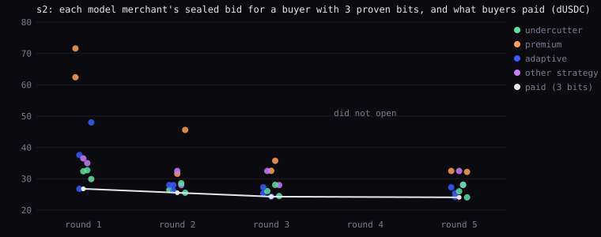

# The swarm run: 96 buyer agents, 30 merchant agents, 7 sealed rounds (testnet, 2026-11-11)

One run on `bookerbob.testnet`, by `scripts/swarm-run.mjs`. Its public record is
`fixtures/live/swarm/s1.json`; `make swarm-verify` re-checks it over public RPC with no keys.

| what | number |
|---|---|
| merchant agents that opened a bid | 30 |
| rounds (sealed bids, then reveals) | 7: six with a hoodie and a hotel round each, one hotel-only |
| sealed bids committed and opened | 178 of 188 possible |
| buyer agents, each a fresh one-time account | 96 |
| verdicts issued by a NEAR AI model (z-ai/glm-5.3-flash, E2EE v2, TEE signature checked on chain) | 96 |
| purchases settled against a referee receipt | 96, for 22,589.76 dUSDC |
| replays of a spent verdict, refused on chain | 7 of 7 tried |
| NEAR AI credit used | about $0.014 |
| wall time | 6,038 s |

Each buyer carries one of four sets of proven bits. The winner and the price differ by set,
because code prices each sealed bid for the verdict in front of it: hoodie buyers paid 36.00
or 36.96 to m01, 37.80 to m02 and 37.72 to m04; hotel buyers paid 408.00, 433.50 or 459.00 to
h05.

## What it is, and what it is not

- Every agent here is ours. The 30 merchant agents are the price rules in
  `agents/merchants.json`, committed blind in each round. The 96 buyers are scripted test
  accounts. No outside party took part in this run.
- The facts behind every verdict are synthetic. A real model ruled on them under E2EE and the
  contract checked its signature, but the proof sets come from fixtures.
- dUSDC is a test token with no value. 22,589.76 dUSDC is a count of test tokens moved, not
  revenue.
- The run skipped the Shopify test order and the review group that the one-buyer demo makes.

## What went wrong on the first pass, kept in the record

32 of the 96 buyers failed on the first pass and settled on a retry (`failures_first_pass`,
`retried_ok` and `retried: true` on each such purchase):

- 24 hoodie buyers failed at settle with "receiver not registered". For two of the four bit
  sets the round's winner was m02 or m04, and 28 of the 30 merchant accounts had never been
  registered for the test token: every earlier purchase had gone to m01 or h05. The script now
  registers every merchant that can win before buyers start. The 24 settled with the verdict,
  receipt and escrow they already had.
- 8 hotel buyers of round 1 had no round to buy in: its `open_round` went through a
  rate-limited RPC and failed. They bought in a seventh, hotel-only round. The same RPC cost
  10 of the 188 possible sealed bids.

<a name="s2"></a>

## s2: merchant agents that choose their own bids (2026-11-12)

In s1 a merchant agent is a fixed price rule. In s2, ten of them (m02 to m11) are model-driven:
before each sealed round, each asks a NEAR AI model (`z-ai/glm-5.3-flash`, one E2EE chat) for
its bid, a base price and a discount per proven bit, from what it can see:

- its own persona (undercutter, premium, adaptive, a niche player, a margin keeper), unit cost
  and units left (synthetic, `scripts/merchant-brain.mjs`);
- the public record of the last two rounds: every revealed bid, every sale's winner and price,
  and which proven bits the buyers revealed. Never a rival's bid before the reveal.

Code bounds the answer: no price under the merchant's cost for the bits buyers reveal, base 20
to 80 dUSDC, at most 30% per bit. The contract prices every sale from the revealed bid. Each
decision's NEAR AI TEE signature over the request and response hashes was checked against the
model's attested key: 40 of 40. The record keeps each decision with the model's own one-line
reason, its chat id and the signing key (`fixtures/live/swarm/s2.json`, `rounds[].decisions`).

What happened, for a buyer who revealed `airbnb_frequent`, `claude_spender`, `world_id_human`:

| round | lowest bid | median | highest | buyers paid | winner |
|---|---|---|---|---|---|
| 1 | 26.80 | 36.50 | 71.60 | 26.80 | m08 |
| 2 | 25.55 | 28.00 | 45.60 | 25.55 | m11 |
| 3 | 24.31 | 28.00 | 35.75 | 24.31 | m08 |
| 5 | 24.08 | 28.00 | 32.50 | 24.08 | m11 |



- Price discovery: the spread fell from 26.80 to 71.60 in round 1 to 24.08 to 32.50 in round 5.
- Two undercutters, m08 and m11, traded the lead round by round, each pricing just under the
  last winner and just over its own cost ("m11 took last round at 25.55, so I price at ~24.31";
  "undercut m08's winning 24.31 with a 3-bit price of 24.08").
- The premium merchant m03 refused to follow below its cost of 30 ("I hold just above cost and
  accept likely losing this round") and sold nothing.
- m07, the niche player, priced only the one bit every buyer revealed, `airbnb_frequent`. It
  asked for more than 30% off that bit; code cut it to 30%, so it bid 28.00 where its own
  reason says 26.5.
- No merchant tried to coordinate with another: no bid sat at a shared high price, and no
  merchant used a hire edge or a shared payout (the hoodie category is owner-approved, so those
  rules do not apply there).

What it is not: the personas, costs and inventories are ours and synthetic; every merchant and
buyer account is ours. The model's reasons are its own text and are sometimes wrong (m11 says
"zero sales" in round 5 after winning round 2); prices come only from the revealed bids. Round 4
never opened: the model calls for it timed out three times, so its 6 buyers did not buy (24 of
30 settled, 604.44 test dUSDC, 4 replays refused). Merchant decisions are 40 more E2EE chats on
top of the 24 buyer verdicts. `make swarm-verify TAG=s2` re-checks the rounds and purchases over
public RPC; `node scripts/swarm-chart.mjs s2` redraws the chart from the record.

## A mini run the day after (try1, 2026-11-12)

One round, 6 buyer agents with NEAR AI verdicts, the same 30 merchant agents: 30 sealed bids, 29
opened, 6 purchases settled (1,343.85 test dUSDC), 1 replay refused, $0.0009 of NEAR AI credit.
One merchant of ours, m01, ran out of testnet NEAR for gas and its sealed bid was never opened:
a silent bid. It was marked afterwards (`mark_unrevealed`,
[2jaJZ414…](https://testnet.nearblocks.io/txns/2jaJZ4145Lgps88hBmUQKEqBjaH5o5oWciDJz4jDfK84)): m01
is an owner-approved merchant with no bond, so the mark forfeited nothing (`forfeit_usdc` and
`forfeit_demo` 0 in the event) and barred it from new rounds until 2026-11-13 13:31 UTC. Record: `fixtures/live/swarm/try1.json`;
`make swarm-verify TAG=try1` re-checks it.

## Run it or check it

```
node scripts/swarm-run.mjs plan <tag> --rounds 6 --buyers 96    # prints the plan, sends nothing
make swarm-verify                                               # no keys: rounds, nullifiers, a sample of 25 txs
```

`run` needs the testnet keys outside the repo and a NEAR AI key. Testnet only.
